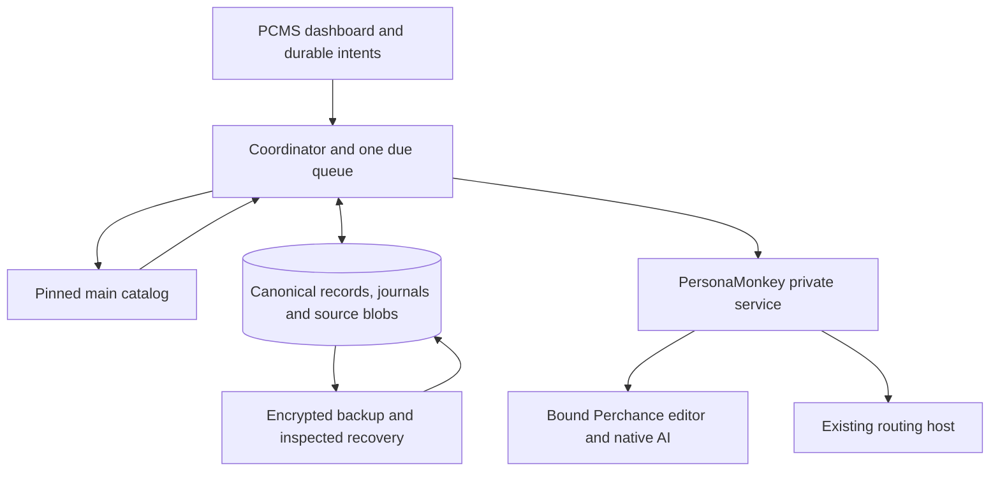

# PCMS-Alpha — Proposed Gate B Technical Design

**Revision:** 1.1, 2026-10-17 UTC. **Status: DESIGN FOR REVIEW; GATE B UNAPPROVED.**

This document proposes the focused GB-01–GB-05 correction of the existing Path B architecture. Revision 1.0 and its supplied archive remain separate, unchanged previous revisions; this revision supersedes only the technical passages identified in `GATE-B-v1.1-CHANGELOG.md`, if the operator approves it. It authorizes no implementation, donor amendment, migration, installation or external effect. The approved Client Contract v1.0.0 and AC-01–AC-18 remain the product oracle. The companion [migration and verification plan](MIGRATION-AND-VERIFICATION-PLAN-v1.1.md) defines proof gates; the [workflow blueprint](IMPLEMENTATION-WORKFLOW-BLUEPRINT-v1.1.md) defines future engineering work. Signed Stage 7 originals remain unchanged.

## 1. Decision and evidence boundary

**Retain Path B. Add one small durable coordinator and repair the demonstrated seams; keep PersonaMonkey, native page workers, effect journals, exact-byte verification, conditional Git mechanics, publication safeguards and the dashboard shell.** Do not add a workflow engine, second router, provider framework, distributed lock service or PCMS daemon.

The coordinator is more than a command sequencer. PB12 proved that current staging and AI stores reject a successor until the preceding candidate is published. Those admission rules must change. PB03–PB11 demonstrated conditional deterministic composition and one lost-rename-ACK recovery; their browser, provider, routing and persistence responses were fixtures. They did not prove a complete live journey. Phase B defects remain defects, including clocks, expiring health, identity replacement, normal workspace staging, 201-job scheduling, Git paths/readback and source-bearing backup size. This design does not relabel any of them as repaired.

Inherited reviewed source baseline (not a fresh branch-status claim): [PR #20](https://github.com/Neb963/PCMS-Alpha/pull/20), open draft, head `0bd2b7d217d2e976d84423233599e94386e487db`; `main` `34a5c48fbfac6c15ef86a453668b3b353402ab18`. Frozen donor: `Neb963/persona-router@9995f6eadfa54be6cc0001f4e04f2a2d9b9401bf`. The pilot source inventory verifies the inspected bytes. Revision 1.0 and the independent review recorded those refs; this focused revision did not re-audit current repository/PR status. Targeted read-only checks at those pinned revisions examined the donor request guards and existing backup crypto only. No product tests or feasibility experiments were executed.

The original I17 operation remains **BLOCKED — ORIGINAL JOURNAL UNAVAILABLE**: batch `batch_e2c328e54f9c4a6ab89f1084134fde52`, slug `pcms-test-esr-chain-20261015-a01`. Its actual last state, first failure, temporary identity, possible CREATE/RENAME effects and installed hold are unverified. Preserve a permanent no-retry exception for its CREATE and RENAME. No source-code diagnosis substitutes for its original journal. **GB-04 scope:** this holds that original operation and unsafe migration/reconciliation of its affected profile/state. It does not block detached development or normal isolated tests in a fresh disposable profile with separate authority. Preserve each profile before changing its own data; shared trust-root/host/schema activation affecting the original remains held until that resource is preserved. Never replay the quarantined target from any new intake origin. See migration plan §1.2.

## 2. One controller, clear ownership



| Owner | Responsibility and prohibited crossing |
|---|---|
| PersonaMonkey | Sole Persona/container, proxy, privacy, tab, shared-control and routing-host authority. PCMS requests typed services; it never edits donor state or supplies raw native commands. |
| PCMS canonical store | Standing intent, immutable account principal, observed exit exclusions, source association, candidate history, source writer, approval, schedules and effect recovery. |
| Perchance | Actual logged-in account, ownership, saved complete source and listing. A response, slug or writable editor alone is not ownership/readback. |
| GitHub | Committed `main` source, declarations, prompt and test inputs. Pinned recovery refs are archival only; they never trigger development. |
| Native AI helper | May edit PJS, HTML and owned `src/` in the selected generator. It receives no Git token, route control, PCMS commands or publication authority. |
| Narrow local helpers | Protected secrets and verified encrypted artifact I/O; diagnostic launcher only for a process it owns. No shell, arbitrary file access, routing administration or provider logic. |

Retain the combined XPI and `persona-route-manager@local`. Security listeners, startup/alarm/message entrypoints register synchronously before awaits. Donor bootstrap stays independent of PCMS failure. Mutation requires active controller, compatible schema, no restore/migration gate, scoped authority and current guards. A corrupt PCMS store disables PCMS effects while preserving donor protection and degraded read-only diagnostics.

One controller remains an operational condition: fresh-profile activation requires explicit confirmation that the previous controller is inactive. This is not a cross-machine locking guarantee. A second active restored controller is unsupported and cannot be made safe by an invented local lease.

### 2.1 Small modules and reuse

Add a coordinator entry module, fixed transition functions, and a due-work index over the existing canonical database. Keep domain code in the current account/supply/source/staging/AI/release/refresh/backup modules. Extract one managed-path/declaration policy and one candidate/source policy where duplication currently disagrees. The number of files is an implementation choice, not a new architecture layer.

Existing `journal.mjs` remains the transaction/effect foundation. `persona-guard.mjs` consumes the new private donor evidence and existing lease registry. Supply and native workers remain adapters. Staging/AI/release stores become candidate-keyed instead of treating one historical stage as a permanent gate. Git transport remains shared. Replace the missing repository observer and manual phase handoffs; replace duplicated inline source payloads with immutable blob references. Do not wrap every existing module behind a generalized service interface.

## 3. Canonical records and coordinator rules

Use additive, versioned records in the same IndexedDB database. Short local transactions own claims and revisions; never hold an IDB transaction over a browser, native, Git or provider await. Transaction completion is the durable ACK. Store sensitive source as bytes, not repeated base64 JSON. Indices select runnable jobs independently of completed history.

The table describes logical record kinds, not one new store/service per row. Reuse current entities/operations/observations/meta and domain records; add only byte storage and indices needed for atomic claims, reservations and eligible-work selection. There is no event-sourcing rewrite or second canonical database.

| Record | Minimum durable content / invariant |
|---|---|
| `Authority` / `Intent` | Origin, stable ID, accepted scope, policy revision, initial-import approval if applicable, account pin, desired result, Pause/cancel status. Routine authority survives wake; it is not publication approval. |
| `Account` | Stable local ID, immutable first-confirmed provider principal, Persona UID, desired lifecycle, binding epoch, inventory certainty/count, observed identity history. A later different principal holds; never overwrite the original. |
| `ExitReservation` | Canonical observed addresses, owner account/binding, evidence/context, history and reservation revision. An address has at most one account owner; archive/removal never frees historical exclusions. |
| `RouteAdmission` | PCMS allocation/grant revision, ledger/runtime epochs, donor assignment/route/safety generations, exit-set digest, network authority and join status. `READY` requires a matching live bounded donor grant, not a stored `ADMITTED` receipt. Automation eligibility is separate from network protection. |
| `Generator` | Stable ID independent of slug/path, positive owner/remote-ID evidence, slug history, source-association epoch, previous-good manifest, actual listing observation, latest declaration and source-writer epoch. |
| `SourceManifest` / `SourceBlob` | Complete sorted deployable paths, lengths and SHA-256 of exact bytes, fingerprint algorithm version, blob references and observation provenance. Declarations, prompts and test files are separately pinned controls. |
| `Candidate` | Generator/account/binding/association IDs, parent candidate, external declaration or Request Changes/human origin, pinned input source/prompt/test absence-or-bytes, final manifest, state, test evidence, writeback receipt and supersession. Immutable revisions preserve every prior candidate. |
| `SourceClaim` | Generator, actor (`DEPLOY`, `AI`, `PUBLISH`, `REFRESH`, `RECOVERY`), candidate, epoch, expected source, unresolved operation and handoff status. Never steal because a timer/worker expired. |
| `EffectOperation` | Stable ID, fixed kind, target/claim epoch, exact request fingerprint, preconditions, dispatch boundary, attributable ACK IDs, independent observations and first causal failure. |
| `Approval` | Human decision bound to exact candidate revision, full-source F, owner/binding/association, test pins and exception status. History survives invalidation; current authority does not. |
| `PublicHold` | Generator/update family, reservation/admission state, capacity policy revision, previous-good and unlist operation. Pending or uncertain unlists consume capacity. |
| `DueWork`, `Clock`, `Incident` | Indexed due kind/scope/priority, qualified interval checkpoints and budgets, causally grouped unresolved/resolved facts. Acknowledgment never resolves an incident. |
| `RecoveryGate`, `RemovalTombstone` | Migration/restore/activation receipts and minimal reliable removal/exit history. The fail-closed outer gate also exists outside any database being replaced. |

`F = SHA256(versioned canonical framing of sorted path, byte length, byte SHA256)`. Validate paths, duplicate/case aliases, lengths, unsupported modes and complete enumeration. Do not normalize source newlines, transcode binary assets or ignore nested files. Version the algorithm; compare legacy F only through an exact materialized-byte mapping. Completeness requires provider evidence, not just a valid local hash.

### 3.1 Fixed progression

`acceptIntent` transactionally coalesces compatible slug origins and pending counts. `advance(scope)` observes facts, chooses the next fixed domain transition, commits its preconditions/claim/effect record, dispatches at most one bounded step, then independently observes and records the result. Startup performs reconciliation before fresh mutation in affected scopes. Alarms, ports and UI are wake hints; the due records are authority.

```text
advance(scope):
  load canonical revisions and all scoped holds
  if possibly dispatched operation exists: schedule observation; return
  choose one known-safe step from the fixed domain transitions
  validate current authority, owner, source, editor and donor admission
  transaction: compare revisions; reserve claim; persist PREPARED
  revalidate external guard and claim epoch immediately before dispatch
  transaction: persist DISPATCH_POSSIBLE
  dispatch through the existing guarded adapter
  checkpoint attributable ACK identity, if any
  independently read authoritative result
  transaction: confirm exact result or retain scoped uncertainty
```

There is no exactly-once external-write claim. A crash between dispatch marking and sending may cause a conservative hold. A lost ACK never authorizes another CREATE, RENAME, save, unlist, publish or Git ref movement. Observational equivalence can confirm an attributable outcome; missing identity or inconclusive negative observation remains held. New operation IDs do not erase old uncertainty. Use bounded backoff for proved no-effect/transient reads, not a universal retry flag.

Priority: safe reconciliation/completion, then due existing-generator work, then discretionary creation/deployment. Bound work per wake, per Persona and per provider; preserve oldest eligible priority. Page eligible jobs using indices, not the first 200 historical rows. Resource signals are measured queue age, native/provider latency, 429/backoff, tab/lease count, storage headroom and available host telemetry; unavailable telemetry stays unknown. Operator maximums are upper bounds, not account/generator inventory caps.

## 4. Final PersonaMonkey private amendment

**Recommend an additive private same-XPI `pcmsPersonaV1` service.** Keep external Integration API v1 unchanged. Build the service inside donor-owned background code and inject it only into trusted PCMS background modules. No website/content-script/UI message exports these methods or caller-controlled route endpoints. A compromised trusted XPI is outside this module boundary; same-XPI privacy is not cryptographic isolation.

Assignment alone cannot enable traffic. GB-01 defines an explicit donor-owned network gate, bounded volatile grants and a durable join with the PCMS reservation (§4.2). A caller digest or stale asynchronous allow response is insufficient. Enforcement remains in the existing donor proxy and blocking-request listeners, including final checks after awaits.

### 4.1 Types

The following is normative proposed TypeScript shape; branded strings are validated opaque IDs, not authority supplied by a page. Inputs reject unknown fields and excessive sizes. Times use integer milliseconds plus lifetime/context identity; caller time cannot extend evidence.

```ts
type Id = string; type Digest = string;
type ErrorCode = "UNAUTHORIZED" | "INVALID_REQUEST" | "REPAIR_NOT_ADMISSIBLE" |
  "VERSION_UNSUPPORTED" | "CAPABILITY_UNAVAILABLE" | "NATIVE_INCOMPATIBLE" |
  "STATE_CONFLICT" | "CONTEXT_CHANGED" | "EXIT_CHANGED" | "RESERVATION_MISMATCH" |
  "EXIT_EVIDENCE_INCOMPLETE" | "PROTECTION_UNAVAILABLE" | "PROOF_EXPIRED" |
  "PERSONA_NOT_FOUND" | "ROUTE_DISABLED" | "IDENTITY_CONFLICT" |
  "CONTROL_BUSY" | "RESOURCE_IN_USE" | "LEASE_LOST" |
  "NATIVE_UNAVAILABLE" | "NETWORK_FAILURE" | "OPERATION_CONFLICT" |
  "OPERATION_CAPACITY" | "OUTCOME_UNCERTAIN" | "RUNTIME_UNKNOWN";
type Effect = "NOT_STARTED" | "DISPATCH_POSSIBLE" | "CONFIRMED" | "OBSERVATION_ONLY";
type Next = "REQUERY" | "OBSERVE_ONLY" | "WAIT" | "HUMAN_ACTION";
type Fence = { donorBootId: Id; revision: number };
type Write = { operationId: Id; authorityId: Id; bindingId: Id; expected: Fence };
type Family =
  | { state: "OBSERVED"; address: string; receiptId: Id }
  | { state: "BLOCKED_VERIFIED" | "NOT_APPLICABLE_VERIFIED"; receiptId: Id }
  | { state: "UNKNOWN"; reason: string };
type Evidence = {
  id: Id; personaUid: Id; routeId: Id; contextId: Id;
  donorBootId: Id; nativeLifetimeId: Id; observedAt: number; validUntil: number;
  ipv4: Family; ipv6: Family; selectedProxy: "VERIFIED" | "FAILED" | "UNKNOWN";
  dns: "VERIFIED_PROTECTED" | "FAILED" | "UNKNOWN";
  protection: "READY" | "UNAVAILABLE"; exitSetDigest: Digest;
  disposition: "READY" | "HOLD";
};
type Assignment = {
  bindingId: Id; personaUid: Id; routeId: Id; contextId: Id; assignmentEpoch: Id;
  gate: "BLOCKED" | "ADMITTED"; allocationRevision: number;
  reservationId: Id; exitSetDigest: Digest; evidenceId: Id;
  routeRevision: number; safetyGeneration: number; grant?: DonorGrant;
};
type Result<T> =
  | { ok: true; value: T; effect: Effect; fence: Fence }
  | { ok: false; code: ErrorCode; effect: Effect; next: Next; operationId?: Id };
type Reason =
  | { kind: "ENROLLMENT" }
  | { kind: "GENUINE_ROUTE_FAILURE"; failureEvidenceId: Id }
  | { kind: "OPERATOR_ROUTE_CHANGE"; intentId: Id };
type Reservation = {
  id: Id; allocationRevision: number; exitSetDigest: Digest;
  ledgerEpoch: Id; bindingId: Id;
};
type Inspect = {
  operationId?: Id; personaUid?: Id;
  kind: "BINDING" | "PREPARE" | "STAGE" | "ADMIT" | "HOLD" | "VERIFY" | "REPAIR" | "RELEASE";
  recordedEffect: Effect; state: "PREPARED" | "DISPATCH_POSSIBLE" |
    "CONFIRMED" | "HELD_UNKNOWN";
  assignment?: Assignment; candidateId?: Id; routeId?: Id;
  configuration: "MATCH" | "CONFLICT" | "UNKNOWN";
  resource: "PRESENT" | "ABSENT" | "UNKNOWN";
  resourceUse?: "IDLE_VERIFIED" | "IN_USE" | "UNKNOWN";
  nativeLifetimeId?: Id;
};
```

| Exact operation | Inputs → output; authority/effect boundary |
|---|---|
| `capabilities.describe()` | No input → namespace/schema, exact donor/native builds, methods, family-verifier support, max evidence age, lease/correlation limits, observational-inspector and clock-witness support. Pure local metadata. Unsupported is explicit. |
| `protectedRoute.prepare(w, p)` | `p:{persona:{kind:"NEW_DEDICATED";nameHint?:string} \| {kind:"EXISTING";personaUid:Id;contextId:Id}, reason:Reason, previousRouteId?:Id}` → `{personaUid,candidateId,routeId,evidence,state:"VERIFIED_UNASSIGNED"\|"HELD"}`. Authorized enrollment or route change only; new Persona is blocked. Donor allocates stable identities durably before container/config/native effects. Existing Persona must belong to this binding. Fixed cookie-free probes may run; no account traffic on candidate. |
| `assignment.stage(w, p)` | `p:{personaUid,expectedRouteId:Id\|null,candidateId,evidenceId,reservation:Reservation}` → `Assignment` with `gate:"BLOCKED"`. Donor quiesces target, rejects active jobs/leases, rechecks protection and probe result against reservation, assigns protected route under its own mutation fence. Changed exits return `EXIT_CHANGED`, still blocked. No Direct. |
| `assignment.admit(w, p)` | `p:AdmitInput` → `Assignment` with a matching bounded live grant only after §4.2's final synchronous generation/snapshot check. Journal intent while blocked; audit `ADMITTED` is not reusable runtime authority. Recheck after all awaits; no route change. Lost ACK is observation-only. |
| `assignment.hold(w, p)` | `p:{assignmentEpoch,reason:HoldReason}` → blocked `Assignment`. Synchronously invalidate/bump safety generation before any persistence await; journal/observe closure. No route deletion or retroactive cancellation. Routine automation Pause/archive does not call this solely to interrupt a still-safe human tab; idle release or actual network-safety invalidation does. |
| `protectedRoute.verify(w, p)` | `p:{target:{kind:"CANDIDATE";candidateId:Id}\|{kind:"ASSIGNED";assignmentEpoch:Id},maximumAgeMs:number}` → `Evidence`. Zero requests fresh proof; finite age capped by donor policy. Reuse valid matching evidence or run fixed probes. Native preparation/probes are effects and journaled. Same-route proactive renewal may run while old evidence remains valid; drift closes the gate immediately. Failed/late renewal never extends proof. Not a pure read. |
| `protectedRoute.repair(w, p)` | `p:{assignmentEpoch,failureEvidenceId:Id}` → `{assignment:Assignment,evidence:Evidence,state:"REPAIRED"\|"HELD"}`. Genuine donor-observed route/native failure only; gate blocked, no active execution lease. Reprepare same route/resource; successful repair still needs the join/admit check. Replacement is a separate prepare/stage/admit under genuine failure authority. |
| `protectedRoute.releaseIdle(w, p)` | `p:{personaUid,routeId,assignmentEpoch?:Id,candidateId?:Id}` → `{state:"RELEASED"\|"ALREADY_RELEASED",routeId}`. Donor checks every ordinary/PCMS tab, job, lease, preparation and other integration reference. Release only unnecessary forwarder; retain Persona, route config and history. No per-account shared-tunnel stop. |
| `recovery.inspect(p)` | `p:{kind:"OPERATION";operationId:Id}\|{kind:"BINDING";bindingId:Id}` → `Inspect`. Strictly observational durable config plus narrow native inventory. No prepare, probes, route addition, connectivity test or cleanup. Absent inspector → `RUNTIME_UNKNOWN`; inspect may not secretly call current mutating `status`. |
| `control.acquire/validate/renew/release` | Existing donor registry, fixed PCMS owner and scope. `acquire({personaUid,operationId,ttlMs})`, `validate({leaseId,personaUid})`, `renew({leaseId,ttlMs})` → `{leaseId,personaUid,contextId,expiresAt}`; `release({leaseId})` → `{released:true}`. Actual existing bounds advertised; current renewal supports 10,000–300,000 ms. Expired/revoked leases cannot be revived. Memory leases are never restored. |

`recovery.inspect` also exposes optional, pure `RuntimeWitness` data including connection/native/system-boot/observer identities, sample sequence and awake/boot counters to trusted donor/clock code. No caller PID, path, endpoint or process command is accepted. The existing native connection provides lifecycle support; the inspector's observational implementation and clocks are new proof obligations, not existing host capabilities.

The normative synchronous `TrustedAdmission.readCommitted(AdmissionKey)` contract and publication/revocation ordering are in §4.2.1–2. It reads only a validated committed snapshot: retained account/network binding, exact exclusive reservation, route/context/evidence/revisions, compatible store session and no outer gate. It performs no effects/database await. Network authority may remain for a human-used archived/paused binding; PCMS automation separately requires active account/controller and current execution guards. Missing callback/snapshot denies new admission and renewal.

`authorityId` is a reference, never a self-issued permission. Each effectful entry calls a fixed trusted authorizer for operation kind, binding, policy/intent revision and allowed reason before effects. The authorizer is not a page-callable policy editor. Control acquisition/renewal and the existing executor also require the current joined assignment; a valid lease alone cannot bypass a closed admission gate.

Complete method signatures below remove shorthand ambiguity in the table. `ErrorCode` consists exactly of the stable error names in §4.3; schemas for all records reject extra fields. A foreign/missing inspection target reports `UNAUTHORIZED`/`STATE_CONFLICT` without disclosing another owner's record.

```ts
type PrepareInput = {
  persona: { kind: "NEW_DEDICATED"; nameHint?: string } |
    { kind: "EXISTING"; personaUid: Id; contextId: Id };
  reason: Reason; previousRouteId?: Id;
};
type Prepared = { personaUid: Id; candidateId: Id; routeId: Id;
  evidence: Evidence; state: "VERIFIED_UNASSIGNED" | "HELD" };
type StageInput = { personaUid: Id; expectedRouteId: Id | null;
  candidateId: Id; evidenceId: Id; reservation: Reservation };
type AdmitInput = { assignmentEpoch: Id; reservation: Reservation; evidenceId: Id;
  expectedSafetyGeneration: number; key: AdmissionKey };
type HoldReason = "ARCHIVE" | "REMOVAL" | "ROUTE_DRIFT" | "PROOF_EXPIRED" |
  "RESTORE" | "OPERATOR_PAUSE" | "CONFLICT";
type VerifyInput = { target: { kind: "CANDIDATE"; candidateId: Id } |
  { kind: "ASSIGNED"; assignmentEpoch: Id }; maximumAgeMs: number };
type Lease = { leaseId: Id; personaUid: Id; contextId: Id;
  assignmentEpoch: Id; expiresAt: number };
type RuntimeWitness = { observerConnectionId: Id; nativeLifetimeId: Id;
  systemBootId: Id; observerEpoch: Id; sequence: number;
  hostAwakeNs: string; hostBootNs: string }; // validated counters; semantics require H proof
type Capabilities = {
  namespace: "pcmsPersonaV1"; schema: 1; donorBuild: Id;
  nativeBuild: Id | null; nativeCompatible: boolean; methods: string[];
  familyVerification: { ipv4: boolean; ipv6: boolean; verifiedBlocking: boolean };
  maximumEvidenceAgeMs: number;
  lease: { minTtlMs: number; maxTtlMs: number; maxTotal: number; maxPerOwner: number };
  operationCapacity: number; observationalInspector: boolean; runtimeWitness: boolean;
  admissionContract: 2; networkGate: "PER_REQUEST_BOUNDED_GRANT";
};
interface PcmsPersonaV1 {
  capabilities: { describe(): Promise<Capabilities> };
  protectedRoute: {
    prepare(w: Write, p: PrepareInput): Promise<Result<Prepared>>;
    verify(w: Write, p: VerifyInput): Promise<Result<Evidence>>;
    repair(w: Write, p: { assignmentEpoch: Id; failureEvidenceId: Id }):
      Promise<Result<{ assignment: Assignment; evidence: Evidence;
        state: "REPAIRED" | "HELD" }>>;
    releaseIdle(w: Write, p: { personaUid: Id; routeId: Id;
      assignmentEpoch?: Id; candidateId?: Id }):
      Promise<Result<{ state: "RELEASED" | "ALREADY_RELEASED"; routeId: Id }>>;
  };
  assignment: {
    stage(w: Write, p: StageInput): Promise<Result<Assignment>>;
    admit(w: Write, p: AdmitInput): Promise<Result<Assignment>>;
    hold(w: Write, p: { assignmentEpoch: Id; reason: HoldReason }): Promise<Result<Assignment>>;
  };
  recovery: {
    inspect(p: { kind: "OPERATION"; operationId: Id } |
      { kind: "BINDING"; bindingId: Id }):
      Promise<Result<Inspect & { runtimeWitness?: RuntimeWitness }>>;
  };
  control: {
    acquire(p: { personaUid: Id; operationId: Id; ttlMs: number }): Promise<Result<Lease>>;
    validate(p: { leaseId: Id; personaUid: Id }): Promise<Result<Lease>>;
    renew(p: { leaseId: Id; ttlMs: number }): Promise<Result<Lease>>;
    release(p: { leaseId: Id }): Promise<Result<{ released: true }>>;
  };
}
```

`RuntimeWitness` is optional and observational, not a claim that an idle connection proves route health. Control methods are fixed-owner adapters over the existing donor registry, not durable route-effect operations; their result boundary describes the local lease change only. `releaseIdle` must require an owned candidate or matching assignment epoch, not accept neither. Leases stamp assignment epoch and cannot outlive its admission/proof authority.

### 4.2 Cross-store join and donor network enforcement — GB-01

**Invariant:** no managed-Persona request receives a usable route unless PersonaMonkey currently holds a matching, unexpired network grant backed by a previously committed exclusive exit reservation. PCMS job eligibility is an additional check; it is not the network gate. There is no distributed transaction or second router.

**Exact insertion points.** In the pinned donor `extension/background.js`, amend the existing `handleProxyRequest` and blocking `handleBeforeRequest`, not a PCMS content script. Resolve the managed Persona from donor-owned `cookieStoreId`/tab/context mapping. Before returning a usable proxy, and again immediately before `handleBeforeRequest` returns permission, check the donor grant, current route/context/security generation and protection. Recheck after **every** awaited initialization/state/native resolution; an early check cannot authorize a later return. Use the donor's existing blackhole proxy with terminal no-fallback entry, plus `{cancel:true}` in its blocking request guard. Never return Direct or the browser's default proxy on denial. Retain the donor's independent privacy, strict-proxy and protection checks even when PCMS fails.

The proxy hook selects the route; the blocking request hook prevents a newly observed request using a previously selected/reused connection from escaping a later revocation. Each new HTTP request/redirect and WebSocket handshake must meet this boundary. Coverage of HTTP/2 reuse, background/service-worker requests, speculative requests, redirects and unclassified requests is an **E-01 B/H proof obligation**, not an API claim of total packet interception. Managed context with ambiguous attribution is denied. Non-managed Personas continue through the existing donor path. Same-XPI extension-origin PCMS provider fetches cannot use the donor's ordinary extension-Direct exemption: account operations use the bound tab; any necessary background account request must have an internally registered, exact-request managed route capability and pass these same checks. E-01 must prove there is no exemption bypass.

**Authorization model: one bounded donor-held grant, checked on every new request.** No asynchronous PCMS database RPC per request, and no permanent `ADMITTED` boolean. The trusted callback reads an immutable, validated **committed snapshot** published only after IDB transaction completion. The donor checks its local grant/session validity and deadlines synchronously at each return boundary. Snapshot expiry/unavailability, a changed generation or a closed outer gate invalidates the grant. Safety generations are per binding; only an actual shared/global failure invalidates all affected bindings. A route change on A must not invalidate B merely because they share a serializer. The donor may renew same-route health while the route remains admitted and the old proof is valid; fresh exits/context/evidence still require a new committed join. Failed renewal does not extend the old grant.

#### 4.2.1 Minimal admission contract

The following supplements §4.1; it is private background composition only. `readCommitted` and `invalidateNow` are synchronous local calls. Neither performs storage, probes or remote effects. `invalidateNow` is the safety half of `assignment.hold`, not a new public route operation.

```ts
type AdmissionKey = {
  bindingId: Id; assignmentEpoch: Id; personaUid: Id; routeId: Id;
  contextId: Id; routeRevision: number; evidenceId: Id;
  reservationId: Id; allocationRevision: number; ledgerEpoch: Id;
  exitSetDigest: Digest; grantRevision: number; pcmsEpoch: Id;
};
type CommittedNetworkAuthority = AdmissionKey & {
  authority: "BOUND_ACCOUNT_NETWORK";
  publicationSafetyGeneration: number; // captured by trusted snapshot publisher
  snapshotValidUntil: number; // donor-validated bounded deadline, never caller extension
};
type AdmissionDecision =
  | { allow: false; reason: ErrorCode }
  | { allow: true; committed: CommittedNetworkAuthority };
type DonorGrant = AdmissionKey & {
  grantId: Id; donorBootId: Id; safetyGeneration: number;
  expiresAt: number; // runtime deadline; never restored or extended by a lease
};
interface TrustedAdmission {
  readCommitted(key: AdmissionKey): AdmissionDecision;
  invalidateNow(p: { bindingId?: Id; reason: HoldReason }):
    { safetyGeneration: number }; // absent binding closes all managed grants
}
```

`Assignment` additionally returns `routeRevision`, `safetyGeneration` and optional `grant:DonorGrant`; a blocked assignment has no live grant. `AdmitInput` additionally requires `expectedSafetyGeneration` and `key:AdmissionKey`; its existing `assignmentEpoch`, `reservation` and `evidenceId` must equal that key. `Fence` retains the donor mutation revision; the safety generation is separate and may advance immediately even if a storage write later fails. `grantRevision` increases on every committed grant replacement; assignment epochs, grant IDs, ledger epochs and PCMS runtime epochs are never reused. All callback inputs come from donor-validated staged state, not caller assertions. `capabilities.describe()` must advertise `admissionContract:2` and `networkGate:"PER_REQUEST_BOUNDED_GRANT"`; a schema-1-only facade without these additions is insufficient.

#### 4.2.2 Ordering, revocation and recovery

1. **Prepare blocked.** Persist binding intent and donor candidate identities before effects. Verify the protected candidate using the restricted probes below. In one PCMS transaction canonicalize all observed applicable addresses, reject another account's historical ownership and commit exclusions/reservation plus allocation revision. A new account cannot send login traffic yet.
2. **Stage blocked.** Donor validates final exits and reservation, quiesces before changing a route, and persists assignment epoch/route revision/context while its live grant is absent. A possibly dispatched native effect retains its operation identity. PCMS commits that exact receipt as `LEDGER_COMMITTED` with new grant revision, then publishes the validated immutable callback snapshot. A commit whose callback publication fails remains safely blocked. Snapshot publication compares the captured safety generation and PCMS epoch again after transaction completion; an older transaction cannot publish authority after a newer invalidation. No await follows that comparison before publication.
3. **Record intent, then admit at one local linearization point.** Donor records admission intent while blocked. After its last await, in the same JavaScript turn under the existing donor mutation serializer, re-read the committed snapshot, current safety generation, the snapshot’s `publicationSafetyGeneration`, revocation latch, evidence/deadlines, route revision and outer gate; compare all key fields; then install the volatile grant. **No await occurs between this final check and installation.** Durable donor `ADMITTED` is an audit receipt, never startup permission. Persistence/ACK failure after installation invalidates the live grant on discovery and yields uncertainty; PCMS observes before marking `READY` or dispatching. A crash always loses the grant and starts blocked.
4. **Withdrawal invalidates first.** Every PCMS admission-affecting change synchronously calls donor `invalidateNow` and closes PCMS dispatch **before** awaiting the transaction that changes/revokes its committed grant. Every donor route/context/privacy/native/outer-gate change uses the same invalidation path before mutation. This local gateway is mandatory; direct admission-record writes are forbidden. A failed later transaction leaves the route conservatively blocked. Invalidation also latches that generation as requiring a **new committed grant revision**: an old snapshot cannot be retagged or admitted by merely re-querying the new generation. Its `publicationSafetyGeneration` must match, publication revisions cannot move backward, and a pending revocation/mutation cannot authorize a competing rejoin. Clear the latch only through the serialized current-intent/evidence transaction and fenced publication, never a read/cache refresh. Donor may always invalidate independently of PCMS availability. Preserve all exclusions even after a confirmed block.
5. **The `allow` race has two outcomes.** If withdrawal wins before the final synchronous installation, generation/snapshot mismatch rejects admission; a delayed allow/ACK cannot reopen it. If installation wins first, traffic was validly admitted against a committed reservation until withdrawal's invalidation point. A later audit write cannot reinstall that grant. There is no promise that withdrawal travels back in time. A request whose final donor permission already returned may still be queued inside Gecko and dispatch after withdrawal; the donor cannot atomically revoke that browser handoff. Treat it as `DISPATCH_POSSIBLE`, not a newly admitted post-revocation request. E-01 must measure this boundary and never promise packet-level cancellation.
6. **Observe disagreements.** PCMS `READY` requires the same live donor grant/key and its own committed record; neither a lease nor a donor audit row suffices. Lost admit ACK stays held until observational inspection. Missing ledger, changed epoch/digest, corrupt/unavailable store or unknown route outcome blocks the managed binding. Do not copy donor configuration into a missing ledger or release historical reservations to make records agree. Recovery reads stored intent and actual native inventory without starting services, then freshly verifies and rejoins.

`pcmsEpoch` identifies the validated admission observer/store session, not the dashboard or coordinator task. A coordinator exception/automation Pause alone need not revoke safe human networking while that independent observer and donor proof remain valid. Observer teardown, store error/corruption, unexpected DB close/version change or incompatible schema invalidates immediately when detected. An undetected failure cannot be recognized instantaneously: the bounded snapshot/grant deadlines cap stale authority, and no renewal is possible without revalidation. A request must not wait indefinitely for PCMS. On background destruction/restart all runtime grants vanish; persisted proxy/blocking listeners must start denied until compatible reconstruction. This startup behavior needs B/H proof.

**Deadlines are enforcement checks, not timer promises.** Expiry is checked at each request and automation dispatch even if a renewal alarm was late. The runtime clock mapping must expire across OS suspend, reject wall-clock rollback/discontinuity and invalidate unknown native/observer epochs (§8.1). Grant expiry is the earliest of evidence expiry, validated store-snapshot expiry and measured admission-policy bound; it never exceeds the current family/protection proof. Until E-01/E-04 proves a valid mapping, account traffic admission cannot depend on an untested TTL.

#### 4.2.3 State/event truth table

`BLOCK NETWORK` below means reject new requests in the affected **managed** Persona using donor guards; it does not close its tab, discard edits or stop another ordinary Persona. `HOLD AUTOMATION` prevents new PCMS work and preserves possible-effect journals. A healthy unrelated binding continues.

| State/event | Donor grant / new managed requests | New PCMS automation | Already-open human tab / connections | Recovery and ordering |
|---|---|---|---|---|
| Valid joined proof/reservation, no job hold | Matching bounded grant permits through ordinary protection | Allowed only with current owner/source/lease checks | Normal protected use | Renew proactively within measured bounds |
| Staged or callback returns allow, final commit not reached | No volatile grant: BLOCK NETWORK | Hold; not `READY` | Existing page retained; no newly authorized route | Recheck generation after final await; only then install |
| Revoke between allow and final installation | Bump safety generation, remove grant: BLOCK NETWORK | Hold immediately | Preserve page; handle already-dispatched work below | Stale admit rejects; audit receipt cannot reopen |
| PCMS coordinator stopped, observer/store healthy | Existing grant remains bounded; donor can verify/renew via committed snapshot | HOLD AUTOMATION | Human protected requests continue within valid grant | Resume job only after canonical reconciliation |
| PCMS admission observer down / store unavailable or corrupt | Invalidate on detection; otherwise existing bound ends at deadline; no renewal; then BLOCK NETWORK | Hold affected controller/store scopes | Keep page/unsaved input; new requests fail when gate closes | Restore validated observer/store; rejoin; never infer missing exclusions |
| Health evidence expires / renewal cannot finish | Expiry itself denies new requests; no lease extension | Hold new dispatch; retain possible save/publish | Keep page; existing permitted stream is not proof of fresh health | Same-route probes/rejoin; expiry alone is not route-failure/rotation authority |
| Human requests donor route change | Invalidate **before** route mutation; BLOCK NETWORK | Checkpoint/hold exact binding | Dirty work preserved; in-use route change refused/deferred | Reserve newly observed exits and rejoin; never silently adopt manual assignment |
| Donor privacy failure / known exit drift/collision | Immediate network invalidation for affected binding(s) | Hold; no replay | Do not reload/close tab; new requests blocked | Native protection retained; classify failure, repair/verify permitted exit |
| One PCMS execution lease lost/expired | Does not revoke otherwise valid network grant | Stop lease-scoped dispatch; cannot revive old lease | Human requests continue; no forced tab/route shutdown | Retain source claim; prove helper idle/reconcile, reacquire after checks |
| Native route/host lifetime changes or transport dies | Invalidate affected proof/grants; BLOCK NETWORK until verified | Hold affected dependency; routing-host-wide failure affects its real scope | Keep tabs; existing transport may fail independently | Observe without ensure/start; then approved same-route repair/verify/join |
| Archive / routine Pause, healthy route still human-used | Routine work stops; retain bounded network-only grant while binding/reservation safe | HOLD AUTOMATION; redistribute only allowed never-attempted items | Human protected use may continue; no forced logout | Gate closes before idle release; archive never releases IP history |
| Removal, restore/schema gate or incompatible donor/host | Close affected network grants before data changes; deny on unsupported contract | Hold affected scopes | Preserve work; migration waits for safe quiescence | Compatible reader, preserved state and fresh join required |
| Already-dispatched request, WebSocket or response stream | No claim of per-frame retroactive revocation | No successor effects without current guard | May finish on old protected transport; no new request authority | Record possible effects; route/resource changes wait for actual quiescence |
| New request over keepalive/multiplexed connection after revoke | Blocking request guard must reject; connection reuse is no exemption | Hold | Page kept; do not pretend closing tab canceled remote AI | E-01 verifies actual reuse/cancellation boundary |
| Ordinary non-managed Persona / personal browser tab | Existing PersonaMonkey rules apply | No PCMS authority implied | Unchanged ordinary functionality | No dependency on PCMS store/clock |

**Fundamental limit:** already-dispatched network bytes cannot be retroactively revoked. Existing WebSocket frames/HTTP streams are not reauthorized by WebExtensions on every byte; no packet-level cutoff is claimed. Freeze PCMS source authority and reconcile their possible effects. Route reassignment and idle release require positive native/local quiescence, including ordinary tab/reference use and active forwarder connections; unknown is `RESOURCE_IN_USE`/hold. Do not forcibly terminate a human tab just because PCMS telemetry expired. A genuine protection failure blocks new requests; emergency transport interruption, if supported by existing donor safety, remains donor-owned and must not be represented as canceled remote effects.

#### 4.2.4 Restricted verification and compatibility

Probes need to verify a blocked candidate without opening account traffic. Reuse the donor's internal route-test override: exact fixed verifier origin/path, single-use unguessable correlation, extension origin, cookie-free/no credentials, no redirect, bounded body/deadline and explicit intended candidate route/context. Never permit `mode:"direct"` for PCMS verification. `handleBeforeRequest` verifies actual proxy selection and independent privacy protection even for this exception. A website, other extension request, replayed token or unknown endpoint cannot acquire it; an unbound verifier request blackholes/cancels. IPv4/IPv6 family and DNS proofs remain required. E-01 must demonstrate this exception cannot fetch Perchance/account data or escape the selected route.

Renewal on unchanged exits does not quiesce human networking merely to probe. While old evidence is valid, verify the same assigned route and commit/admit a new bounded grant; no route replacement or permanent control lease. Expiry closes requests until renewal completes. Changed exits/context cannot reuse the old grant; retain old historical exclusions, reserve permissible new addresses, and rejoin. Known route change/drift invalidates immediately. No routine Cloudflare-driven rotation.

Managed-binding markers and the independent restore/migration gate live in donor-owned metadata outside the replaced PCMS DB. Startup honors those markers before loading PCMS. Store/schema migration closes and observes affected gates **before** replacement; mixed/unknown schema has no callback snapshot. Package/host version negotiation is mandatory; never deserialize a stored `ADMITTED` row into a live grant. An old donor that does not implement these guards cannot be made safe by a new PCMS flag: do not activate or downgrade that combination on a managed profile. Before any authorized downgrade, use a donor-understood durable Block configuration and verify startup denial, or refuse the downgrade. Non-managed donor operation remains available. E-01 includes interrupted migration, old native host and an incompatible donor build; unsupported combinations remain held, never “best-effort admitted.”

Executable negative obligations are E-01 N01–N12 in the migration plan. Every enforcement check above must be proved at the actual donor request boundary before S01 admission is promoted.

### 4.3 Exit evidence, renewal and errors

Donor determines family applicability. IPv4 SOCKS transport, a timed-out IPv6 probe or an IPv4-only echo does not prove IPv6 blocking. Each usable family needs actual selected-route exit observation; blocked/not-applicable needs positive protection evidence. Unknown family, proxy selection, DNS or privacy holds admission. Fixed verifier endpoints and native inspection must be implemented and proved; their availability is not assumed. If two applicable addresses are observed, reserve both. Distinct route/relay IDs do not prove distinct exits.

Define exit-set digest version 1 over the sorted canonical observed address set with explicit family tags; use one shared parser/canonicalizer for donor evidence and PCMS reservations. Reject nonpublic/malformed/zoned addresses, collapse equivalent IPv6 forms and IPv4-mapped aliases, and hash versioned length-framed bytes. Blocked/not-applicable verdicts remain separate evidence, never fictional addresses. No caller may supply a digest in place of donor-observed addresses and verifiable evidence identity.

Operational proof is context/lifetime-bound and expires under bounded TTL qualified by the early S01 E-01/E-04/H measurements (§8.1); no numeric TTL is proved here. Renew proactively on the same route without closing valid human networking. On expiry donor guards reject new managed requests and PCMS effects; already-dispatched effects remain uncertain/reconcilable. Execution-lease loss stops that automation, not otherwise valid human networking. Lease renewal is separate; do not acquire permanent leases for 50 accounts or evade current 16-per-caller/128-total bounds. Share per-route proof, stagger renewals and reserve bounded queue capacity; 1,000 generators cannot multiply probe rate by 1,000.

Unobserved provider exit drift between probes is not preventable by a local ledger. This design forbids known overlapping verified exits and holds immediately on detected drift; it does not claim continuous knowledge of the provider's hidden egress. E-01 must establish a defensible freshness bound and protected-family behavior. If required isolation cannot be provided, report that exact capability gap rather than imply perfect packet-level exit pinning.

| `ErrorCode` group | Mandatory meaning / action |
|---|---|
| `UNAUTHORIZED`, `INVALID_REQUEST`, `REPAIR_NOT_ADMISSIBLE` | Wrong scope/raw host/Direct input or challenge-only repair. Reject before effects. HTTP challenge, login failure and 429 are not route-failure evidence. |
| `VERSION_UNSUPPORTED`, `CAPABILITY_UNAVAILABLE`, `NATIVE_INCOMPATIBLE` | Hold dependency; no fallback to raw state, Direct or manual routing disguised as automation. |
| `STATE_CONFLICT`, `CONTEXT_CHANGED`, `EXIT_CHANGED`, `RESERVATION_MISMATCH` | Close/retain block, requery and re-evaluate allocation. Never enable with the old digest. |
| `EXIT_EVIDENCE_INCOMPLETE`, `PROTECTION_UNAVAILABLE`, `PROOF_EXPIRED` | No new effect/admission. Fresh verification required; not evidence of genuine route failure by itself. |
| `PERSONA_NOT_FOUND`, `ROUTE_DISABLED`, `IDENTITY_CONFLICT` | Hold exact binding, preserve original identities. |
| `CONTROL_BUSY`, `RESOURCE_IN_USE`, `LEASE_LOST` | Wait/checkpoint; no override or writer theft. Reconcile anything already dispatched. |
| `NATIVE_UNAVAILABLE`, `NETWORK_FAILURE` | Safe classified failure; scope it and verify no-effect boundary before retry. |
| `OPERATION_CONFLICT`, `OPERATION_CAPACITY` | Same ID/different fingerprint or protected journal capacity. Reject before new effects; retain all unresolved records. |
| `OUTCOME_UNCERTAIN`, `RUNTIME_UNKNOWN` | Observation only/hold. No generic retryable bit can authorize replay. |

Method-level negative acceptance is explicit: `describe` must not prepare native state; `prepare` rejects foreign Persona/raw host/unknown reason and retains one identity after lost ACK; `stage` rejects active leases/jobs, stale reservation and changed exits while blocked; `admit` rejects missing/corrupt ledger, superseded epoch, archive and outer restore gate; `hold` cannot reopen or undo a sent request; `verify` rejects caller-proclaimed IPv6 applicability and cannot extend stale proof; `repair` refuses challenge/429-only evidence and never chooses a new relay implicitly; `releaseIdle` refuses ordinary donor tabs/shared references/in-flight prepare; `inspect` must perform zero native/config/network mutation and returns unknown on unsupported hosts; control renewal refuses expired/foreign/revoked leases and cannot bypass a blocked assignment. All need D+B; actual family/repair/resource/restart claims additionally need L/H as specified in E-01.

Reuse donor operation correlation and mutation fences. Persist `PREPARED → DISPATCH_POSSIBLE → CONFIRMED/HELD_UNKNOWN` with fixed request fingerprint, target and allocated identity. Native inventory includes only route/resource/lifetime facts and cannot call the current `status` path that adds a route. Operation-store capacity is backpressure, never permission to evict unknown effects. Keep PCMS historical exclusions outside the bounded donor operation store.

Inspection must not auto-start routerd, a tunnel or forwarder. A bounded native-messaging bridge process may service the read, but if the routing service is absent its observational branch reports absent/unknown rather than using an ensure/start path. The observer connection itself is not a route-use reference that keeps unnecessary forwarders alive. Prove these negatives against the actual host startup code under E-01/H.

### 4.4 Compatibility

Same-XPI remains the recommended least-complex boundary for the installed topology: one package/version, existing registry and no new external trust policy. Preserve existing guard calls while adding the namespace; hold unsupported new work on old donors/hosts. External Integration API v1 clients and default trust rules stay unchanged. A later separate-extension design can expose these donor services under a versioned, exact-sender, opt-in protocol, but would add two-package compatibility, policy/correlation migration and serialization work without removing any family/host proof obligation. Do not build a transport abstraction now.

## 5. Account, creation and source association

Add Account persists enrollment intent, prepares protected distinct route/blocked Persona, joins reservation/admission, opens the donor-owned login tab, and waits for human Login/Confirm. Bind the independently detected real principal once and synchronize inventory before allocation. Reauthentication of an existing account must match its original principal; a collaborator/editor key or changed login cannot silently become the account owner.

Archive blocks new source work, records desired archived state and checkpoints/reconciles possible effects. It retains a valid bounded network-only grant for existing safe human use; it closes/observes the gate before releasing safely idle resources. Routine Pause and lease loss do not force-close human tabs (§4.2 truth table). Redistribute only automatically allocated, provably never-attempted items; explicit pins and possible creations stay associated. Reactivation uses the same Persona/principal/history with fresh owner/route checks. Confirmed local removal separately deletes selected credentials/session data, retains minimal exclusions/source/uncertainty/tombstones, and attempts a new verified backup without undoing removal if that export fails.

All UI and recognized Git origins coalesce on one durable slug operation. Contradictory explicit account pins hold that slug only. Balance trustworthy owned counts plus pending allocations across all non-archived managed accounts, including unavailable ones; unknown initial inventory is not zero. Recheck provisionally stale counts before creation. The 60-owned-generator account-growth suggestion considers every non-archived account using confirmed counts, is advisory, and never registers an account.

Creation transitions: `REQUESTED → ALLOCATED → OWNER/MISSING_VERIFIED → CREATE_PREPARED → CREATE_UNCERTAIN or PRIVATE_EMPTY_CONFIRMED → RENAME_PREPARED → RENAME_UNCERTAIN or TARGET_CONFIRMED → GIT_INIT_PENDING → ASSOCIATED_NOT_READY`. Actual already-owned targets take verified adoption instead. A collision/unknown owner holds; it never proves absence or ownership.

Reuse private initial zero-byte PJS/HTML plus empty manifest save, checkpoint attributable temporary slug/remote ID, then guarded rename and independent owner/private/empty/inventory/old-slug observations. No blind create discovery from a census difference. Provider immutable-ID/reuse behavior remains E-03. Git outage does not erase confirmed remote creation or restart it.

Initialize only `generators/<slug>/DEPLOYMENT.md` with **`Status: NOT_READY`**, through guarded conditional Git write, then atomically associate its verified path with the confirmed generator. Existing/divergent folders are not overwritten. Only recognized directly nested valid-slug folders count; no new discovery manifest. Legacy `gens/` links are explicit historical associations, never new discovery authority or aliases.

Adoption preserves actual public/private state and full source. Before the first existing-source mutation, require complete independently observed original bytes, immutable local manifest, verified recoverable independent encrypted checkpoint and required Git archival receipt. If working Git diverges, create an immutable archival commit/ref such as `refs/tags/pcms-originals/<generatorId>/<F>` whose source tree uses only the allowed `generators/<slug>/` paths; never write `originals/` on main or overwrite development source. Record that it is a **new archive of observed provider source**, not a fabricated historical development commit. Ref immutability and actual Git permissions need E-05 proof.

An adopted public generator may enter safe Refresher eligibility from its positively observed baseline and recoverable source; it need not be republished to manufacture a release record. That observation is not a human approval of a new candidate.

## 6. Main catalog, declarations and conditional writeback

Resolve `main` once to commit/tree; enumerate the allowed subtree at that commit, preserving full root tree for scoped writes. Try recursive trees with explicit completeness check; on truncation walk non-recursive tree SHAs one subtree at a time. Trees are not a paginated directory listing. Cache immutable tree results, checkpoint traversal, bound per-wake work, and resume until complete. If a non-recursive subtree is itself truncated or unsupported, mark that scope incomplete and hold it. Never infer removals from an incomplete snapshot, 404 masking auth, request budget or arbitrary 20k/30k cap. `generators/` inventory and each candidate's full deployable manifest require completeness before their effects.

Pin the configured repository's verified identity and authorized full name; remove the current adapter's hardcoded `Neb963/per-gens` assumption. Git transport targets GitHub's fixed API origin, rejects redirects and scopes paths to that repository. A changed repository identity requires a new connection/import scope, not reuse of old source associations.

First populated connection presents one revision-bound import preview: exact recognized item set, current ownership/missing/ambiguous facts and allocation. Approval fingerprints material scope, not unrelated HEAD changes. Changed material items need focused reapproval; unchanged authorized items retain approval. Later unambiguous merged folders use standing discovery authority. Startup/reconnect/alarm/Sync now share this observer; unmerged branches are inert. Apparent folder renames require the accepted Rename existing / Create separate choice; disappearance only notifies and holds dependent development, with no remote listing/source mutation.

### 6.1 Coherent READY identity

For new authoring, specify one exact `Status: READY` and a unique `Ready-Revision: <opaque revision token>` in `DEPLOYMENT.md`; change the token in the commit containing finalized source. This is declaration syntax under C-40, not a new manifest or operator Start action. NOT_READY has no deployment authority. Duplicate tokens with different declared input are invalid.

Compatibility: existing READY without a token is recognized once using `(associationEpoch, declaration commit, DEPLOYMENT blob OID)` as legacy identity. Locate the coherent main-ancestry commit that introduced/changed that declaration, using complete path history as needed; do not pin arbitrary later source edits as if newly declared. If its identity/coherent source cannot be established, hold that declaration with a focused explanation. A new token is required for subsequent new-format declarations. First connection recognizes previously unseen valid READY once; consumed declarations and superseded candidates survive restart.

Store external input manifest at declaration commit, not just latest HEAD. Prompt and optional TESTING inputs are pinned when the job starts. Later source edits without a new declaration create drift/conflict facts but no automatic new deployment. Later prompt/TESTING-only changes affect future jobs and do not invalidate the existing job's pinned test authority. A changed READY token/revocation is different and can supersede/hold it.

PCMS never manufactures external READY after creation or writeback. Its tested source commit leaves the external declaration/control files unchanged and records operation/candidate/input-declaration/output-F causality. The observer suppresses self-triggering by declaration identity, not by trusting commit-author names or arbitrary text claiming to be PCMS. Reused token/input mismatch without an attributable own-write receipt holds.

### 6.2 Protected credential and write protocol

Extend the existing on-demand vault helper with a strictly versioned, fixed-purpose Git credential scope; preserve its backup `get/set` behavior. Proposed operations `git.store({repositoryId,credential})`, `git.status({repositoryId})`, `git.get({repositoryId})`, `git.remove({repositoryId})` map only to configured GitHub repository entries in OS Secret Service/KWallet. No arbitrary vault attributes, shell or endpoint arguments. Background Git code consumes returned credentials ephemerally; never relay them to UI responses, AI, content scripts, logs, canonical records or any backup. Host registration remains exact combined-XPI ID. Current helper supports only backup get/set; this is an explicit technical extension requiring H proof.

Missing/locked/revoked credentials hold Git-dependent continuation and preserve source; they do not drop jobs or roll back provider effects. After any restore reconnect Git explicitly. Canonical prompt already present is read unchanged. Only proved absence permits an explicitly approved versioned starter; the current fixture prompt is not automatically an approved starter. PCMS prompt edits preserve drafts and conditionally update that path only.

For a genuinely empty configured repository, positively verify repository access and empty Git state; masked 404 or merely missing main is insufficient. Create a root tree/parentless commit containing only the expressly authorized starter prompt and correctly associated managed NOT_READY paths that are actually needed, then create `refs/heads/main` only while absent. Journal object/ref identities before the possible ref effect and independently read them back. If another initial commit wins, observe and reconcile its managed paths without force or replacing unrelated content. A nonempty repository with missing main is `MAIN_MISSING`, not permission to fabricate a new authoritative history. A lost initial-ref ACK follows the same observation-only rule. Verified empty initial catalog completes an empty import scope; later merged folders use ordinary automatic discovery. No manual repository scaffolding is required when this capability is proved.

For tested AI F: compare current relevant deployable path OIDs, source association and declaration against the job's expected base (or attributable previous own writeback). Preserve unrelated HEAD changes by building a child of freshly read HEAD with the exact allowed edits. Use nonforced ref movement, independently read commit/tree/blobs and absence. If HEAD moves, observe first; rebuild on a newer unrelated base only after confirming the previous ref outcome and unchanged relevant paths. Relevant conflict preserves F and waits/reconciles newest READY; no force or automatic three-way merge.

Git REST nonforced movement is **not an expected-old-SHA compare-and-swap**. The child commit/fast-forward relationship and post-read protect the operation; actual branch restrictions still need GIT proof. Optional `TESTING.md` absence is an explicit pin, not a readback failure and never synthesized to mask the defect. Current tests can remain pinned while newer TESTING exists, since writeback does not edit it. Git success requires independently matching final deployable bytes; a PATCH ACK or local commit object alone is insufficient.

## 7. Candidate lifecycle and source ownership

Maintain three independent facts: **candidate state**, **actual provider listing/source**, and **source claim/effect uncertainty**. Superseded is not deleted; a candidate cannot be made safe by changing its label. The per-generator claim serializes AI, native stage/save, human adoption, publication, Refresher and recovery across all candidates.

| Transition / trigger | Preconditions and resulting behavior |
|---|---|
| `DECLARED → QUEUED` | Coherent external input recorded. Before admission coalesce to newest declaration and preserve older history; public listing remains untouched. |
| `QUEUED → ADMITTED` | Correct account/route/owner, complete recoverable baseline, clean/known editor, no uncertain writer, public-update slot, and eligible sleep or explicit Update now. New private empty source needs no public slot. |
| `ADMITTED → STAGING → DEVELOPING` | If public, journal/observe unlist before mutation. Pin full input/prompt/test absence-or-bytes, stage and independently verify, then actual native AI helper/test cycles. Existing private nonempty source can update after preservation/checks; remove private-empty-only successor restriction. |
| `DEVELOPING → TESTED` | Actual observed required checks pass on the exact current F. Any test/helper save changing F invalidates earlier checks; converge all required checks on one final source. Known failure stays blocking. |
| `TESTED → GIT_CONFIRMED → REVIEWABLE` | Conditional permitted writeback and exact readback. Candidates can appear developing/blocked in the queue earlier; Ready requires the required current receipts. No additional routine Git permission. |
| `REVIEWABLE → APPROVED → PUBLISHING → PUBLISHED` | Individual human approval for changed/exceptional source; clean bulk only unchanged fully tested selected candidates. Recheck current candidate/F/owner/Git/editor/claim before dispatch. Confirm public listing **and** saved F independently. |
| Request Changes | Candidate-scoped instructions create child work revision using preserved previous F/history, revoke old approval, resume AI/tests/writeback automatically under same claim/update hold. No restage/Start ceremony or previous-publication prerequisite. |
| New READY before admission | Mark older queued candidate superseded; only newest is staged. |
| New READY during AI/review | Set desired successor, invalidate obsolete approval, reach a proved safe checkpoint, snapshot work, quiesce native helper and reconcile any possible save. Then supersede and hand claim to newest eligible revision. No implicit merge. If helper cannot be proved idle, hold successor. |
| Human dirty/saved edit | Stop competing admission/publication, preserve exact raw work where safely observable; unknown editor is not clean. Offer Adopt as new candidate / Defer. Adoption creates a child, reruns tests and needs fresh approval; Defer retains the conflict/claim fence. |
| Route/session/archive interruption | Checkpoint and hold scope. Do not release writer while native AI/save could still run. Reverify original principal/owner/route before resuming; imported approval never activates. |
| `PUBLISHING` loses ACK | Retain writer and public slot, observe source/listing under the same operation. A newer declaration or Request Changes waits for this reconciliation; cannot pretend publication never happened. |

Supersession and approval compete in one canonical transaction over current candidate revision. If publication was already `DISPATCH_POSSIBLE`, it cannot be retroactively canceled; first reconcile that operation. Request Changes targets the exact candidate revision and is stale if a newer declaration already won. A donor lease expiring is not evidence that remote AI stopped. Native helper stop/idle observability is an E-02/E-09 dependency; inability to quiesce keeps the generator held rather than overwriting either work product.

The native staging workspace normalizer must support observed null/default/per-panel preference forms while retaining dirty, divergent and collaborative-edit holds. Tests must exercise actual supported interaction instructions, not just five fixed smoke assertions or AI prose saying PASS. Chat 1 uses pinned Git prompt; optional fresh Chat 2 uses pinned TESTING when present. Infrastructure unavailability may produce the accepted explicit individual manual/exceptional review, truthfully labeled; a genuine required failure can never be waived as unavailability. No subjective iteration-count/no-progress stop. Objective failures, explicit Pause and real resource ceilings retain resumable checkpoints.

Observe all relevant editor tabs in the managed browser and install human-intent/dirty/collaboration checks in the native boundary; recheck immediately before save with no intervening asynchronous source edit. These are PCMS-local serialization and provider-native divergence checks, **not a proven provider compare-and-swap** against an unobserved editor on another client. E-02/E-09 must establish what the actual native save checkpoint/collaboration protocol protects, including a concurrent externally saved revision. If source safety cannot be established for the observed situation, hold rather than assert a globally atomic source lock. Human input during AI work first preserves observable raw work and fences successor/publication; helper quiescence must be proved before any conflicting automated save resumes.

Native job completion must be attributed to the selected session/target and observed helper-idle/final-source state. A final assistant message or commit-message marker is untrusted metadata, never tests or save proof. Under C-43 standing writeback, a missing suggested commit message may use a fixed PCMS summary of the verified operation; it must not create another manual commit ceremony. This deliberately supersedes the historical marker-as-automatic-writeback prerequisite while retaining completion attribution, independent source/tests and credential confinement.

### 7.1 Test evidence, without a new test framework

Retain the native AI/helper and selected-generator preview; selectively replace the five-fixed-assertion oracle as the complete test authority. Record each case as `{caseId,testInputPin,sourceF,sessionId,previewTarget,actions,expected,observations,verdict,observerVersion}` with verdict `PASS|FAIL|UNAVAILABLE|INCONCLUSIVE`. Source before/after and preview provenance must identify the same F. Helper prose/tool-history is attributable input to inspection, not an independent PASS by itself.

Use a small allowlist of selected-preview actions and observations (click/type/select and DOM/runtime outcome checks), plus the existing smoke checks. Native helper can propose a bounded action plan from pinned Git instructions; validate target/action scope and compare actual observed outcomes to those instructions. The plan grants no arbitrary script execution, navigation, credentials or PCMS authority. Preserve evidence for actual interactions and a genuine failed assertion. Do not introduce a general browser automation framework or require a new structured TESTING file: existing narrative TESTING remains legitimate. Ambiguous expectations, unsupported actions or unobservable preview/source correlation are `INCONCLUSIVE`/unavailable, not invented checks or PASS; after permitted recovery the accepted explicitly labeled individual manual route may be used, with actual checks recorded. A known actual failure remains blocking. E-02/E-09 must prove the supported native history/preview boundary and a real repair cycle before this automatic testing path is accepted.

If Chat 2 changes F, Chat 1 and every required check are run/observed again on the final F, with fresh Chat 2 isolation where applicable. Test-only input revisions remain pinned for the job. Yield safely at verified checkpoints for fair scheduling; an objective execution/resource limit preserves work without labeling the AI unproductive. If the helper cannot be safely quiesced, retain the source claim and hold rather than let another writer proceed.

### 7.2 Bounded public update holds

Reserve `PublicHold` transactionally **before** unlisting. Capacity is measured/configurable against public-fleet visibility and completion/review capacity; no fabricated fixed product quota. Initial pilot concurrency is explicitly scoped, then measured before fleet expansion. Count every admitted previously public generator through unlisting, development, Git conflict, review and uncertain publication; do not free a slot merely because a candidate supersedes, a worker dies or the account archives. Successors reuse that generator's slot. Never acquire a slot just to idle in a general queue; admit only when the next update step can run.

Store `PublicHoldPolicy {revision,maxConcurrent,qualificationEvidenceId}` and check `occupied + pendingUnlist < maxConcurrent` in the same transaction that reserves a slot. Its finite positive value must respect the operator hard maximum and measured safe source/review/visibility capacity; the disposable test's limit is only that test's scope. No qualified policy means `PUBLIC_HOLD_CAP_UNQUALIFIED` for new public updates, not an unlimited fallback. A lower cap stops new admission without canceling occupied holds or forcing publication. Choosing/tuning the production value is a measured engineering obligation under C-87, not a new ranking strategy or a permanent account/generator quota.

Release capacity after confirmed reviewed publication or an explicit, verified operator recovery/disposition. Unknown listing/effect consumes capacity conservatively. Long review waits are visible and backpressure further updates; there is no timed auto-publish or automatic restoration of previous-good public visibility. Source-safe rollback restores proven previous-good **unlisted**, journaled and independently checked; public listing still requires the applicable explicit human authority. Existing clocks resume their preserved remainder after verified recovery/publication, not a new budget by default.

## 8. Refresher, clocks and background continuation

One global oldest-eligible-first scheduler remains. Safe refresh requires currently ACTIVE budget, no scoped Pause/hold, current donor/owner proof, no conflicting writer/editor, exact supported full source and a fresh **complete** feed observation showing absence. PRESENT means no routine save. Partial/stale feed means UNKNOWN, never absence. Unknown save outcome means observe first; repeated ineffective complete observations lead to bounded diagnosis/hold rather than marker churn or route rotation.

Reuse the qualified native marker method, simplify per-target ceremonies into once-enabled standing method authority plus fresh per-target source/ownership checks. Persist exact `beforeF → afterF`, approved marker location/rule and independent saved-byte readback. Every other byte must match. This derivation is a controlled Refresher save, not a new human-approved publication candidate or Git READY. The known derivation chain explains expected provider/Git differences on the next update; arbitrary drift still holds. Refresher cannot touch a candidate under development/review/publication, nor overwrite human work.

Report saved-source result separately from complete-feed presence/rank and occupancy. Occupancy uses observed managed entries / observed complete page entries with timestamps and coverage; unknown periods remain unknown. The 1,000-generator reservoir and approximately 24h active / at least 72h eligible rest remain; no promise of fixed page size, rank or provider acceptance. Do not replace the accepted rotation with an unapproved ranking algorithm.

### 8.1 Qualified time and early S01 feasibility — GB-02

**Invariant:** active/rest budgets advance only for closed intervals with attributable browser/native liveness **and** valid scoped eligibility coverage. Two timestamps, an open native port, a fresh observation at the far end, or elapsed wall time do not establish the intervening interval. Uncertainty freezes the affected portion; permanent near-zero accrual during ordinary Firefox use is a failed design, not successful conservatism.

Retain one observer over the existing donor native connection while clock work exists; no always-running companion daemon, per-generator observer or permanent per-account execution lease. An idle port's actual effect on the installed Firefox background context must be measured. “Worker” below includes the actual event/background-page lifecycle used by the package; do not assume a service-worker API or that an open dashboard keeps it alive.

#### 8.1.1 Witness and credit contract

The proposed read-only `RuntimeWitness` adds `systemBootId`, native process `nativeLifetimeId`, pipe/connection ID, observer epoch, monotonically increasing sample sequence, `hostAwakeNs` and `hostBootNs`. Counters are unsigned integers with advertised OS/clock semantics and resolution. On the Linux target, the candidate pairing is a monotonic clock excluding system sleep and a boot-time clock including it; actual semantics and process/pipe identity are H proof obligations. They are **system counters observed by this native process**, not a claim that the process or Firefox ran for all of their delta. A new process cannot inherit old eligible time by reporting the same system uptime.

Credit only the intersection of:

1. A closed browser-observer interval with the same live background epoch and acknowledged native connection/lifetime, contiguous sequence, measured maximum gap and no unload/disconnect/timeout/error. The host must report continuity of its browser-owned transport and detect EOF/parent exit, not infer Firefox liveness from its own survival. An unclosed interval is never credited.
2. Awake coverage established by the paired counters. If boot-time advances more than awake time beyond measured error, suspend occurred. Drop the ambiguous interval around suspend; do not guess where sleep began from wall time. Resume starts a new evidence window after route/owner/observer validation. Negative/implausible counter deltas or OS boot changes invalidate the window.
3. The intersection of explicit validity intervals for donor route/family/protection evidence, committed network grant, account/session/owner eligibility, provider monitoring policy and generator source/state/Pauses. Each evidence record identifies scope, start, expiry, generation and invalidations. A response at the end cannot backdate eligibility to the start. Detected failure invalidates the overlapping open window; recovery starts new coverage. Ordinary lease expiry affects execution, not independently substantiated rest time, unless it removes a required eligibility proof.

Calculate a conservative credited interval from that intersection, subtract timestamp/counter uncertainty, and persist `(observerEpoch, intervalSequence, covered bounds, supporting receipts, creditedMs, discarded reason)` with accumulated budgets in one transaction. Do not double-credit replay. Clip before the earliest expiry or hold; do not count a later renewal as continuous proof unless its validity actually overlaps. At restart use the last committed budget; never subtract the last wall timestamp. A suspend-crossing or unknown observation gap earns zero uncertain credit even if both endpoints look healthy.

Health coverage between probes is a **bounded sampling policy**, not proof of continuous remote health or invariant public exit. Its admissible age, failure detection latency and uncertainty must be justified by E-01/E-04 measurements. A transport witness alone does not establish route/provider health. If the required coverage cannot be substantiated at practical cost, stop clock-dependent admission and amend this mechanism before implementing the Refresher scheduler; do not replace the product rule with wall time or request-only credit.

#### 8.1.2 Measurement-driven freshness and shared resources

Remove v1.0's proposed 30-second heartbeat/60-second gap as normative defaults. **No heartbeat, health TTL, snapshot TTL, renewal lead or probe concurrency is a proved operational limit today.** S01 selects a bounded test matrix, measures it, then records the qualified configuration and supported environment in the existing evidence ledger. A configuration without matching evidence cannot activate clock-dependent scheduling. Numeric values are engineering settings behind the standing policy, not repeated operator approvals.

Let `N` be live managed routes, `k` the actual requests per complete dual-family/protection verification, and `T` the qualified renewal period. Baseline route traffic is approximately `N*k/T` requests per second, before retries; record bytes, CPU, wakeups, p50/p95/p99 latency and 429/failure/backoff. For illustration **only**, 50 routes × 3 requests / 300 seconds is 0.5 requests/s; this is arithmetic, not a recommended or tested TTL. Probe family/DNS needs determine real `k`. Measure at least 50 routes and production-equivalent pending work; synthetic routes prove queue cost, not actual network cost.

Cache only evidence for the identical route/context/native lifetime and allowed validity interval. Renew per **route/Persona**, not per generator: 1,000 generators must not cause 1,000 route probes or heartbeats. Stagger renewals and bound their concurrent share of the existing due queue. Reuse one complete recent-feed observation for all relevant generators; retain separate feed and route proof. If a proof deadline cannot be met under contention, defer new discretionary work and freeze only expired scopes. Do not extend TTL because a queue is busy or fan out an incident for every affected generator. Fixed-purpose verifier activity does not consume permanent execution leases or keep idle forwarders alive unnecessarily.

Already-open human tabs retain valid grants through proactive same-route renewal. When proof genuinely expires, donor guards block their **new requests**, not their pages/edits (§4.2); excessive healthy-use interruptions are a feasibility failure. A missing observer message is `RUNTIME_UNKNOWN`, not proof Firefox shut down. Independent process/OS evidence establishes shutdown in tests. A native-host crash invalidates its affected proofs; reconnect starts new epochs, re-verifies/rejoins and resumes from committed budgets without catch-up saves. Clock-host failure must not stop unrelated donor functionality.

#### 8.1.3 S01 checkpoint: minimum measurements and pass/fail

E-01/E-04/E-07 plus native H run **during S01**, before accepting dependent clock design or implementing S07 scheduling. The operator's installation/profile is not modified by this document. The later authorized experiment must use the actual persistently installed, fully enabled XPI, pinned Firefox/donor/host and a disposable profile with dashboard and devtools closed.

| Measurement | Minimum decisive evidence | Proposed engineering acceptance / safe failure |
|---|---|---|
| Ordinary lifecycle and accrual | At least one multi-hour continuous run covering many renewal cycles; idle and realistic active load; explicit idle-unload attempt; native-port open/close/reconnect and unexpected host exit | Demonstrate eligible-time accrual with no dashboard. Target **≥95%** of independently classified eligible awake runtime and bounded known loss; this is a prospective viability criterion, not a measured claim. Failure holds clock-dependent paths |
| Awake/suspend semantics | External OS/process trace plus samples before/during/after at least one real OS suspend/resume, worker destruction, normal Firefox exit, forced crash and native-host restart | No credit in externally established shutdown/suspend/unknown gaps; preserve last committed budgets. Drop ambiguous windows. Native uptime alone never passes |
| Clock uncertainty | Compare counters/receipt times against an independent monotonic/process reference; measure resolution, drift, scheduling jitter and accumulated discarded intervals | Per-window uncertainty must be finite and recorded; credited lower bounds cannot intentionally include it. Target aggregate timing uncertainty ≤1% of independently observed eligible time; unexplained positive credit beyond measurement error fails. If 95% accrual requires counting unknown gaps, redesign |
| Freshness and availability | Sweep heartbeat/gap/TTL/lead settings, including busy tabs, CPU pressure, rate limiting and slow probes; record expiration causes and detection latency | Choose values that satisfy bounded isolation/detection risk **and** accrual. No unexplained healthy binding shutdown in the baseline run; repeatable false expiry or failure to detect a controlled outage within the qualified bound fails |
| 50+ Personas / 1,000+ generators | Actual 50+ route/native contexts for route cost; D/B may simulate queue/history/source load, H measures real process resources; record substitutions | Report peak/RSS/storage/wakeups, probe bytes and queue age. No per-generator probe scaling, renewal starvation, missed ownership guards or unbounded wake work; meet recorded target-machine headroom and progress limits |
| Recovery | Restart same installed package/profile and host, including a blocked grant and possible source effect | No restored live lease/grant, no retroactive time and no write replay. Automatically requalify unaffected valid scopes; unknown effect keeps its writer hold |

The 95%/1% figures are **proposed pass criteria for the feasibility experiment**, not heartbeat/TTL measurements or changes to 24h/72h budgets. Record raw elapsed/awake/eligible/credited/discarded time and error bounds, so the ratio is not calculated from a self-certified clock. The independent denominator must include otherwise-healthy awake time lost solely to late/expired internal telemetry; report that availability loss separately. Do not achieve 95% by labeling every observer gap ineligible or shrinking the denominator to the clock’s own receipts. D proves exact arithmetic, interval clipping/deduplication and boundary races; B proves actual extension lifecycle; H proves native/OS/process/counter behavior; L is required for actual dual-family route/provider health. A short synthetic run cannot satisfy a long installed-XPI or true 24/72 claim. Final AC-14/15 still needs genuine timed evidence; early S01 need not wait four days to reject a failed mechanism.

**Promotion rule:** S01's donor admission cannot promote without E-01 negatives and its relevant B/H/L protection evidence. Clock feasibility must pass the above installed-runtime checkpoint before S07 scheduler implementation begins. If it cannot earn meaningful eligible time, repeatedly interrupts healthy human use, cannot bound positive credit/detection, or requires an always-running companion daemon, require a **targeted technical amendment** first. Continue independent Git/source/disposable engineering within its proven scope; do not call a permanently frozen Refresher complete. No unmeasured TTL tuning is a substitute for this result.

Pause/holds freeze scoped active and rest budgets. During qualified global healthy time an unavailable account's established active-slot grace defaults to 60 minutes, then releases slots while retaining remaining active budget/priority; confirmed global outage freezes that grace too. Updates/review freeze the generator's remaining sleep; resting does not unlist. One coalesced alarm restores due work without catch-up bursts; no per-generator alarms or missed-save replay.

## 9. Source-bearing backup and restoration — GB-03

**Invariant:** one portable encrypted file must recover the complete dependency-consistent donor/PCMS state and every referenced source byte, without making memory proportional to repeated source copies or treating file creation as recovery proof. Keep immutable blob deduplication and pin every original, previous-good, candidate/history and unresolved-effect dependency. Supersession is not permission to discard old recoverable bytes. Git credentials remain excluded.

> **2026-10-18 operator-approved S02 §9 amendment (narrow technical supersession).** This paragraph and the comparison below supersede **only** the source-volume-independent browser-memory implementation language in §9.1 and §9.3 (including their table's memory row, “bounded source streaming”, “A source stream should scale with bounded transport/record buffers, not total U”, and the expectation of an immutable content-addressed source store). They do **not** waive any security, completeness, transactional-consistency, donor-coherence, history, cryptographic, retention, identity, inactivity or negative-evidence requirement. The selected single-message native AES-GCM v2 wire format and independent authentication remain unchanged. This is an operator technical decision, **not** an E-06 independent approval or operational activation token.
>
> | Aspect | Prior text / implementation assumption | Approved S02 technical requirement |
> |---|---|---|
> | Browser capture memory | Memory independent of total unique source U; mandatory bounded source streaming regardless of installed canonical schema | A **measured, proportionally resource-admitted aggregate IndexedDB snapshot** is acceptable. All five stores must form one transactionally consistent source cut; all source, predecessor, history, removal and donor dependencies must be closed and rechecked before export. Snapshot, compiler, donor and restore aggregation may scale with measured source data if resource-admitted and failures are safe. |
> | Inactive restore memory | Bounded total-U-independent staged interpretation/application | Complete authenticated two-pass native readback followed by resource-admitted aggregate decode, guarded inactive transactional canonical apply and independently observed donor readback; no partial activation or plaintext temporary archive. |
> | Persistent source model | An additional immutable content-addressed source database may be regarded as a prerequisite to memory independence | **Retain existing canonical IndexedDB source and history**. A new persistent source store requires measured failure evidence and separate narrowly reviewed authority, not scale speculation. |
> | Resource limit | Implicit scale-independent browser-memory promise | Use proportional source/donor bytes and observed quota/headroom, conservatively budget aggregate working sets and storage, fail **before** possible privileged write when admission is inadequate, preserve all 14 successful archives and last-known-good. Browser storage usage/quota and native filesystem available bytes are advisory, not reservations; Firefox JS heap may be unavailable; acknowledge this rather than fabricating precision. Defend interruption/ENOSPC after admission. Benchmarks must be expanded with real fleet growth; no test-fixture-sized permanent capacity ceiling. |
> | Capacity evidence | An unspecified arbitrarily large U was treated as necessary to prove constant-memory viability | The 50 Persona / 1,024 history / ~65 MiB unique / ~130 MiB referenced / 1,075 canonical-row / ~283 MiB IDB usage run is an **initial benchmark only**. The design must target 50+ accounts and 1,000+ generators with growing history, declaring actual supported operating environments and measured limits, not promising infinite size. |
>
> **Unchanged:** original §9.2 cryptographic framing, single-message AES-GCM and its cryptographic upper limit, authenticated end/inventory, original/donor/history/removed-account fidelity, source-drift refusals, password/Secret Service behavior, native fixed-purpose permissions, qualified 14-file retention and last-good protection, v1 compatibility, source/inactive restore gate, E-06 genuinely independent approval, and original I17 no-replay quarantine. The old text below is retained as the accepted historical rationale **only where not superseded by this explicit amendment**. A merely green CI run does not furnish E-06 sign-off or authorized live E-02 evidence.

### 9.1 Compare constructions and select A

Targeted pinned-source inspection confirms `src/ui/backup-core.mjs` v1 uses a 64 MiB cap, nested JSON, base64 byte serialization, an encrypted donor envelope and whole-buffer WebCrypto PBKDF2-SHA256/AES-256-GCM. The donor crypto helper uses the same primitive family. These are **existing source facts**, not a new cryptographic audit or proof that v1 meets AC-17. Simply raising the cap or passing a stream to `SubtleCrypto.encrypt()` does not supply a streaming API.

**A — recommended:** minimally extend the existing single-message AES-GCM envelope to a versioned binary v2 payload, serialize each unique source blob once, and use a maintained native cryptographic library's incremental AES-GCM context for that **one message**. Preserve donor portable serialization/validation as an opaque section. Input/output I/O chunks are transport fragments, **not independently keyed/authenticated ciphertext records**. This changes payload framing and implementation location; it does not invent a new AEAD or per-chunk nonce protocol. Native encryption is fixed-purpose backup work added to the already-required protected secret/artifact helper; no generic crypto service.

**B — alternative, not selected:** a versioned wrapper around a maintained streaming-AEAD implementation such as libsodium `crypto_secretstream_xchacha20poly1305`, using its documented header/state/final-tag and rekey semantics, plus reviewed authenticated application framing. This adds a new cipher/format dependency and authenticated frame/final-inventory rules. It is more appropriate only if measured A limitations justify it; it is not automatically safer because it authenticates chunks sooner. Neither this comparison nor a library name constitutes independent review of a PCMS container.

| Requirement / cost | A: one streamed AES-GCM message | B: library streaming AEAD with authenticated frames |
|---|---|---|
| One file, complete source / ~1,000 generators | Yes: complete inventory and unique raw blobs in one envelope; no source omission to fit cap | Yes, same application inventory/deduplication requirements |
| Memory | Bounded source streaming, record/manifest pages and crypto buffers; current donor serialization may still need its own bounded buffer and must be measured | Bounded frames, but donor serialization and application parsing still need measurement |
| Storage overhead | Raw unique source + record/donor metadata + small header and one 16-byte tag; no outer base64 | Same unique data plus library stream header/tag overhead per frame and reviewed framing |
| Authentication / truncation / reorder | Whole-message GCM tag authenticates header AAD and all ciphertext; reject wrong length, missing tag, appended/truncated/reordered bytes and incomplete inventory | Per-frame authenticity plus sequence/order/length/final inventory/mandatory final-tag checks; individually valid frames are not a complete archive |
| Nonces / key lifecycle | One fresh salt-derived archive key and one fresh 96-bit IV per archive invocation; no chunk nonce counter | Library-managed stream nonce/state/rekeying; fresh key/header per archive; no invented PCMS nonce arithmetic |
| Corruption / partial write | Whole file rejected; no authoritative partial restore; fresh run after interruption | Whole restore still rejected if incomplete; authenticated partial chunks must not activate partial accounts/source |
| Independent real-disk readback | Full ciphertext reopen/hash, complete authenticated decrypt and source-inventory verification required | Same; successful frame writes are insufficient |
| Fresh profile / removal / identity mapping | Existing restore semantics preserved; portable passphrase and donor decoder required | Same; streaming encryption does not solve mapping or activation |
| v1 compatibility | Retain isolated v1 reader/decoder and legacy limits; old readers explicitly reject v2 | Same plus a second crypto implementation/format lifecycle |
| Complexity / maintainability | Incremental library AES-GCM, small authenticated format delta, two-pass authenticated restore; one end-of-message trust boundary | Additional library packaging, stream-state/framing/rekey/finalization review and interoperability tests |

**Decision:** choose A. No hard requirement currently needs random access, partial salvage or independently trusted early chunks. Two-pass readback/restore avoids both whole-source memory and unverified plaintext disk. B would not remove donor mapping, consistent-cut, vault or full-source proof obligations. A is selected **conditionally on E-06 and independent format/security review**, not declared validated. If measured source sizes exceed single-message GCM limits or safe streaming/decrypt-before-trust cannot be implemented with the supported library/host, stop S02 format promotion and propose a narrow technical amendment comparing measured alternatives. Do not silently switch to B or drop bytes.

### 9.2 Normative security and payload requirements for A

This specifies required properties for the later reviewed format, not a claim of a validated wire implementation. Freeze the exact byte grammar, parser limits and vectors before writing a v2 reader/writer; use the existing source schema/type taxonomy where possible.

- **Outer envelope:** fixed magic/version, bounded non-sensitive algorithm/KDF fields, fresh 16-byte random salt, fresh 12-byte random IV, exact ciphertext length and full 16-byte authentication tag. Use PBKDF2-SHA256 deriving a 256-bit AES key, retaining the existing 250,000-iteration baseline pending independent KDF review; do not weaken it or claim it is an eternally adequate password policy. Authenticate the exact serialized header, including version/length/algorithm fields, as GCM AAD. Validate hard lengths/KDF resource bounds before expensive work, but mark all header metadata untrusted until the tag passes. Account names, source inventory and controller facts are inside ciphertext. A ciphertext SHA-256 is a disk-identity check, not a substitute for AEAD authentication.
- **One message:** use a maintained native library's AES-GCM incremental API; no home-grown AES, GHASH, MAC, nonce schedule or encrypt-each-chunk loop. I/O fragmentation may change arbitrarily without changing plaintext/ciphertext semantics. Enforce the library and NIST single-invocation bound **before** export (`2^39−256` plaintext bits, i.e. `2^36−32` bytes, or a lower supported implementation limit). Do not describe it as an unlimited stream or carry a 64 MiB product cap forward without cause. Memory/headroom bounds are measured independently of that cryptographic ceiling.
- **Key/IV lifecycle:** the OS CSPRNG supplies fresh salt and IV for every run; abort on entropy failure. Derive a new archive key for each run from the portable recovery passphrase; never reuse an old stream context after a crash. Persist run identity/header before possible append effects; a lost ACK may be inspected but cannot restart encryption with the same key/IV. An aborted or uncertain run is not resumed cryptographically: start a new run/salt/IV, retain the uncertain artifact for diagnosis, and never count it for retention. A repeated salt/IV pair within known artifacts is rejected; cross-profile probabilistic uniqueness relies on the CSPRNG and must be independently reviewed, not asserted absolute. No derived archive key is stored in the file or logs. Passphrase/key access remains fixed-purpose, transient and excluded from ordinary browser storage; best-effort memory clearing is not a guarantee that Python/JS made no copies.
- **Authenticated payload:** a versioned, length-delimited record stream contains the consistent-cut metadata, donor portable section, canonical records referencing immutable byte IDs, each unique raw blob exactly once, and one terminal inventory/count/digest record. The frozen grammar must specify integer byte order/overflow limits, exact type tags and section ordering, canonical path rules, duplicate rejection and a mandatory end with no trailing data. Retain non-source binary structured-clone values losslessly using the existing validated type taxonomy or byte references; no JSON omission of `undefined`/typed data. Record framing is application data inside the single authenticated message, not a new cryptographic protocol. A valid GCM tag with a missing referenced blob or incomplete donor section still fails backup completeness.
- **No plaintext temporary archive:** export incrementally from pinned records/blobs into encryption and write ciphertext only. Restore/readback first streams decryption to a discard sink and authenticates the **entire** message before exposing an authoritative preview or parsing source/identity metadata for decisions. Then rewind/reopen the same immutable tracked ciphertext and decrypt again into bounded validation/staging, verifying authentication again before any staged data is committed as restorable. Check same file identity/digest across passes. Second-pass browser staging is target-profile data under the restore hold, not a standalone plaintext temporary archive; repeat tag/inventory verification gates its promotion. Staged browser records are inactive and discardable; no first-pass unverified plaintext is written to disk, displayed as authoritative or activated. Prevent file replacement/symlink races; if immutability cannot be assured, use a protected ciphertext copy, never an unverified plaintext spool. No partial-authenticated salvage path.
- **Review/vectors:** an independent qualified reviewer must check the envelope grammar, AAD, length/end handling, KDF/key/IV lifecycle, no-plaintext staging, parser bounds and legacy dispatch before format implementation is promoted. Produce deterministic fixed-key/salt/IV **test-only** vectors cross-checked against another maintained implementation/WebCrypto for small cases and published AES-GCM known-answer material. Include empty/binary/multi-fragment payloads, wrong password/tag/header, every boundary truncation, appended/reordered/duplicate transport fragments, duplicate records/blobs, omitted source and integer overflow. Never use vector keys/IVs in exports. Review and vectors are outstanding, not generated evidence in this revision.

If B is later proposed, its technical amendment must identify exact library/version/security review, authenticated archive/version/stream ID/section/index/length framing, ordering and replay rejection, mandatory final tag plus authenticated total inventory, library nonce/rekey/key limits, crash abandonment and v1 dispatch, independent interoperable vectors and the **measured** reason A fails. It requires independent review before implementation promotion. Do not invent a per-chunk AES-GCM scheme as the default fallback.

### 9.3 Artifact boundary, size and actual recovery proof

Capture a short dependency-consistent cut and pin immutable bytes. Donor and PCMS are not one transaction: retain donor revision/drift receipts, bounded recapture and incomplete classification. Possible provider effects stay uncertain in the cut. Do not freeze the fleet throughout encryption, flatten the donor's portable section or imply that cookie state is a remotely authoritative snapshot.

Let `U` be all unique retained source bytes, `D` donor portable bytes, and `M` canonical records/manifests/framing. Estimate A size as `U + D + M + envelope overhead`; reference deduplication removes repeated source across stages/history but does not reduce genuinely distinct revisions. A hypothetical 1,000 × 1 MiB unique source is about 1,000 MiB **before** donor/history, not a measured fleet size. Compression is optional and not required to make this proof pass; binary/source must remain lossless. Measure representative current/original/previous-good/AI-history assets, largest record/asset, IDB quota, native-message expansion, heap/RSS, export duration, two-pass readback and fresh-profile staging space. Budget the retained 14 successful files **plus** the new ciphertext and any necessary protected ciphertext/staging copy; do not rely on deleting the last known-good to gain space. A source stream should scale with bounded transport/record buffers, not total `U`. The opaque donor exporter's own buffer remains an explicit E-06 headroom dependency; B would not automatically fix it.

Native work is indispensable here because WebCrypto's existing interface is whole-buffer and browser download metadata cannot independently recover actual disk bytes. Extend the on-demand backup helper with only these fixed-purpose operations; keep routing and diagnostic launcher privileges separate:

| Operation | Fixed contract / allowed effect |
|---|---|
| `backup.export.begin({runId,cutId,expectedPlaintextBytes,keyRef})` | Authorized trusted background export only. Host generates salt/IV/header and one AES-GCM context; chooses an opaque handle and tracked ciphertext temp in the configured backup folder. Key reference resolves only the backup passphrase; no arbitrary vault query/path/algorithm |
| `backup.export.append({handle,sequence,bytes,digest})` | Bounded plaintext **backup-stream fragment** received from the trusted exporter, immediately encrypted; never a plaintext file. Exact next sequence and digest, session-bound handle; duplicate ACK query returns the recorded receipt, does not encrypt the fragment twice |
| `backup.export.finish({handle,expectedPlaintextBytes,cutInventoryDigest})` | Finalize once, persist tag, verify lengths, flush file and directory, atomically publish tracked ciphertext; report `WRITTEN_UNVERIFIED`. Lost result is inspected, never blindly finalized/re-encrypted |
| `archive.inspect({runId})` / `archive.read({artifactId,offset,length})` | Read-only tracked metadata/ciphertext access. No create, ensure-directory, rename, finalize, cleanup, retention update, vault unlock, plaintext preview or repair. Missing manifest/file reports unknown/absent. Claimed header inventory is always `UNVERIFIED` |
| `backup.verify({artifactId,keyRef})` | Explicit read-only authenticated full-file verification: reopen actual tracked disk object, decrypt to discard then independently validate complete recovered source/donor/record inventory. No persistent host mutation, implicit migration/retention or controller activation. Returns a receipt only after full proof; no unverified plaintext result |
| `backup.restore.read({artifactId,keyRef,verifiedReceiptId,sequence})` | Explicit inspected-restore session, bounded second-pass stream for inactive staging. No arbitrary file/path; repeat full authentication and final inventory before apply. Source/identity access is not ordinary read-only diagnostic inspection |
| `archive.remove({artifactId,retentionDecisionId})` | Explicit retention/cleanup action limited to tracked eligible automatic copies, positively abandoned temporary automatic artifacts under the rules below, or separately confirmed local test artifact. Never called by inspect/read/verify; last known-good/manual files protected |

Message bounds must respect actual Firefox/native limits including base64/JSON overhead; choose and test a small transport buffer. Handles bind owner session, run/cut and immutable header. Sequence receipts report accepted byte count/digest; missing/unknown append outcome abandons that export rather than guessing the cipher state. Crash recovery cannot recreate a live crypto context from an offset. Bound abandoned temporary ciphertext storage: only an explicit cleanup mutation may reclaim a positively identified incomplete/abandoned automatic run after verifying it is neither known-good, restore-in-use nor an unknown completed outcome. Unknown artifacts remain held for inspection/verification; manual exports and needed recovery records are never swept. Read-only inspect cannot perform this cleanup. Real native `inspect` must not create an empty tracking file as a side effect. Host chooses paths, rejects traversal/symlinks/untracked IDs and returns errors without preparing anything on read-only calls. A new verifier session may allocate transient memory/descriptors but may not mutate persistent host/application state.

**Backup PASS:** an independent reader reopens the completed disk file, authenticates/decrypts all of it, decodes/validates the donor section, materializes every referenced source manifest/byte hash and canonical ownership/recovery/history relation, and matches the pinned consistent cut. Then perform actual same/fresh-profile restore trials with UID mappings and inert activation. The writer's digest, encryption finalization, successful file creation or Downloads success alone cannot award PASS. Routine unattended success requires the full authenticated recovery/inventory check; fresh-profile activation is a format/build acceptance proof, not a ceremony on every daily backup. If independent recovery validation fails, retain last known-good, no successful retention slot and no recovery-dependent mutation promotion.

Keep default latest 14 **successful automatic** archives, manual exports excluded, last-known-good protected. Account removal triggers a fresh attempt without undoing removal if backup fails; old copies are not rewritten. Restore v1 with its unchanged decoder/limits; a v1 archive that omitted source is incomplete, never retroactively complete. All new exports are v2 only after its proof. Unsupported old readers reject v2; do not overwrite historical archives or destructively convert a profile to make them readable.

Restore remains: authenticated complete inspection → removal-aware preview → verified per-profile pre-restore checkpoint → independent outer restore gate → donor validated import/actual UID mapping → mapped inactive PCMS groups → observations → explicit activation. Union reliable historical exclusions with conflict holds; do not infer missing newer history. A fresh profile without later removal history requires explicit account inclusion. Imported leases/grants/evidence/approvals are historical, Git token absent and possible effects remain uncertain. No global rollback of cookies/containers is promised; previous controller must be inactive before activation. An unavailable original I17 journal blocks that affected state's migration/causal closure, not independent fresh-profile engineering (§1 and companion plan §1.2).

## 10. Diagnostics, failure projection and design limits — GB-05

One-button diagnostics uses the same durable intents/coordinator and production XPI on predesignated disposable accounts, Git paths and namespace. Verify actual scope every run, no production fallback. Keep the accepted exact-candidate human publication decision and any genuine login/challenge. Preserve remote test artifacts and sanitized history; no automatic remote deletion. Resume the relevant failed stage only after invalidated prerequisites and possible effects are reconciled. Read-only emergency diagnostics never bootstrap providers, unlock secrets or export raw source/chats/tokens.

### 10.1 Restart target, one-time setup and ownership

**Recommendation:** the restarted browser is a dedicated disposable Firefox process/profile owned by a fixed, on-demand **per-run diagnostic supervisor**, adapted from the existing external harness. It is a real browser exit/relaunch, not extension reload, tab reload or a manually performed restart. The same persistently installed production XPI is present before and after; no temporary add-on reinstall or profile replacement. Ordinary personal Firefox processes are never targets.

One-time diagnostic setup registers (a) an operator-selected supported Firefox executable/build, then pinned/validated by the launcher; (b) a launcher-created disposable profile root with an unguessable profile marker and supported persistent-XPI installation; (c) the exact approved XPI digest/Gecko ID/version; (d) a native manifest limited to `persona-route-manager@local`; and (e) the already-accepted disposable account/namespace scope. Setup verifies platform prerequisites and which PCMS controller/profile is authoritative. Host installation and profile creation require later explicit authorization; neither occurs here. Updating the XPI/build invalidates the old diagnostic package qualification and requires a new matching run, not a repeated account-enrollment ceremony.

After that setup, one PCMS **Run diagnostics** action starts/contacts the bounded supervisor and launches/focuses its registered target automatically. The action may originate in the ordinary dashboard; that browser stays open. The target's production runner performs the journey and checkpoints its own restart stage. No per-run terminal command or manual browser restart is part of the normal UX. Opening the dedicated test process is an implementation detail shown as diagnostic progress, not a second operator workflow.

The supervisor has no route authority, provider credentials, source mutation logic or business scheduler. It owns only its launched process/profile, package identity, bounded run tickets and restart receipts. It may launch/quit **only** that target with fixed validated arguments. No caller-provided executable, path, PID, shell command, arbitrary URL, process signal or generic automation script. Use a no-remote/new-instance launch configuration and test that Firefox did not forward the invocation to an existing process. Gecko child/content processes are part of that owned browser tree; an ordinary personal Firefox PID is never inferred from a name match.

On the Linux target, use an OS-user-private local endpoint, peer credentials and a per-run random capability delivered through the supervisor-launched process environment to its exact-ID native bridge, never URL/CLI/log/backup/source. The bridge authenticates to the supervisor using that capability plus run/profile epoch; the native manifest alone proves extension ID, **not profile ownership**. A bridge from an ordinary profile without the capability cannot request restart. Whether Firefox propagates the required private environment/identity through its native-host launch and sandbox is an explicit E-08 H spike; if unavailable, propose a narrowly reviewed alternative before depending on it. Same-user malware/compromised trusted XPI is outside this local authorization boundary; do not describe the secret as cross-user or cryptographic browser isolation.

A single OS lock under the private launcher root fences the diagnostic supervisor, and a profile lock fences its child. Store run generation, owner process start identity and ticket state; a PID alone is insufficient because it can be reused. Concurrent clicks attach to the same run; a conflicting controller/request returns `DIAGNOSTIC_BUSY`. Stale lock recovery first verifies process death using an OS process handle/start identity and inspects the ticket; never kill a guessed PID or take over a live profile. After a supervisor crash, relaunching the fixed helper may recover the ticket only after authenticating the same registered resources; an unproved child stays held and is not adopted by executable-name matching.

**One-controller handoff:** no cloned original business state is installed into the disposable target. The ordinary controller persists a diagnostic handoff hold, stops new PCMS effects and reaches a verified safe checkpoint before the target may mutate its explicitly designated test scope. It preserves source claims and all unknown effects. The supervisor may launch the target read-only before that acknowledgement, but cannot grant diagnostic execution. Only the controller pair registered in one-time setup may hand off; an unknown/another active controller blocks. The old controller remains read-only until the target reports a durable completed/held stop and the supervisor confirms it no longer has mutation authority. This is a local diagnostic interlock, not a distributed controller service. The accepted previous-controller-inactive condition still applies to restore; local locks do not prove another machine is inactive. They also do not detect arbitrary unregistered copied controllers; one-time setup must establish the accepted inactive-other-controller condition, and the interlock fences the registered pair only. An unresolved remote ACK does not by itself forbid handoff: preserve its fence, prove local execution idle and keep the diagnostic namespace disjoint. Unproved local helper activity does forbid it. If the original controller cannot quiesce safely, report `CONTROLLER_HANDOFF_HELD`; do not sacrifice human work or cancel uncertainty to make diagnostics start.

### 10.2 Conceptual minimum restart protocol

This is a protocol walkthrough, **not an executed prototype**. All durable writes below carry run ID, profile marker, package digest and monotonic request generation.

| State / transition | Browser runner / supervisor action and independent evidence |
|---|---|
| `REQUESTED → OWNED` | Fixed native start action creates/attaches to the one per-run supervisor; verify registered resources, package and controller handoff. Supervisor durably records ticket and exact launched child/process-tree identity; browser authenticates its run capability |
| `OWNED → RESTART_PREPARED` | Production runner commits budgets, intents, source claims and diagnostic stage. Possibly dispatched provider effects stay uncertain. Check all target tabs/helper activity; dirty human edits or unquiesced local writer yields `HUMAN_WORK_PRESENT`/hold, not forced termination |
| `RESTART_PREPARED → RESTART_ACKED` | Target sends only `{runId,requestGeneration,checkpointDigest,packageDigest}` through the authenticated bridge. Supervisor fsyncs the correlated restart ticket **outside the browser/profile DB**, then acknowledges. The request survives termination of either dashboard/target browser. No credentials/source in ticket |
| `RESTART_ACKED → EXIT_OBSERVED` | Supervisor requests graceful shutdown through the fixed owned-child harness path and waits for the exact process tree's exit/OS handle completion and profile-lock release. It owns the child from launch. A close-window request, new boot ID or absent tab alone is not exit proof. Uncooperative shutdown reports timeout; do not force-kill human work for routine PASS |
| `EXIT_OBSERVED → RELAUNCHED` | Supervisor verifies the same installed XPI bytes/Gecko ID and unchanged profile marker, then launches the same configured executable/profile with a fresh browser nonce/capability generation. Record old exit and new process start identities; reject process forwarding or old-process reuse |
| `RELAUNCHED → RECOVERY_VERIFIED` | New authenticated bridge/extension boot reports matching package/profile/run and reads the durable checkpoint from real IDB. Independently confirm installed add-on enabled, old process gone, new process tree exists, startup protection precedes providers, budgets/claims persist, and uncertain remote effects go to observation only |
| `RECOVERY_VERIFIED → CONTINUE` | Record restart receipt outside browser and in diagnostic history. Revalidate route/owner/source/scope before resuming the relevant production stage. No boot/grant/lease/approval is restored as execution authority. Full diagnostic PASS still needs the other accepted evidence tiers and human test publication |

Native messaging hosts are normally terminated when their browser connection closes. Therefore the native bridge **cannot itself be assumed to survive restart**. On Linux, the fixed per-run supervisor must be outside that browser-owned process group/lifetime before ACKing the ticket; prove actual survival under Firefox's host termination behavior. It remains bounded to this diagnostic run and exits on completion/failure timeout after recording a result; it is not a login service or always-running companion daemon and it supplies no Refresher clock. The Linux proof should use a fixed detached supervisor launch (new process session/group, closed inherited native-message pipes and private bounded IPC); detaching an arbitrary subprocess is not an exposed API. No separate service is required for normal PCMS operation. Supported-platform mechanisms other than Linux require their own proof; no cross-platform claim is made from Linux evidence.

### 10.3 Failure, cleanup and early E-08 stop conditions

| Failure | Required report / safe behavior |
|---|---|
| Setup absent, wrong package/install mode, invalid capability or profile marker | `BLOCKED_RESTART_HARNESS`/`PACKAGE_MISMATCH`; no process termination or alternate target |
| Launch fails / process forwards / XPI absent or disabled after restart | `FAIL` at launcher/package stage with OS/extension evidence; no AC-16 restart PASS, no replacement profile or reinstall hiding failure |
| Native bridge crashes before ticket ACK | `INCONCLUSIVE`/transport failure; inspect ticket and child before resuming; no inferred request acceptance |
| Supervisor crashes / ticket ACK lost / child status unknown | Keep diagnostic/controller hold; report `RESTART_OUTCOME_UNKNOWN`. Read-only inspect exact run/process identity before a new restart; no automatic duplicate launch. A recoverable finite supervisor may resume observation, never possible provider writes |
| Browser exited but relaunch or state recovery incomplete | Retain old checkpoint/profile/ticket and first causal failure; report stage `FAIL`/`INCONCLUSIVE`, source/effect holds stay. Ordinary controller must not auto-resume against an unproved diagnostic child |
| Restart while a remote operation is uncertain | Persist operation/source/hold capacity before shutdown; startup may read-only reconcile it. If local AI/transport cannot be safely quiesced, restart stage waits; uncertainty is never converted to fresh CREATE/RENAME/save/publish |
| Ordinary personal Firefox sessions or user work present | Never close, inspect private contents, reconfigure or delete them. Restrict control to owned disposable tree; unknown ownership is a block |

Retain the reusable dedicated profile and local report/ticket by default for resumption and troubleshooting. On successful bounded shutdown, the supervisor releases only its own process/socket/lock resources after observing exit; it does not delete profile/source or remote generators. Optional local disposable-profile cleanup is separately explicit, requires no live process/lock, exact marker and descendant-of-owned-root checks, no symlinks, and preservation of needed uncertainty/report records. Remote cleanup remains the accepted operator-confirmed test-owned action. A cleanup failure is reported separately from journey results.

**E-08 is early, not S08-only.** During S01, or an independently authorized disposable proof after S00, demonstrate actual OS process exit/relaunch with the same installed enabled XPI, dashboard closed, durable IDB state and native bridge killed/reconnected. Test supervisor survival, two competing requests, wrong-profile capability, PID reuse, launch failure, lost ACK, helper crash and incomplete restoration. Keep an unrelated personal Firefox process running and prove it was untouched. Use a fixture uncertain remote effect and independent effect counter to show restart does not replay it. The early mechanism needs B+H; full AC-16 later needs real disposable L/GIT workflow and exact human publication. This design performs none of those experiments.

If practical one-time setup, authenticated ownership, survival after browser exit, persistent install or actual cold recovery cannot be achieved, stop dependent diagnostic integration and report the **specific failed capability and observed evidence**. First try a smaller fixed launcher/harness correction within the architecture. If only a manual operator restart could satisfy recovery, the narrow client choice is to authorize the required bounded launcher/setup or explicitly amend AC-16 to allow that manual step. Manual restart is **unapproved**, not the normal fallback. No broader product decision is required now because impossibility has not been established.

UI retains Working, Waiting, Needs attention and Ready for review with real source/tests/listing details. Reviewed unresolved incidents remain active; only verified recovery resolves them. Keep the six-destination shell, one focused dashboard and paged indexed projections. Family-complete admission, native complete source/helper idle, observed tests/save/create/rename, guarded Git, clock coverage, reviewed recoverable backup and bounded restart all remain architecture-critical proof obligations; none is established by this protocol or approval of its direction.

## 11. Adversarial consistency review

This separate adversarial pass challenged the amended failure boundaries after drafting. It is design reasoning, not an executed independent-agent review or product evidence. Existing source/candidate/Git/publication rules were checked for compatibility rather than redesigned.

| Attack / inconsistency examined | Resolution in this proposal / residual obligation |
|---|---|
| Revocation after allow / donor assigns before ledger commit | Blocked stage, committed-snapshot publication fence, final synchronous install and invalidate-before-await make ordering explicit. Delayed audit cannot reopen; E-01 N01/N02/N12 pending. Bytes dispatched before revocation remain possible effects. |
| Conflicting donor route changes / archive or Pause | Route mutation invalidates before awaits and must quiesce; active source/route uncertainty holds. Archive/Pause/lease loss alone stop automation while valid human networking continues. E-01 N04/N06 pending. |
| Native restart changes context but old ledger digest still matches | Admission callback also matches Persona/route/context/evidence; same-route verification recommits the grant before admission. Digest alone is never sufficient. |
| Cached IPv4 result labeled full protection | Explicit per-family evidence; unknown IPv6 holds. Real fixed verifier/IPv6 protection unproved; no claim of invisible egress pinning. |
| READY B while A has uncertain save/publish | Reconcile A first; preserve writer/history, invalidate obsolete unexecuted authority, then hand off. No second source actor. |
| Request Changes bypasses old store publication gate | Child candidate under same retained source/update claim; prior publication is no longer admission prerequisite. PB12 must become a meaningful regression. |
| Human edit versus native helper already running | Retain claim, checkpoint/quiesce, preserve raw source, Adopt/Defer. Unknown remote helper activity holds rather than “cancel succeeded.” |
| Local writer mistaken for provider-wide atomic lock | Native dirty/collaboration/divergence checks retained; E-02/E-09 must prove protection against relevant concurrent saved revisions. Unknown cross-client state remains a hold, not an assumed CAS. |
| Prompt/TESTING edit cancels current job | Pins remain; only source/declaration conflict changes source authority. Missing TESTING is a first-class pin. |
| Own Git writeback loops READY or defeats external changes | Declaration identity plus attributable own output; relevant-path compare, no force/merge, independent readback. Commit-author text is insufficient. |
| Public hold freed on supersession/archive/time limit | Count generator across successors and uncertainty until verified disposition. No silent previous-good republication. |
| Refresher marker invalidates future source provenance | Exact sanctioned derivation chain; writer exclusion; no approval reuse for arbitrary altered source. |
| Stale health in long work / clock credits requests or shutdown | Per-request/dispatch expiry checks, shared proactive route renewal and closed coverage-qualified intervals. No retroactive renewal credit; early installed S01 E-01/E-04/H measurements must demonstrate useful accrual and acceptable detection. |
| Interrupted encryption / truncated or reordered fragments / omitted old candidate | Selected A is one AES-GCM message, fresh run after uncertainty, whole-tag/end/inventory rejection. Pins preserve all distinct referenced bytes. No partial restore or successful retention slot; independently decrypted source-heavy H recovery pending. |
| Narrow helper becomes native administration | Exact fixed-purpose schemas, tracked artifact IDs, no arbitrary file/process/route parameters; independent negative tests and technical scope approval. |
| Browser restarts with uncertain remote save / host dies / two controllers | Supervisor ticket survives browser, owned process identity and same package verified; original controller handoff remains held until target relinquishes authority. Uncertain save/source claim survives and is only observed. Early E-08 B/H pending; personal Firefox untouched. |
| New declaration syntax narrows accepted old READY | Legacy coherent READY recognized once; new syntax is authoring format, not extra operator Start/import permission. Unknown history held, never guessed. |
| Different-profile restore / untrusted backup header | Authenticate complete disk bytes before authoritative preview, validate donor/UID/source/history mappings, explicit account inclusion where removal history absent; no imported live grant/approval/token. E-06 pending. |
| Missing historical I17 journal stalls all development | Only affected original migration/causal closure held; fresh isolated profiles proceed under separate authority with known target quarantined. Shared host/schema application still requires affected-resource preservation. |
| Thousands of generators consume routes/wakes | One shared per-route verifier, one feed observer, indexed bounded due work; no per-generator native port/alarm/probe. Measure 50+ actual routes plus 1,000+ source/history load; unexplained expiry/starvation fails S01. |
| New grant cache / helper / supervisor broadens failure domain | Donor grant cache is disposable projection, not canonical exit authority; fixed backup crypto/artifact scope and finite supervisor do not share routing privileges or supply clocks. Failure holds only real dependent scopes; no generic executor, daemon or new orchestration service. |

No intentional product-contract change is proposed. Technical supersessions requiring Gate B review are listed in the migration plan. The remaining route-hook coverage, installed clock viability, native complete source, independently reviewed A framing/recovery and authenticated restart assumptions are material; operator Gate B approval would accept this technical direction and its proof conditions, **not execute those proofs, authorize implementation/effects or assert capabilities work**. Implementation/host/provider scope remains a separate authorization.

## 12. Source and authority references

Line locations are inherited evidence locators at the pinned revisions, not current-HEAD assertions or edit instructions. This revision directly checked only the request-boundary and backup files needed for GB-01/03; other implementation/pilot facts retain their inherited evidence tier. Primary API/library checks establish documented interfaces, not executable feasibility.

| Ref | Authority or source |
|---|---|
| A1 | Approved `PCMS-Alpha-CLIENT-SPEC-v1.0.0.md`, effective-rule index, C-05–07, C-34–53, C-61–91, §§2.1–2.7; companion AC/T/E matrix. Spec SHA-256 `c06f81a8df164b8a6421a1ec9f38e61d971ad3cea0ae128637604462a5dec021`; matrix `b1c44d342ed4ef685cf6c3d6811744cb62574e791757fc91d661e99dbc557015`. |
| A2 | Signed Stage 7 package SHA-256 `19cac5e03b1d40d77515313c4b386add1425ba6ebf69943a0b9d0462c644a79f`; Stage 3 §§2–9, Stage 2 §§4–6, Stage 5 tests/unknowns, Stage 7 signoff and engineering originals. Historical technical reference; later client behavior controls. |
| A3 | Phase B `ENGINEERING-REVIEW.md` F01–F17 / P01–P16 and gap matrix; Path B `PATH-B-PILOT-RESULTS.md` PB01–PB12, API proposal and readiness report. Inherited evidence retained at its original tiers. |
| S1 | [journal.mjs](https://github.com/Neb963/PCMS-Alpha/blob/0bd2b7d217d2e976d84423233599e94386e487db/src/runtime/journal.mjs), transition/transaction code; [persona-guard.mjs](https://github.com/Neb963/PCMS-Alpha/blob/0bd2b7d217d2e976d84423233599e94386e487db/src/runtime/persona-guard.mjs) 18–99; `accounts.mjs` 18–86. |
| S2 | `supply-boundary.mjs` 204–478; `perchance-supply.mjs` 18–155; `supply-git.mjs` 8–18,55–111; `source-boundary.mjs` 70–173. |
| S3 | `staging-store.mjs` 100–153, `perchance-stage.mjs` 62–66,121–148; `ai-store.mjs` 157–215, `ai-boundary.mjs` 377–709; `release-core.mjs` 30–59,90–148 and release store/boundary. |
| S4 | `git-source.mjs` 8–16,57–173; `git-writeback.mjs` 67–159,245–331; `ready-source-git.mjs`; `refresh-source-store.mjs`, `perchance-observer.mjs`, Refresher core/stores; Phase B F05/F10–13 locators. |
| S5 | `scripts/build-i00.mjs` 16–46; `overlay.mjs` 15–39; donor `background.js` 151–174,357–433,469–705; `persona-intelligence.js` 7–61; `management-integration.js` shared leases/mutation fences; donor `mullvad-native.js` 13–43 retains native port; `mullvad-runtime.js` 100–235; `native/routerd.py` 959–995,1104–1155. |
| S6 | [backup_vault_host.py](https://github.com/Neb963/PCMS-Alpha/blob/0bd2b7d217d2e976d84423233599e94386e487db/native/backup_vault_host.py), blob `66a3cd5d9a2c883ae8245a678d5a837f21711941`, and exact-XPI native manifest `e4141de2915f0e4c3acd99e184feef00a7ed3434`: fixed `secret-tool` backup get/set only, no Git/artifact API today. |
| W1 | Inherited Mozilla [event-page/startup listener reference](https://firefox-source-docs.mozilla.org/toolkit/components/extensions/webextensions/events.html) and [runtime.onStartup](https://developer.mozilla.org/en-US/docs/Mozilla/Add-ons/WebExtensions/API/runtime/onStartup), recorded 2026-10-16 UTC. Synchronous persisted-listener behavior was checked in this revision; these pages do **not** establish the installed package’s native-port keepalive or useful clock accrual. That remains early E-04/E-07 B/H proof. |
| W2 | GitHub [Git trees](https://docs.github.com/en/rest/git/trees) and [Git refs](https://docs.github.com/en/rest/git/refs), checked 2026-10-16 UTC: detect truncation, traverse subtrees, use nonforced refs. Actual repository permissions/readback remain E-05. |
| R1 | Supplied `PCMS-Alpha-Gate-B-Independent-Review-2026-10-17.md`, GB-01–GB-05; SHA-256 `c1ebe6a18f757b2bc713d69d3570666d44f4534dea523d2093ca3eb0105e3043`. Original design archive SHA-256 `278d01939d2e737062a43f54526138a209c6d05686acd71d1b0d5b5537cd4226`; three original file hashes retained in changelog. |
| R2 | Direct pinned source: donor [background.js](https://github.com/Neb963/persona-router/blob/9995f6eadfa54be6cc0001f4e04f2a2d9b9401bf/extension/background.js) (`handleProxyRequest`, `handleBeforeRequest`, existing route-test override), blob `4fbbe2125dd6f325acf1c31696af76b35e2ebef9`; PCMS [backup-core.mjs](https://github.com/Neb963/PCMS-Alpha/blob/0bd2b7d217d2e976d84423233599e94386e487db/src/ui/backup-core.mjs), blob `3087a58bc21b1a28e51ee63ee812fbc5578aa3b1`; donor [backup-crypto.js](https://github.com/Neb963/PCMS-Alpha/blob/0bd2b7d217d2e976d84423233599e94386e487db/donor/personamonkey/extension/lib/backup-crypto.js), blob `be942232ee619f3943777b9fe0d4c84b38f4665d`. Read-only checks, 2026-10-17 UTC. |
| R3 | Mozilla [proxy.onRequest](https://developer.mozilla.org/en-US/docs/Mozilla/Add-ons/WebExtensions/API/proxy/onRequest), [ProxyInfo](https://developer.mozilla.org/en-US/docs/Mozilla/Add-ons/WebExtensions/API/proxy/ProxyInfo) and [blocking request hook](https://developer.mozilla.org/en-US/docs/Mozilla/Add-ons/WebExtensions/API/webRequest/onBeforeRequest): routing/cancellation interfaces and no-fallback/isolation fields, not proof of all transport coverage. [Native messaging termination](https://developer.mozilla.org/en-US/docs/Mozilla/Add-ons/WebExtensions/Native_messaging#closing_the_native_app) explains why the bridge cannot be assumed to survive browser exit. Checked 2026-10-17 UTC; E-01/E-08 remain necessary. |
| R4 | [NIST SP 800-38D](https://nvlpubs.nist.gov/nistpubs/Legacy/SP/nistspecialpublication800-38d.pdf), §§5.2.1/8, for GCM limits/IV uniqueness; maintained-library [incremental GCM/finalization documentation](https://cryptography.io/en/latest/hazmat/primitives/symmetric-encryption/), for the decrypt-before-trust constraint; [WebCrypto encrypt](https://developer.mozilla.org/en-US/docs/Web/API/SubtleCrypto/encrypt), for whole-buffer interface; [libsodium secretstream](https://doc.libsodium.org/secret-key_cryptography/secretstream), B comparator only. Checked 2026-10-17 UTC; no PCMS cryptographic review or vectors claimed. |
| R5 | Python [clock identifiers](https://docs.python.org/3/library/time.html#clock-id-constants), for candidate Linux boot/monotonic counter semantics. OS counters do not establish browser liveness or route health. Checked 2026-10-17 UTC; E-04 H must prove the actual runtime. |

**Stop boundary:** proposed design delivered for review. Gate B remains unapproved; no implementation or Phase C begins from this document alone.
