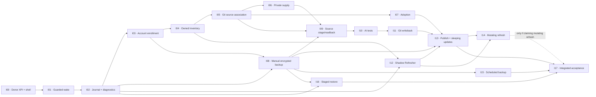

# PCMS-Alpha — Stage 6.1 Implementation Dependency and Vertical-Slice Design

**Prepared:** 2026-10-12  
**Status:** STAGE 7 RECONCILED — S6-Q07–Q12 accepted (all recommended A) on 2026-10-12. I00–I17 are controlled by the audited Stage 6.5 plan/phase contracts; this document records the original derivation. No implementation performed.  
**Scope:** Future coding-phase order and contracts only. No repository initialization, code changes, CI execution, provider actions or final ZIP.  
**Predecessor:** Stage 6.0 Implementation Strategy draft (S6-Q01–Q06 accepted) and CI Engineer Prompt draft.  
**Next:** Stage 6.2 agent recovery/continuation contract, 6.3 minimal Git governance, 6.4 CI/gates, 6.5 final phase instructions, Stage 7 audit.

## 1. Design method and authority

Work backward from observable operator tasks, the Stage 2 lifecycle, the accepted Stage 3 architecture, Stage 4 UI contract, and Stage 5 proof obligations. The Stage 6 handoff's G6-0–G6-6 are indicative technical groupings, not frozen agent assignments. **Design Stage 6 is not actual implementation.**

Constraints:

- Exactly one PCMS+PersonaMonkey XPI; retain donor Gecko/native-host compatibility and protected-route fail-closed behavior. Only PersonaMonkey admits browser mutations.
- PCMS IndexedDB holds canonical intent, scoped holds and recovery journal; immutable source and independent readback distinguish local command acceptance from remote effect.
- One account ↔ one dedicated Persona; positive Perchance owner evidence for mutation. A manual enrollment override never grants remote mutation authority.
- Private-first empty creation and subsequent rename are two distinct journaled effects; preserve remote successes when GitHub is unavailable.
- Source release fingerprints cover PJS, HTML and complete `src/` additions, changes, deletions; AI may edit generator-owned source but never gains PCMS/GitHub authority.
- No source overwrites of human dirty/unknown editor state. Existing-generator source changes only after *evidenced sleep* and confirmed unlisting.
- READY, tested, committed, human-approved and actually published are separate states. Published activity does not equal confirmed recent-list visibility.
- One global Refresher; mutating refresh disabled until demonstrated legitimate effective action; no speculative no-op saves.
- One authenticated encrypted integrated backup with guarded staged restore; restored state does not imply active authority. Diagnostics operate without the normal Core.
- Every phase has a traceable XPI, meaningful tests at appropriate tiers, a visible operator outcome (where technically feasible), clear disabled states and a rollback/hold behavior.

**Updated evidence availability (2026-10-12):** Library-first retrieval located the finalized Stage 5 *Test and Failure Matrix* (56 P-tests), *Evidence and Unknowns Register*, and *Operator Acceptance Plan* (H-01–H-07). The final Stage 5 Verification Specification and Decision Register were later located in the current project sources; the Stage 6.5 audited plan maps all 56 P-tests, all 56 Stage 1 REQ references and UX-01–10. Do not infer PASS from any mapping.

## 2. Meaning of a phase

A phase is a **bounded, acceptance-testable capability**, not a package, file tree, arbitrary subsystem or funding round. Each implementation-agent invocation handles exactly one phase, commits its actual changes, and stops after verified merge or a durable blocked report. Every phase includes the minimum applicable UI, observability, negative cases and migration/recovery behavior.

A phase may be accepted with externally effectful functionality still disabled **only if its phase objective explicitly names the independently proven non-effectful deliverable**. It cannot be accepted as a working provider feature merely because a simulated test passes. Later feature-enablement gates are explicitly separate.

Predecessor completion means accepted and merged into `main` with evidence. Readiness is **not** inferred from green PR status, historical phase names, or a design-level PASS.

The roadmap is a *partial order*, not mandatory uninterrupted serial progress: one agent executes one eligible phase at a time. A blocked branch is not overwritten; a genuinely independent eligible phase can proceed only after the obstruction is recorded and shared-state safety is established.

## 3. Proposed implementation slices (working IDs I00–I17)

| ID | Operator-visible completion target | Prerequisite phases | Focused acceptance / never claim |
|---|---|---|---|
| **I00 — Baseline XPI + shell** | Donor behavior still works in one packaged XPI; PCMS six-destination shell opens with explicitly disabled features | None; authorized destination setup and pinned donor snapshot | Reproducible package, unchanged protected defaults/Gecko/native identity, donor regressions. **Not** running PCMS workflows. |
| **I01 — Security-first background runtime** | Background can wake/recover with dashboard closed; runtime status names route/guard blockers | I00 | Static listener registration, sender validation, bounded Persona guard, packaged Firefox suspend/restart and fail-closed tests. No PCMS provider writes. |
| **I02 — Durable commands and emergency diagnostics** | UI shows canonical revisioned status; interrupted fake operations yield correct held receipts; redacted emergency diagnostics available with Core broken | I01 | IndexedDB intent / DISPATCH_POSSIBLE before fake effect, independent oracle, no-blind-replay, out-of-DB restore guard, fail-isolated donor. |
| **I03 — Account enrollment** | Select/create unbound Persona, human login handoff, positive identity verification, exclusive binding, pending/unverified and repair states | I02 | Guarded Persona routing, exact account context, revocation, rebind/archive, no manual UID input in normal UI; no unsafe enrollment override writes. |
| **I04 — Owned inventory** | Read-only account Sync/discovery, 1,000+ generator inventory, search/filters and observed owner/listing/age | I03 | Owner vs editKey distinction, missing != deleted, scoped account holds, revision-fenced UI. |
| **I05 — GitHub source association** | Git connection/setup status, explicit folder↔slug mapping, pinned `main` READY/manifest inspection, GitHub-first candidate visibility | I02, I04 | No inferred ownership from README/READY, path collision/symlink/traversal defense, no write/auto-publication. Private `per-gens` may still be uninitialized: show precise setup blocker. |
| **I06 — Private slug supply** | Paste/freeze user slugs, per-item allocation/receipts, remotely private-empty reserve + distinct guarded rename, create non-READY Git folder if available | I03, I04, I05 | Lost create/rename response, collision, owner check, Git outage pending folder, exact readback; provider mutation disabled until applicable live authorization/gates. |
| **I07 — Existing-generator adoption** | Operator consent, preserved original source/local immutable baseline plus non-overwriting GitHub archive, safe association | I04, I05 | Public vs unlisted, wrong owner, concurrent folder/source, no modification before both baselines; preserve original for rollback. |
| **I08 — Manual encrypted archive** | Operator can export one authenticated encrypted PCMS+supported donor archive, with explicit exclusions and verifiable metadata; restore guard exercised, no activation | I02, I03 | Locked/invalid key, secret redaction, consistent snapshot, failed export not success. Build early **before live source overwrite**; full restore arrives later. |
| **I09 — Candidate staging/readback** | For newly reserved generators, pin READY source, stage privately, verify complete PJS/HTML/`src/` manifest; show diff/conflicts/recovery | I05, I06, I08 | Full byte/path/deletion fingerprint, source drift, dirty/unknown editor, ambiguous save, no publication. Existing managed targets **still disabled** pending sleep lifecycle and adoption. |
| **I10 — Native AI test/repair** | Chat 1 configurable prompt, optional genuinely fresh Chat 2, all generator-owned source changes observed, repeat until justified stop, test evidence in Work Queue | I09 | True source/test binding, known-failure blockers, no AI-prose PASS, no Git permissions for native AI, clean handoff/tab lifetime. |
| **I11 — Revision-safe Git writeback** | Source comparison and manual/opt-in automatic conditional commit of verified final source; return Git commit/readback receipts | I10 | Relevant/unrelated HEAD drift, lost commit response, branch changes, `src/` deletions, untrusted suggested message, no force push; **not publication**. |
| **I12 — Refresher shadow engine** | Refresher shows one global queue, remaining budgets, monitoring observations, capacity/health and Pause/holds, *without automatic mutating refresh* | I02, I04 | Evidenced active/sleep time, outage/crash/Firefox closure, ~60min account grace, 50+/1,000+ simulation and bounded alarms. No recent-list placement guarantees. |
| **I13 — Approval/publication + existing updates** | Source-bound individual/safe-bulk approval; publish only after readback and revalidation. Extend same staging/review lifecycle to adopted existing generators **only in proven sleep and after unlisting** | I07, I08, I09, I10, I11, I12 | Full-source F, test/READY/owner/editor revalidation; rollback/hold, pending publish response, outdated Git A→B, publication not implied by commit. Operator approval to publish is a separate product interaction. |
| **I14 — Validated mutating Refresher** | Eligible published generators can execute a **legitimate, independently evidenced** refresh action via oldest-eligible queue; dashboard shows attempted vs observed presence | I12, I13 | Actual method **unverified** until narrow operator proof; effect remains disabled if unsupported. No fake visibility or noop spam; capacity and per-account isolation. |
| **I15 — Scheduled encrypted backup** | OS-vault-assisted daily protected archives and tracked last-14 retention; transparent locked-key/Downloads limitations | I08 | KDE vault capabilities, AES-GCM/authenticated file, download completion tier, filename retention; no plaintext fallback. |
| **I16 — Staged restore/activation** | Same/fresh-profile restore preview, checkpoint, UID remapping, stepwise receipts, safe inactive controller until explicit activation | I02, I08 | Crash after every dependency group, donor/PCMS mismatch, wrong-old-controller safety, rollback/holds; no restored implicit trust. |
| **I17 — End-to-end product qualification** | All six workspaces connected; cross-system adversarial rehearsals, operator checklist and accessibility/fleet performance findings reconciled | I13, I15, I16; I14 if claiming mutating-Refresher acceptance | Final smoke + security + recovery + 50+/1,000+ + keyboard/AT. Existing missing live-provider proof => explicit disabled/unsupported capability, not all-product PASS. |

**Phase count is provisional.** I01/I02 and I15/I16 are deliberately separated where the test oracle/rollback differs; conversely, do not add a phase for every interface or UI component. Stage 6.5 may combine/split **only where it improves testability and operator value**, with explicit dependency updates.

## 4. Dependency graph and critical path

**Critical early proof:** I00→I01→I02→I03→I04. The first actual operator flow is enrollment with visible owned inventory, not seven backend-only phases. Route/non-bypass and journal durability must precede provider effects.

**Independent branches after initial foundation:** shadow Refresher (I12), backup capability (I08/I15), staged restore (I16 after I08, **not dependent on unattended vault integration**), and safe Git source inspection can progress when another branch is blocked, but only after verifying shared-state requirements and unfinished-PR ownership. Do not start multiple agents in parallel.

**External setup conditions are not implementation-phase ACCEPTED statuses:** GitHub `per-gens/main` must actually exist before integration against the real repo; operator grants private repo write and any live effects separately. CI uses emulators, not production write credentials. F1's earlier one-off provider success is not a substitute for packaged-XPI verification.

## 4a. Checkpoints that expose integration mistakes early

| Checkpoint | What can be demonstrated in a packaged Firefox build | What still cannot be claimed |
|---|---|---|
| **C0 (I00–I02)** | PersonaMonkey preserved, secure wake and durable fake effect recovery, real PCMS shell with diagnostic route | Account ownership, live provider operations, complete backup |
| **C1 (I03–I05)** | Human-friendly enrollment and read-only owned generator inventory, explicit Git status/folder mapping | Permission to mutate a remotely owned resource from an unverified enrollment override |
| **C2 (I06–I09)** | Safe private reservation/adoption and exact unlisted candidate staging under deterministic provider faults, manual protected archive | Public deployment or genuinely verified live remote behavior absent operator proof |
| **C3 (I10–I13)** | Complete simulated source-bound release/review/writeback/publication lifecycle and non-mutating Refresher scheduling | Automatic public deployment or proven real recent-list effectiveness |
| **C4 (I14–I17)** | Proven feature-specific admission, backup/restore, load/UX and cross-system adversarial acceptance at recorded evidence tiers | Unsupported live-provider or OS-host guarantees when their actual gates have not passed |

The purpose is to avoid green infrastructure PRs that leave the operator without an intelligible application, and to prevent the final phase from becoming the first real integration attempt. The accepted Stage 4 prototype is the UI behavior target, not an implementation that can be declared done by copying static HTML.

## 4b. Coverage reconciliation against known Stage 5 unknowns

| Unknown group | Proposed phase(s) proving it | Important remaining caveat |
|---|---|---|
| **U-01 / U-07 / U-09** Persona guard, tab/editor ownership, event-page wake | I00–I03; I09, I12 | Packaged Firefox proof necessary; emulator cannot prove real wake |
| **U-02 / U-03 / U-04** owner, create/rename uncertainty, slug identity | I03–I07 | Prior F1 is one historical live happy-path observation, not crash-safe integrated acceptance |
| **U-05 / U-06 / U-08** complete assets, native AI/test evidence, Git revision fencing | I05, I09–I11, I13 | Real helper capability and owner-dependent writes may require a later operator probe |
| **U-10 / U-15** effective Refresher, fleet limits | I12, I14, I17 | Mutating Refresher remains OFF until effective legitimate method proven |
| **U-11 / U-12 / U-13 / U-14 / U-16** vault, restore, Downloads, independent diagnostic, controller activation | I02, I08, I15–I17 | Real KDE/Firefox/profile evidence cannot be inferred from simulated PASS |

This is a **topic-level crosswalk**, not a substitute for the now-located final P51–P56 matrix. Stage 6.4 must map each phase to exact individual P/UX/H IDs, test owner, tier and required-vs-conditional CI selector.

## 5. Minimum contract for each future phase

Every final phase definition in Stage 6.5 must name, without speculative over-detail:

1. Stable ID, operator-visible user story, dependency IDs and relevant accepted requirement section(s).
2. Explicit allowed outcomes / scope / what must NOT be implemented; necessary shared architecture repairs permitted under Stage 6.0.
3. Entrypoints and authority touched (donor, IndexedDB, Perchance, GitHub, OS vault, UI), including guard/lease and feature flags.
4. Durable state transitions and crash boundaries; negative cases; fallback/hold/rollback behavior.
5. A runnable proof tier and *specific* traceable Stage 5 test IDs **from the located final 56-test matrix**; donor regressions and packaged Firefox requirements where applicable.
6. Minimal UI surface from the six accepted destinations and exact disabled/uncertain states; traceable XPI build.
7. Completion/merge gate and evidence artifact, with no simulated-to-live tier escalation.
8. Remaining unproven external assumptions; allowed advancement of independent phases.

UI foundations must not become an excuse to implement all six screens with fake buttons; acceptance requires actual phase-relevant UI states backed by canonical controller data. Conversely, normal phases must not recreate the routing authority, GitHub engine or UI state management for each feature.

## 6. Phase acceptance and blockers

- **Build acceptance:** code and deterministic/packaged-browser tests prove the phase's specified implementation, without claiming unperformed operator-live proof.
- **Capability enablement:** effectful features turn on only after all required evidence/authority gates; a phase with safe feature flag OFF can still be accepted for an expressly non-effectful scope such as shadow scheduling, but not as an enabled refresh engine.
- **No hanging ambiguous branch:** record the precise failed effect/test, ensure no untracked active remote command, preserve branch/PR, and stop or explicitly defer with independent dependency proof.
- **Do not retrofit previous accepted phases to appear green:** fix regressions as scoped repairs; keep clear actual verification tier, not historical success from old Alpha.
- **No artificial rollback:** a Git revert cannot undo a remote Perchance/Git effect; reconcile independently and hold uncertain state before considering a new effect.

## 7. Accepted Stage 6.1 decisions

**S6-Q07–S6-Q12 were accepted by the operator on 2026-10-12 (all recommended A).** The following records the selected options and their rejected alternatives:

- **S6-Q07: milestone order.** Recommend early Account enrollment + read-only owned inventory after foundation, before reserve/deploy; alternative: build Perchance write adapters first and postpone operator workflow.
- **S6-Q08: backup gate.** Recommend manual encrypted integrated backup before the first automated existing-source overwrite; full staged restore later once schema/source contract is stable. Alternative: complete full backup/restore before any provider write (safer against profile loss but substantially delays first user flow).
- **S6-Q09: provider-gated completion.** Recommend distinguish implemented-and-disabled from verified-and-enabled; a simulated implementation never masquerades as live readiness. Alternative: prohibit accepting any phase before full live service proof, which may stall otherwise useful local work.
- **S6-Q10: sequencing through blocked phases.** Recommend allow independent READY phases after a recorded scoped blocker, with no concurrent agents, no ignored shared-state risks, and one phase per invocation. Alternative: strictly numerical phase order regardless of dependency independence.
- **S6-Q11: refresh order.** Recommend shadow Refresher first and independently proven mutating refresh last; alternative: implement them together and block the entire Refresher until method verified.
- **S6-Q12: work-unit granularity.** Recommend moderately sized vertical slices (working 18 stages), then simplify after dependency/CI mapping; alternative: larger 7–8 group milestones that may reproduce late integration hazards.

## 8. Stage 6.1 closure and Stage 6.2 handoff

Stage 6.1 has provisional acceptance after choices S6-Q07–12 were answered and the roadmap is checked for cycles, exact authority dependencies, early UI acceptance, safe effect admission, deferred-live truthfulness, and no unnecessary phase splitting.

Stage 6.2 must define: how a new agent identifies one phase deterministically; how it detects/resumes prior PR and resolves merge conflicts; what it may change across boundaries; how blocked/abandoned branches are handled without ghost claims; what happens when final PR CI changes during merge; and the exact stop/report contract. Stage 6.3 covers merge protected authority; 6.4 maps real test matrix; 6.5 produces final prompts and phase contracts. None of these design steps authorizes implementation.

## 9. Testing-timing clarification (accepted 2026-10-12)

**Manual live tests must be minimized, targeted and concentrated in the last implementation/acceptance phases.** All early phases rely on deterministic fakes, previous provider evidence and real packaged Firefox under sanitized fixtures. Early agent-driven live Perchance/Mullvad/Cloudflare tests are not permitted. H-01 and H-07 form the final operator-facing acceptance session; H-06 is required for any claim that fresh-profile activation is safe; H-02–H-05 are conditional only if the relevant external capability is enabled and cheaper evidence cannot establish it. A feature may remain safely OFF rather than demanding an early user test. An exceptional earlier feasibility probe requires proof that deferral would waste substantial implementation effort, a narrowly scoped procedure and separate explicit authorization. Do not repeat the proven F1 happy-path reservation experiment.

Acceptance of I03/I04 means a functioning **packaged testable UI/workflow** at its asserted evidence tier, not a demand that the operator repeatedly log into live accounts during development. UI progress and runtime effects must remain distinguishable.
