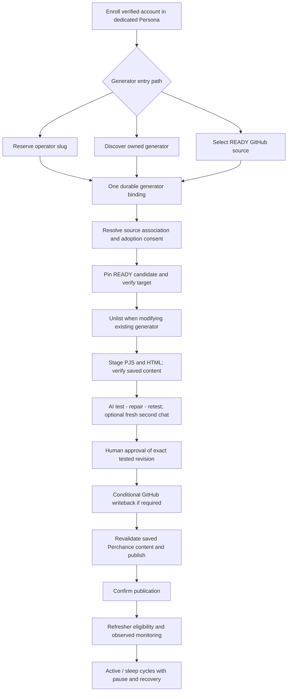
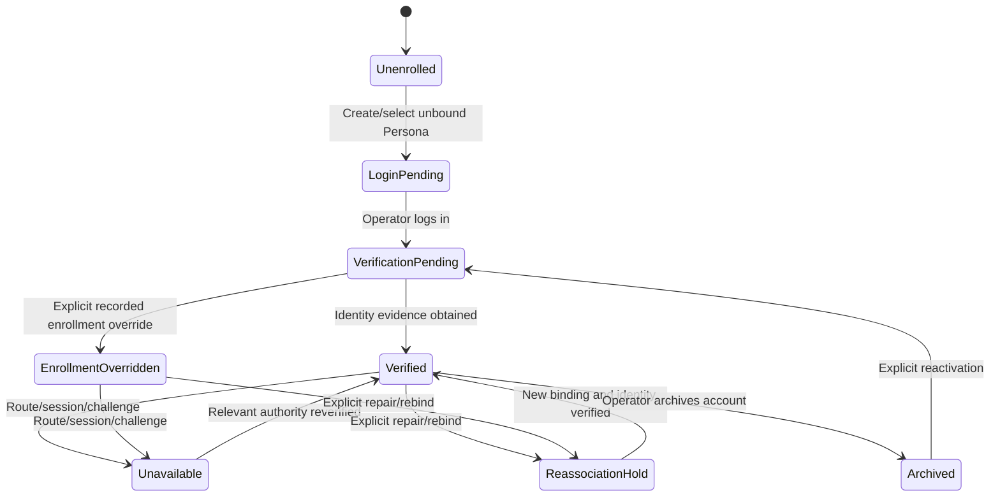
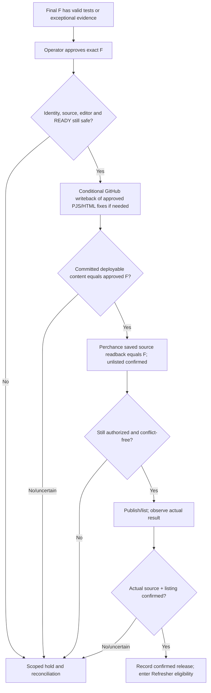
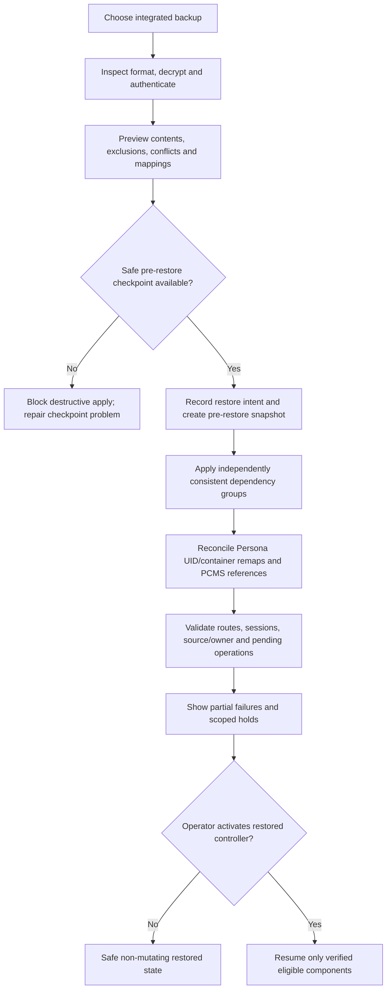
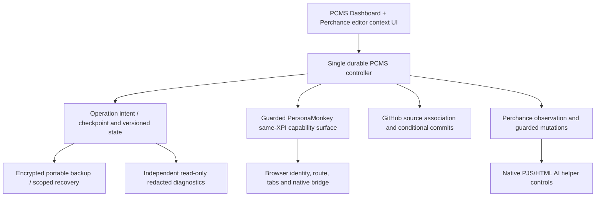

# PCMS-Alpha — Stage 2: Behavior and Lifecycle Specification

**Status:** **CLOSED / ACCEPTED AT DESIGN LEVEL**  
**Compiled:** 2026-10-12  
**Scope:** Stages 2.1–2.6 — domain and authority, generator binding, release and AI testing, Refresher, backup and recovery, and cross-system consistency  
**Predecessor:** `PCMS-Alpha-Stage-1-Requirements-Audit.md` (2026-10-11)  
**Successor:** Stage 3 — Minimal Architecture (not yet designed or accepted)  
**Implementation status:** None authorized by this document. No source changes, GitHub mutations, live provider automation, or final design ZIP are implied.

> **Purpose.** Specify what PCMS-Alpha must do from beginning to end, including disputed ownership, interruptions, human edits, remote uncertainty, downtime, and restoration. This is a behavioral contract **not** a database schema, frozen API, UI mockup, development roadmap, or claim that unverified provider controls work today.

**Document map**  
§0 — Authority, interpretation and scope  
§1 — End-to-end contract and invariants  
§2 — Stage 2.1: identity, domains, ownership and holds  
§3 — Stage 2.2: reservation, discovery, binding, adoption and collisions  
§4 — Stage 2.3: release, AI repairs, tests, approval, GitHub and rollback  
§5 — Stage 2.4: Refresher clocks, capacity, visibility and fairness  
§6 — Stage 2.5: encrypted backups, restore, controller activation and diagnostics  
§7 — Stage 2.6: cross-system precedence and adversarial cases  
§8 — Behavioral acceptance scenarios  
§9 — Complete Q32–Q106 decision register  
§10 — Unknowns and minimum verification  
§11 — Stage 3 architecture handoff  
§12 — Closure and sources

---

## 0. How to use this specification

### 0.1 Authority and interpretation

The applicable precedence is:

1. Explicit product decisions accepted in the Stage 1/Stage 2 design conversation, including later revisions of earlier decisions.
2. Existing PersonaMonkey security and portability guarantees, insofar as supported by its source and reference contracts.
3. Observed technical evidence, which may disprove feasibility assumptions but cannot silently change product intent.
4. Engineering interpretations **clearly identified as derived invariants** in this document. Implementation details not settled here remain for Stage 3 or Stage 5.

**Language:**

- **MUST / MUST NOT**: accepted behavioral requirement or a necessary safety implication of accepted decisions.
- **SHOULD**: design-level recommendation consistent with decisions; a proposed implementation must explain deviations.
- **MAY**: permitted behavior, not mandatory.
- **CONFIRMED**: explicitly decided requirement, **not** proof of running code.
- **EVIDENCED (DONOR)**: capability described or tested in the current PersonaMonkey donor; its behavior in the combined XPI still requires integration testing.
- **UNVERIFIED**: actual platform/provider control, guarantee, or feasibility not yet demonstrated.
- **DEFERRED**: intentionally for Stage 3 architecture, Stage 4 UI, or Stage 5 validation; not permission to invent policy silently.

This document integrates the accepted Q32–Q106 decisions, earlier Stage 2.1 authority decisions, and the Stage 1 baseline. The **later clarification limiting Perchance AI to PJS/HTML supersedes the original Q55 option**, and the **unbounded-in-iteration, progress-governed repair loop supersedes Q46's earlier merely bounded-retest phrasing**. Q41=B (GitHub-outage reservations continue) and Q49=B (exceptional manual-testing fallback) are intentional non-default decisions.

### 0.2 Product boundary and source references

- Product: one PCMS-first Firefox extension/XPI incorporating the useful PersonaMonkey functionality, including an advanced secondary PersonaMonkey UI. Internal PersonaMonkey organization may be simplified or refactored, but verified security/functionality must be retained.
- Operating scope: one computer and one controlling Firefox profile/environment; no multi-machine controller election, module marketplace, separate general-purpose workflow engine, or independently operating PCMS scheduler.
- Scale target: potentially **50+ accounts** and **1,000+ generators**.
- New implementation destination: [`Neb963/PCMS-Alpha`](https://github.com/Neb963/PCMS-Alpha); do not treat the historical Alpha implementation as authoritative.
- Donor: [`Neb963/persona-router`](https://github.com/Neb963/persona-router), copied later from a pinned provenance-recorded source snapshot, with regressions retained.
- Generator development source: one private [`Neb963/per-gens`](https://github.com/Neb963/per-gens) repository, deployable files taken from `main` at pinned revisions.
- Historical references only: `Neb963/persona-monkey-pcms`, `Neb963/PersonaMonkey-PCMS-Alpha`.

The Stage 1 requirements document remains authoritative for requirements not repeated in detail here, including basic UI accessibility, account enrollment, and late operator-led acceptance. This Stage 2 document is the more specific authority for lifecycle behavior and for decisions made after Stage 1.

### 0.3 What is explicitly out of scope

This document does **not** select IndexedDB vs other storage, prescribe package/folder/module count, finalize browser messaging interfaces, define persistence table names or enum values, create implementation phases, establish GitHub Actions configuration, specify the exact provider DOM selectors/API endpoints, or promise recent-list placement. Those must follow behavior and evidence, not drive it.

## 1. End-to-end product contract

A representative successful lifecycle is:

For first deployment to a newly reserved generator, there is no previously published revision to restore, and the candidate need not wait for a prior active-to-sleep transition. Every other safety condition still applies.

At every arrow there can be an independently recorded **pending**, **confirmed**, **uncertain**, **held**, **failed**, or **operator-action-required** result. No arrow is assumed atomic across Firefox, GitHub and Perchance.

### 1.1 Non-negotiable cross-system invariants

1. **One execution authority.** PersonaMonkey retains authority for Persona identity, Firefox containers, routing, native bridge, browser execution and relevant safety/control leases. PCMS must not bypass it or create a second browser automation controller.
2. **One owner per fact.** Perchance determines actual remote account ownership, saved source, remote generator existence and listing; GitHub determines committed source and READY; PCMS determines account-generator bindings, intent, approvals, scheduling and recovery disposition.
3. **No guessed remote success.** Local intent, request completion, saved readback, list observation and operator approval are distinct facts.
4. **No wrong-account mutation.** Every modifying operation requires current target, account/Persona and session/ownership evidence appropriate to that operation.
5. **No blind replay.** Persist durable intent before external mutation; after an ambiguous attempt, reconcile the remote state before any repetition.
6. **No silent overwrite.** GitHub content, Perchance saved source, and unsaved human editor work are protected by conflict checks.
7. **No automatic public release.** A new or changed candidate requires human approval of its exact final content; READY or AI PASS is not approval.
8. **No active-generator source update.** Updates to existing managed generators wait until sleep; unlisting and safe staging are confirmed first.
9. **No unverified security downgrade.** Route failures, restored sessions, manual enrollment overrides or browser recovery cannot silently switch a protected Persona to Direct.
10. **Scoped recovery.** A failure holds actual dependencies; unaffected safe work can continue. Automatic recovery cannot clear an operator Pause.
11. **No destructive inference.** Temporary disappearance is not confirmed deletion. Archive by default; explicit deletion preserves tombstone/source/history.
12. **No claimed guaranteed visibility.** Refresh success is not recent-list presence or rank, and the list's capacity is not a constant guaranteed by PCMS.
13. **No fabricated test PASS.** Test evidence is tied to the exact final source; generated prose alone is not sufficient for clean bulk approval.
14. **No restored authority without reconciliation.** A backup recovers state and evidence, not an unconditional license to replay old operations.
15. **No competition for one generator.** At most one modifying release/rollback/AI-edit operation targets a generator at a time; read-only observation remains possible where safe.

## 2. Stage 2.1 — Domain, identity and authority

### 2.1 Entities and stable identifiers

These are **logical concepts**, not prescribed storage tables.

| Concept | Identity/relationship | Meaning and lifecycle |
|---|---|---|
| Persona | Stable `personaUid` owned by PersonaMonkey | Browser identity and policies. A current `cookieStoreId` is an installation/container reference, **not** the durable Persona identity. |
| Perchance Account | Stable PCMS `accountId` | One managed Perchance account with verified provider identity, binding and health evidence. May be archived or deliberately rebound. |
| Generator | Stable PCMS `generatorId` | Managed identity and audit history. Associated with a remote slug, a verified owner, an optional GitHub source folder, and release/schedule records. |
| Remote target | Account + slug + observed remote evidence | The actual Perchance resource, not an arbitrary GitHub folder name or stale local claim. |
| Source association | Repository + explicit folder/path configuration | Versioned development source, content fingerprint and READY evidence at a pinned revision on GitHub `main`. |
| Release | Stable `releaseId` | Candidate lineage, exact source content, testing evidence, approval, writeback and publication results. |
| Operation | Stable `operationId` | One durable attempted change with target/version, preconditions, checkpoints and observed result. |
| Schedule | Generator association and configured budgets | One active/sleep lifecycle, remaining budgets, eligibility and queue history. |
| AI test job | Release + source fingerprint + prompt/instruction revisions | Bounded browser execution, repair checkpoints, evidence and final disposition. |
| Consent/approval | Identity + target + content/version/scope | Public-generator adoption, manual exception, deletion or publication authority. |
| Pause | Operator-imposed scope | Intentional inhibition of scheduled work; does not disappear when health recovers. |
| Recovery hold | Reason + dependency scope + evidence | Protective inhibition, automatically cleared **only** when its actual safety condition is verified and policy permits. |
| Observation | Target + observation time + method + outcome | Time-bounded evidence, possibly stale/uncertain, about owner, route, listing, metrics or source. |
| Backup/restore operation | Archive/checkpoint identifiers + restore progress | Portable state snapshot, mapping review, safety journal and reconciliation outcomes. |

Stable PCMS identities are preserved across explicit repair/reassociation when continuity has been established. A duplicate slug string does not establish identity continuity if ownership changed or a deleted slug was later reused.

### 2.2 Authority matrix

| Fact or action | Authoritative owner | PCMS-Alpha duties and prohibitions |
|---|---|---|
| Persona UID, contextual identity, isolation policy | PersonaMonkey | Keep stable reference, ask typed guarded operations, honor remapping and rotation. |
| Mullvad/proxy route, protected fail-closed behavior, native bridge | PersonaMonkey | Display safe status and pause dependents. No second native RPC or implicit Direct fallback. |
| Browser/session execution and leases | PersonaMonkey | Request bounded guarded execution. Do not bypass lease/execution safety through arbitrary tab automation. |
| Perchance authentication and generator ownership | Perchance | Verify via available evidence; never equate manual enrollment override to mutation authority. |
| Live Perchance PJS/HTML, assets and public listing | Perchance | Observe, stage, read back and reconcile exact results. |
| AI helper chat and code-edit activity | Perchance native helper | PCMS orchestrates permitted helper actions and observes PJS/HTML modifications/test results; the helper never gets GitHub/PCMS privileges. |
| GitHub source, HEAD, commits, READY and `TESTING.md` | GitHub `per-gens` | Pin and compare relevant revisions; make guarded writebacks. |
| Account associations, generator mapping, scheduling, approvals, holds | PCMS | Preserve local intent and history; prevent stale mutations. |
| Operator editor changes and decisions | Operator / actual browser editor | Protect unsaved work; require explicit reconciliation and consent. |
| Passwords, cookies, route credentials, WireGuard material | Appropriate browser/PersonaMonkey/native facilities | No casual duplication in PCMS or redacted diagnostics. Backup only supported legitimate portable state. |

**Internal integration boundary (accepted):** a **narrow, guarded, typed same-XPI adapter** over the retained PersonaMonkey functionality. The present cross-extension Integration API was designed for separate trusted extension senders and cannot be presumed to work unchanged for an internal PCMS caller. Relevant guarded execution/lease and privacy behaviors must be preserved even if internal code organization changes. The Gecko ID `persona-route-manager@local` and appropriate native host compatibility remain constraints. The exact API signatures are deferred to Stage 3.

**Donor evidence:** existing PersonaMonkey reference materials describe stable Persona UIDs, guarded execution capabilities, internal Management/Persona OS distinction from external Integration API, encrypted complete backups and restore remapping. This is donor evidence, **not** acceptance that their combined-XPI refactoring is already implemented.

### 2.3 Account enrollment and operation eligibility

The diagram is a **conceptual view**. Verification, route condition, archival and operator Pause are separate facts and need not be one database enum.

**Enrollment:**

1. Operator creates a Persona or chooses a currently unbound Persona from a selector; routine UI does not require raw UIDs/container IDs.
2. PCMS opens Perchance through that Persona. The operator manually logs in.
3. PCMS obtains authenticated identity evidence and links the account only to that one dedicated Persona.
4. If initial identity cannot be established, a clearly labeled **manual enrollment override** is allowed with operator intent and provenance; it **does not** allow a future remote mutation without independent target/session/owner evidence.
5. The reverse exclusive mapping also holds: a dedicated Persona must not simultaneously serve as the active identity of another PCMS account.

**Health and route challenge:** a Cloudflare or related challenge is recorded with observed account, Persona/route and time. It does not permanently prove a particular route defective. The operator may choose a new clean Persona and an alternate route; PCMS must not bypass the challenge or silently relax protected routing. Inaccessible sessions/routes hold affected account mutations; shared dependency failures may hold several accounts.

**Reassociation:** preserve logical account/generator history while invalidating stale account/Persona/session-specific permissions. Require independent validation before reopening mutations. Pending releases tied to the previous identity require renewed review/approval as defined in §4.

**Archive:** archive the account by default; retain associated Persona object (subject to PersonaMonkey authority), generator/source/history and reconciliation trail. No implied remote deletion.

### 2.4 Pause, recovery hold and source conflict are different

| Condition | Who creates it | What it blocks | How it ends |
|---|---|---|---|
| Operator Pause (global/account/generator) | Operator | Scoped scheduled remote mutations and operational-budget consumption | Explicit operator Resume; health recovery alone cannot clear it |
| Recovery hold | Safety/reconciliation controller | Affected unsafe mutation/release/scheduler dependency | Verified resolution, or operator-assisted reconciliation where required |
| Source/editor conflict | Source/readback/dirty-editor detector | Relevant writes and publication | Explicit comparison and approved resolution |
| Excluded/unadopted inventory | Binding policy | Unapproved source deployment/management | Required READY, consent and authority independently satisfied |
| Account/session unavailable | Health evidence | Dependent remote operations; active budget frozen | New good evidence, subject to Pause and other holds |

A restored healthy component may resume automatically **only** after all applicable recovery dependencies reconcile and the operator has not paused it. Read-only observation and local data protection may continue during Pause.

### 2.5 Every remote mutation has a durable intent

A remote write must be attributable to an immutable target identity and expected revision/context. Before sending it, PCMS records enough information to identify what was intended and whether retry can be safe. Subsequent operation evidence distinguishes:

- **Prepared:** intent and preconditions recorded; no known external attempt yet.
- **Attempted:** call may have reached provider.
- **Confirmed:** provider state observed to satisfy the specific expected result.
- **Uncertain:** response, timeout, shutdown or readback cannot establish result.
- **Failed:** negative result demonstrated; whether to retry depends on operation semantics.
- **Held / reconciled / archived:** disposition and retained evidence, not loss of history.

These are explanatory categories, **not mandatory enum names**. In particular, a request timeout does **not** prove a mutation failed. Ambiguous results invoke bounded read-only reconciliation, with a scoped hold if inconclusive. No fire-and-forget remote mutation is acceptable.

## 3. Stage 2.2 — Generator binding, reservation, adoption and lifecycle

### 3.1 One binding lifecycle; three entry points

A single generator record may originate from:

1. **Supply/reservation:** the operator submits explicit slugs. PCMS chooses an eligible verified account (unless explicitly selected), creates an actual empty **unlisted** Perchance generator and links source.
2. **Account discovery:** PCMS observes generators owned by verified accounts during periodic or manual Sync. It reconciles existing records or adds new inventory records. A discovered generator is **not automatically READY**.
3. **GitHub-first:** a READY folder/revision is discovered in `per-gens`. PCMS may suggest a matching slug/account, but the operator must explicitly confirm target slug and owning account before reservation or adoption.

All three converge on **one logical `generatorId`**, remote association, source association, readiness/release process and Refresher lifecycle. No path gets a separate backend or weaker safety rules.

### 3.2 Independent dimensions, not one enormous state enum

| Dimension | Representative values | Why separate |
|---|---|---|
| Remote existence | unknown, confirmed unlisted, confirmed listed, ambiguous, confirmed absent | Remote fact may change without PCMS causing it |
| Owner evidence | verified under bound account, disputed, inaccessible, pending | Same slug does not prove account ownership |
| Source association | none, folder pending, existing-folder review, linked, conflict | GitHub can fail independently of Perchance |
| Management permission | observed-only, public-adoption-pending, authorized, archived | Being owned/discovered is not edit consent |
| Deployment eligibility | unready, READY, candidate under test/review, published, held | GitHub READY is distinct from approval/publication |
| Scheduler | not started, active, sleeping, suspended, paused | Source state and time state are not identical |

A UI may summarize these dimensions as plain language, but never replace the evidence-bearing facts with an ambiguous single status such as “OK.”

### 3.3 Bulk slug reservation: required behavior

**Input:** a set of operator-specified slugs (no automatic substitute names), optional target accounts, and a preview of projected allocation and conflicts.

**Preflight:** validate supplied values, deduplicate against the current batch/inventory, inspect known remote and source ownership where possible, consider eligible verified accounts, and show per-item dry-run classification. This is a preview, **not** a promise the remote state cannot change before mutation.

**Allocation (Q32):** automatically distribute as evenly as practicable among eligible accounts, with optional operator selection. The selection may change before the first remote attempt. **It must not silently change after any attempt with an uncertain result**, even if another account is healthy.

**Per-item sequence:**

1. Persist slug, chosen account/Persona, operation identity and relevant preflight evidence.
2. Check applicable safety holds, current account/session/ownership evidence and route eligibility.
3. Attempt remote creation of an **actual empty, unlisted** generator—not just a local reservation row.
4. If creation is confirmed, record actual slug/owner/listing evidence and preserve the binding.
5. Create a real GitHub source folder under the configured root, usually named after the slug, using a non-READY `DEPLOYMENT.md` initialization; store an **explicit** folder association.
6. If GitHub is unavailable, **keep the Perchance reservation and queue the missing folder creation** (Q41=B). This incomplete-but-valid state is expected, not automatically a failure of the reservation.
7. Complete only confirmed missing work after reconciliation. Report an independent per-item receipt and aggregate batch summary.

GitHub folder creation is never simulated by a local empty directory. If GitHub supports no empty folders, the initial non-READY marker provides the actual committed object. Creation must be conflict-safe and must not overwrite content.

**Already-owned slugs (Q33):** if authenticated evidence establishes the generator is owned by the selected/known managed account, reconcile into inventory instead of recreating it. Preserve existing live content/listing; a public existing generator requires adoption consent before source management. No mutation is implied by inventory reconciliation.

**External/taken slugs:** skip as externally unavailable **only on affirmative evidence**. A failed lookup or challenge is not proof of another owner. Never fabricate an alternative slug.

**Uncertain remote create (Q38):** perform bounded read-only reconciliation on that same account/slug. If ownership and creation cannot be established, **hold that slug for operator review**, do not retry blindly or attempt under another account. Unrelated batch items continue.

**Already attempted GitHub commit with lost response:** inspect current folder/content/commit first. A matching folder name by itself is not evidence PCMS created or owns the source.

### 3.4 Discovery and adoption

**Inventory Sync:** periodic lightweight account inventory reconciliation and manual Sync, using Persona-guarded access and verified account identity. Existing PCMS records are matched by observed remote identity/owner evidence; missing listings produce *unobserved/uncertain* status, **not immediate deletion**. Read-only discovery may proceed on generators not yet managed.

**Existing unlisted owned generators (Q40=A):** automatically bring them into inventory and create/link a missing safe GitHub folder without separate public-adoption consent. This is **not** license to edit source before the ordinary source baseline, readiness and release conditions are met. If a pre-existing unassociated GitHub folder matches, explicit confirmation remains required (Q42).

**Existing public owned generators:** one-time **adoption consent** is required before PCMS changes their source or listing as part of management. A previewed batch may be approved together (Q37), but each generator independently preserves its original source and obtains a per-item outcome. Failure in one item does not erase other valid results.

**Baseline requirement (Q36):** before the first source-changing operation on an existing generator, retain (a) an immutable local baseline, protected in the integrated backup policy, and (b) an archival copy in GitHub. Archival must use conflict-safe paths and **must not overwrite** an existing development source, an unrelated folder, or a prior baseline. If either required baseline cannot be established, that generator is held from modification. Snapshot provenance must identify the observed account/slug, source and observation time; preserve public-state evidence where observable.

A generator discovered as public may be visible in inventory, searchable and monitored without being adopted. Consent authorizes a future guarded workflow; it is not blanket permission to overwrite a drifted live source.

### 3.5 GitHub-first source association

- Read source only from the single configured private `per-gens` repository's `main` branch, pinned to a particular commit and relevant file contents.
- `DEPLOYMENT.md` must contain the strict **`Status: READY`** marker; configured deployable files must be valid. `main.pjs`, `index.html`, and configured/available assets define the deployable artifact. Merely containing code does not imply READY.
- `TESTING.md` is optional, version-pinned input to the independent Chat 2; it is not the default testing policy.
- Folder name defaults to slug under configured root for newly created folders, but **slug ↔ folder is an explicit mapping**. Do not derive remote owner/authority from folder names.
- Before binding a READY folder to a remote target, require explicit confirmation of the owning account and target slug (Q35).
- If an existing unassociated folder appears to match a generator, inspect without modifying and require confirmation (Q42). A folder already bound elsewhere is a conflict, not an opportunity for silent reuse.
- An already bound folder must not simultaneously be current source for two distinct managed generator identities. Changing association requires an explicit reviewed operation and preserved provenance.
- READY is necessary for staging but insufficient for adoption, release approval, or publication.

The exact asset conventions (including whether a `thumbnail.jpeg` is optional/required for particular generators), relative path templates and supported source validation rules remain Stage 3/5 contract details. Do not silently invent mandatory additional repository files.

### 3.6 Ownership/collision matrix

| Observation | Required disposition |
|---|---|
| Slug confirmed available and chosen account verified | Reserve empty/unlisted; then initialize or queue GitHub folder |
| Slug already confirmed owned by same managed account | Reconcile; preserve existing source/listing; determine adoption needs |
| Same slug confirmed under another managed account | Hold current association; require explicit reassociation and new verified authority; preserve history (Q39) |
| Slug affirmatively taken externally | Skip and report; do not invent replacement |
| Owner not verifiable | Hold modification; report what is unknown |
| Remote generator already mapped to one PCMS `generatorId` | Reuse/reconcile logical identity; no duplicate record |
| GitHub folder missing | Create non-READY marker when authorized and accessible |
| GitHub folder present but unassociated | Inspect, request explicit association approval, do not overwrite |
| GitHub folder bound to another generator | Conflict, use operator-authorized alternative or reassociation |
| Perchance reserved, GitHub offline | Keep reservation and queue folder work (Q41) |
| Perchance creation outcome ambiguous | Bounded read-only reconciliation; hold exact slug; no second-account attempt |
| Folder creation outcome ambiguous | Read content and commit history; repeat only if demonstrably absent and safe |
| Remote resource absent from one inventory observation | Mark uncertain/missing observation; preserve binding and history |
| Old deleted slug later appears under different owner | Do not automatically reactivate old binding or trust old consent |

### 3.7 Archive, reassociate and delete

- **Reassociation:** requires operator initiation, target account/source verification, preserved stable PCMS identity and history, and invalidation/revalidation of dependent permissions. An account change does not transfer trust or approvals automatically.
- **Archive generator:** excludes it from routine management while retaining remote generator, linked source, baselines, releases, schedule history and tombstone/archival status. Archive of an **incomplete operation** (Q43) may stop automatic repair of that specific operation, but must retain the remote reservation, evidence, unresolved condition and explicit repair path.
- **Deletion:** remote Perchance deletion is a distinct, explicitly confirmed, potentially destructive action; retain local tombstone, revision history and GitHub source. No local “Delete” affordance may silently delete both provider sides. A remote deletion request requires actual confirmation semantics; those are UNVERIFIED.
- **Bulk operations:** use preview/dry-run, clear target set, one operator authorization when applicable, independent receipts, partial results and a way to inspect failed/uncertain items. Never treat batch-level failure as proof individual remote operations failed.

### 3.8 Binding transition invariants and acceptance examples

**Must always hold:**

1. One current management binding per confirmed remote target; no duplicate creation through alternative entry paths.
2. Account allocation does not change after an attempted uncertain reservation.
3. A confirmed Perchance result is not discarded because GitHub is offline.
4. No overwrite or implicit ownership of an unrelated GitHub folder.
5. Public-source adoption consent and original-source snapshots precede first modification.
6. No automatic trust transfer on reassociation or slug reuse.
7. An archived incomplete operation retains evidence and remains repairable.

**Example — 100 successful reservations, GitHub offline:** record 100 confirmed remote reservations and 100 pending source-folder operations. None is deployable merely because its remote creation succeeded. On GitHub recovery, reconcile each folder and create only those demonstrably missing, without reissuing Perchance create requests.

**Example — batch of 20 public generators:** the operator approves the preview once. Only generators whose baseline and archival copy succeed may proceed to subsequent source changes; other entries are individually held, with their public source unchanged.

## 4. Stage 2.3 — Release, native AI testing, human review and publication

### 4.1 Definitions and version lineage

An existing generator may have:

- **P — Previous good published release:** the last source and publication result PCMS can substantiate, retained for safe rollback.
- **A — Candidate from GitHub:** deployable source pinned to a `per-gens` `main` revision, with exact relevant file fingerprint and READY evidence.
- **A1, A2, … — AI repair revisions:** meaningful PJS/HTML edits, saved/read back with fingerprints and test evidence.
- **F — Final candidate:** exact tested deployable content after all successful repairs; F may equal A if the AI made no changes.
- **C — GitHub writeback commit:** a new commit, when required, containing the approved deployable content. Different commit ID alone does not change F if relevant content is identical.

**Identity of approval:** an operator approval is bound to the specific `releaseId`, generator, verified account association, final deployable-content fingerprint, applicable default prompt revision, optional `TESTING.md` snapshot and observed test evidence/exception flags. Approval is not permission to publish any future different source. A post-approval content change invalidates the corresponding authority until re-tested and re-approved as applicable.

A fingerprint must reflect all configured **deployable** content rather than merely `main.pjs`. How to represent, normalize and verify inaccessible assets is UNVERIFIED and must be specified without pretending unverifiable files were checked. AI-helper edits, however, are strictly limited to the editable **PJS and HTML** code, not the broader asset set.

### 4.2 Release eligibility and staging

**Inputs:** an explicit bound generator, verified owner/Persona/session/route, relevant GitHub READY source pinned to `main`, valid deployable files, sufficient operator adoption consent for an existing public generator, and no applicable safety Pause/Hold.

**Existing managed generator:** source-changing work is eligible **only during sleep**, never active. A pending READY release that becomes eligible during sleep takes precedence over admitting the same generator into a new active cycle (§5 and Q99). Before staging, preserve the previous good source and required original baseline, confirm source and editor conflict safety, **unlist**, and verify that unlisting was actually effected. Freeze the generator's remaining active/sleep budget while it is held for release work.

**New generator:** a previously reserved empty/unlisted target may stage without waiting for a prior active/sleep cycle, once binding, source readiness and authority are verified.

**Staging:** apply the exact pinned deployable PJS/HTML and permitted assets through authorized paths; confirm saved remote source by readback wherever possible. A request receipt alone is insufficient. If the staged source does not match expected content, hold and reconcile. Human unsaved edits (or the inability to establish editor safety) prohibit competing source writes.

**During review:** keep candidate **unlisted** until decision and publication (Q44=A), even when the operator takes a long time to review. Do not silently republish the old release while awaiting approval. The effect of unlisting on actual visitor accessibility remains a provider unknown and must be disclosed during later testing.

### 4.3 AI-helper authority: narrowed final decision

**Perchance native AI helper MAY:**

- See and interact with the generator's **PJS and HTML** code through its native editor environment.
- Run available live generator tests in that environment.
- Diagnose failures, modify PJS/HTML, save resulting code, run more tests and report observable outputs.

**Perchance native AI helper MUST NOT:**

- Access GitHub APIs, credentials, repository contents or writebacks directly.
- Edit `DEPLOYMENT.md`, `TESTING.md`, README/source-control policy, non-PJS/HTML assets, unrelated generators or account settings.
- Approve or publish a release, manage Personas/routes, or acquire PCMS administrative authority.

**PCMS exclusively handles:** fetching/pinning GitHub files; extracting and supplying test instructions; scheduling helper execution through PersonaMonkey; observing/verifying edited PJS/HTML and evidence; preserving diffs and checkpoints; conditional GitHub writeback; operator approval; final listing/publication; and recovery. When AI reports a dependency outside PJS/HTML, record it as a blocker requiring an authorized PCMS/operator GitHub-side correction, new candidate reconciliation and retesting (Q102). Do not silently elevate AI permissions.

### 4.4 Two-chat testing and autonomous debug/fix/test loop

**Chat 1 (mandatory when available):**

1. Start a testing **job**, pinning its source fingerprint, default testing prompt revision, relevant inputs and account association. The default prompt is authoritative **only in PCMS Settings**, with editable version history and import/export; any job started after a revision change uses the new revision, including updates to old generators.
2. In a PersonaMonkey-controlled automation-owned context, start the native AI helper with the default prompt.
3. Observe tests, failures and code changes. On failure, the helper **diagnoses → edits permitted PJS/HTML → saves → verifies readback → retests**.
4. Repeat automatically until applicable tests pass, or suspend for a genuine blocker, resource/rate limit, human-editor conflict, unsafe situation, or demonstrated repeated lack of progress. **No fixed arbitrary repair-iteration count.** A blocked candidate is not reported as passed.
5. At intermediate iterations, selective affected tests may be used for speed; before a normal clean test completion, obtain observable passing evidence for **all applicable suites on the same final source fingerprint**.

**Chat 2 (optional by source instructions):**

1. Only when a pinned generator-specific `TESTING.md` exists **and Chat 1 has reached the required successful checkpoint**, create a genuinely **fresh AI-helper conversation** with those instructions. The current code includes Chat 1 repairs, but the new chat must not inherit the first conversation history.
2. Chat 2 may also autonomously fix and retest PJS/HTML. Every such source change invalidates prior source-dependent evidence.
3. Revalidate the default suite after Chat 2 repairs; revalidate Chat 2 as necessary after further code changes. Continue to a **stable final F** for which both applicable suites have passing evidence against the **same exact revision**.
4. If `TESTING.md` does not exist, a successful default suite proceeds to ordinary review. Failure/unavailability of optional Chat 2 is handled by the exceptional-review rules, not by fictitiously reporting it as passing.

**Convergence safeguards:** a repeated ineffective strategy should prompt a different approach when feasible. Demonstrable no-progress cycles may suspend the job and request manual attention; all useful source checkpoints and reports remain available for manual Resume. Firefox or helper-session interruption requires source/evidence reconciliation; conversation continuity is not assumed possible. AI running concurrency is globally configurable with a **default of one active AI job per account**; browser automation tabs are bounded. An awaiting-human-approval candidate does not occupy an AI execution slot.

**Testing evidence:** record source fingerprint(s), meaningful code diffs, test names/instructions, observed outcomes, stable errors, timestamps, relevant browser context and summary. Do not persist entire AI chat transcripts by default (Q57). A model-generated textual declaration of PASS without observable supporting evidence is **not** sufficient for clean bulk-approvable success (Q59). Perchance's exact helper control surface and evidence accessibility remain UNVERIFIED.

### 4.5 Review and human approval

The review must expose final PJS/HTML/source diff, relevant assets, previous approved source, test evidence, repair history, warnings, source/readiness conflicts and actual listing state. The operator can inspect the corresponding Perchance `#edit` page where useful; PCMS must never close or discard an operator's unsaved editor tab.

| Review category | Approval rule |
|---|---|
| **Clean** | All required tests have observable PASS for the exact final source; no AI changes, unresolved warnings, drift, identity/source conflicts or exceptions; eligible for explicit safe bulk approval. |
| **AI-modified but fully tested** | Requires **individual** review and explicit approval, even if every test passed. |
| **Default AI testing unavailable** | Q49=B: permit *explicitly acknowledged manual-testing fallback* and individual approval, clearly labeled **not AI-verified**. Not eligible for clean bulk approval. |
| **Optional Chat 2 unavailable/incomplete** | Q47=A: preserve Chat 1 results, label overall testing incomplete; allow exceptional individual review/approval after recovery attempts and warning. |
| **Known failing required test / unresolved confirmed defect** | Q54=A: publication **blocked**. Manual-testing fallback is not a bypass for observed failures. |
| **Stale, drifted, unsafe editor or identity conflict** | Hold and reconcile; no valid publication approval merely from previous PASS. |

Exceptional manual approval records the exception, explicit acknowledgment and actual evidence. It never upgrades the release's testing provenance to full AI PASS. All approval paths remain subordinate to identity, routing, ownership and editor-safety invariants.

### 4.6 GitHub changes and candidate obsolescence

- An actual change to this generator's deployable content during testing/review causes the active candidate A to stop at a **safe checkpoint**; preserve its code and report, mark it outdated and offer explicit reconciliation with new source B (Q45/Q56).
- A change only to an unrelated generator in the same repository should trigger **read-only relevant-source revalidation**; if this generator's deployable source, READY condition and pinned testing inputs remain valid, it need not invalidate the candidate solely because repository `HEAD` advanced (Q58).
- Testing instructions are **pinned for the job**. Updating `TESTING.md` or the default prompt applies to subsequent jobs, rather than retroactively changing the existing job (Q63). However, **READY revocation** or a relevant source conflict blocks publication immediately.
- Any unexpected Perchance live-source difference, human saved/unsaved changes or incompatible GitHub evolution creates a visible conflict. Do not automatically merge A/F into B and do not silently choose which human change to keep.
- If Github becomes unavailable after staging, AI tests and preserved review evidence may continue locally (Q103); actual publication remains blocked until relevant source is verified and necessary guarded writeback succeeds.

For ambiguous “unrelated” changes, fail conservatively: a non-deployable document change is not automatically relevant to release output, but changed assets, READY status and pinned test requirements must be evaluated using their actual semantics, not repository commit ID alone.

### 4.7 Final approval → GitHub synchronization → publication

**Required ordering:**

1. Approval is pinned to exact F and evidence.
2. Immediately before mutation/publication, reverify account/Persona/session authority, relevant GitHub READY/source, source safety, human-editor state, Perchance saved source and unlisting.
3. If the AI changed PJS/HTML, conditionally write back only **approved** changes to GitHub; protect against intervening relevant commits and verify resulting deployable fingerprint. No unrelated asset or policy file write by AI.
4. Confirm GitHub's deployable content (after any writeback) and Perchance's staged saved content correspond to approved F. Do not call the release “verified” for assets the provider cannot actually expose reliably; a necessary unverified asset blocks ordinary verification until an explicit supported disposition exists.
5. Publish/list the target; establish actual remote publication result by readback/observation.
6. Only **confirmed** publication records a new good released revision and makes Refresher admission possible, subject to remaining sleep and capacity.

A new GitHub commit C containing **identical approved deployable content** does not by itself invalidate F or force repeat approval. A differing result does. `Approval`, `GitHub-synchronized`, `Perchance-synchronized`, `published`, and `Refresher-eligible` are independently reportable facts.

### 4.8 Human editor conflict resolution

PCMS may use separate automation-owned tabs, but can mutate the generator only when it can establish that operator-owned unsaved edits will not be overwritten. **Unverifiable dirty state is unsafe**, not automatically clean. The restriction also applies to final publication (Q60), even when saved content appears to match the candidate.

When an operator changes live source during review, **hold** and offer explicit, evidenced reconciliation choices (Q52):

- Treat the operator's saved/source changes as a new candidate requiring appropriate tests and approval;
- With confirmation, restore the reviewed source **only when** it will not destroy unsaved work and target ownership is still valid;
- Defer without losing either source or review evidence.

Never automatically close or reuse the operator's unsaved editor tab as a transient automation context. The implementation mechanism for reliable editor safety is UNVERIFIED; lack of that mechanism blocks unsafe writes rather than relaxing protection.

### 4.9 Release interruption, failure and rollback matrix

| Moment/condition | Required response |
|---|---|
| Crash before unlist | Reverify sleep and unchanged source; resume only from known state |
| Crash after unlist, before staging | Check actual listing/source, then decide safe next step |
| Crash during AI edits | Compare durable checkpoint with saved remote source; retest on recovered final code; do not invent chat continuity |
| Crash after approval | Preserve approval; repeat relevant pre-publication checks, not blindly reapprove/publish |
| GitHub write succeeds, acknowledgment lost | Inspect resulting content/commit; do not reapply blindly |
| GitHub write conflicts | Hold; no automatic merge/revert |
| Publish succeeds, acknowledgment lost | Observe listing **and** saved source; no blind republish |
| Post-publication source/listing verification fails | Hold; safely unlist and restore previous good P when actual state permits (Q61) |
| GitHub writeback succeeded but Perchance publication failed | Keep GitHub commit; quarantine F; conditionally restore P remotely when safe (Q62) |
| Human dirty editor or unverifiable state | Hold all competing source mutations and publication |
| Known failing test persists | Continue permitted repair or hold; no approval shortcut |
| Optional Chat 2 incomplete | Exceptional individual review only with truthful evidence |
| Account/Persona reassociated | Hold candidate, reverify session-dependent test validity and renew approval (Q101) |

**Interrupted ≠ failed.** A safe, recoverable interruption resumes from a verified checkpoint. Do not run rollback solely because Firefox restarted or a remote response was delayed.

**When rollback is necessary:** retain immutable previous good source P, the failed candidate F and evidence. Restore P only if current ownership, editor safety and live source conditions permit. Verify source readback; **leave the generator unlisted/sleeping for review**, rather than silently restoring public listing. Quarantine F against automatic repeated release until changed or explicit manual retry. The earlier GitHub writeback, if confirmed, remains preserved for history; do not automatically rewrite GitHub history to match Perchance rollback.

If even rollback cannot be verified, retain a scoped `RECOVERY_HOLD` and surface operator action; no false “restored successfully” status.

### 4.10 Release acceptance invariants

- No AI or GitHub event becomes public without approval bound to final F.
- The same source fingerprint underpins final tests, approval, GitHub deployable content and Perchance readback.
- AI may edit only PJS and HTML; PCMS alone performs GitHub operations and manages assets.
- Default Chat 1 and optional fresh Chat 2 must eventually agree on a stable final revision for an ordinary PASS.
- A known failing test is never relabeled as unavailable testing.
- Unrelated GitHub commits do not arbitrarily starve independent generators, but relevant changes and READY revocation block publication.
- Failed update never silently destroys the last known-good source or unsaved human work.
- Publication failure does not turn a candidate into a confirmed good release.
- Pending review does not hold an AI execution slot; it **does** retain an unlisted release hold on the generator until safely resolved.

## 5. Stage 2.4 — Refresher, operational clocks and visibility

### 5.1 Refresher's authority and limits

Refresher controls **which verified, published generators receive scheduled eligible refresh attempts**, how long their active/sleep operational budgets last, and what is observed about the recent list. It cannot control or guarantee Perchance's ranking/filtering algorithm. It MUST NOT override a release hold, modify generator code as a shortcut, or equate a successful save to visibility.

There is **one global oldest-eligible-first scheduler**, not per-account cohort engines or a separate general-purpose workflow runtime. Accounts, source releases and recovery holds constrain eligibility but do not create competing scheduler authorities.

### 5.2 Generator scheduling phases and budgets

Conceptual phases:

```mermaid
stateDiagram-v2
    [*] --> NotEligible: No confirmed release / excluded
    NotEligible --> Eligible: Confirmed release + authority + no blocking hold
    Eligible --> Active: Admitted under effective capacity
    Active --> Sleeping: Active operational budget exhausted
    Sleeping --> Eligible: Minimum sleep budget exhausted
    Active --> Suspended: Visibility/health issue
    Sleeping --> Suspended: Health or release hold
    Suspended --> Eligible: Reconciled; no active reservation
    Suspended --> Active: Reconciled and slot still valid
    Suspended --> Sleeping: Reconciled; preserved sleep budget
    Active --> Active: Validated healthy operational time accrues
    Sleeping --> Sleeping: Validated healthy operational time accrues
```

This diagram omits orthogonal Pause, account health and restore states. They freeze relevant budgets rather than necessarily changing the nominal generator phase.

- **Active duration**: configurable per generator, default approximately **24 hours** of admitted, verified healthy *operational* time.
- **Minimum sleep**: configurable, example/default **72 hours**, with the generator **normally remaining publicly listed** but not routinely refreshed. This is a minimum eligible sleep budget, not a guaranteed wall-clock wait.
- **During deployment/review unlisting or release hold (Q64)**: freeze the generator's remaining active/sleep budget. After verified successful publication, resume the **preserved remaining sleep budget** (Q100). If it has reached zero, enqueue for potential active admission, not an automatic capacity grant.
- **New generator**: after first confirmed publication, may enter eligibility without an artificial previous sleep.
- **Interrupted active generator**: preserve its remaining active budget. If it loses its slot after grace, it reenters oldest-eligible-first scheduling with retained original waiting priority (Q75), not an automatic privileged slot.

To avoid arbitrary scheduling resets, revisions and recovery events must not replace remaining operational budgets with full new cycles unless a separately authorized policy specifically requires it.

### 5.3 What counts as time

An interval consumes an active/sleep budget **only if** its applicable conditions were established for that interval. In particular:

| Condition | Budget accounting | Operational consequence |
|---|---|---|
| Firefox running; adequate evidence Perchance and dependencies are healthy | Accrue active budget if admitted, or sleep budget if sleeping | Eligible dispatch/monitoring continues |
| Firefox MV3 event page normally suspended | **May accrue** through sufficient independent evidence | Dashboard and background page do not need permanent open tabs |
| Firefox entirely closed | **Freeze both** active and sleep | Resume after restart from reliable checkpoint |
| Unclean crash with unknown final seconds/minutes | Credit only reliably observed/checkpointed healthy time (Q65) | Never assume the entire wall-clock gap was healthy |
| Confirmed Perchance global outage | Freeze both clocks across affected fleet | Do not misclassify as dozens of independent account failures |
| Interval whose Perchance health cannot be sufficiently established | Conservatively withhold uncertain time (Q66) | Do not silently charge it to active/sleep |
| Individual account route/session unavailable | Freeze dependent generator budgets | Enter account availability grace for active slots |
| Manual Pause (global/account/generator) | Freeze scoped budgets | Scheduled mutations stop; lightweight read-only monitoring and backups continue as allowed |
| Generator unlisted for release or under release hold | Freeze its budget | Exclude from Refresher source/refresh competition |
| Recent-list absence but otherwise healthy | Initially count admitted healthy time; observe/retry separately (Q68) | Persistent visibility failure eventually suspends generator |

These rules require a well-defined evidence window and checkpoint semantics, but do not require inventing the exact moment Firefox crashed. Mere timestamps surrounding an unchecked gap are not proof of healthy provider operation.

**Grace policy:** when an account becomes unavailable, its active allocation is held for a configurable initial **60 minutes**. During grace, its active budget is frozen but its slot remains reserved. If still unavailable after grace, release the slot, retain unfinished active budget and original waiting priority, and permit eligible healthy generators to fill available capacity. On recovery, the affected generator re-enters global scheduling; it does not force eviction.

A confirmed *global* provider outage has priority over this individual-account grace logic: its elapsed time does not expire all accounts as though they independently lost routes. The exact grace elapsed-time source/clock is an implementation detail, but the policy must not count a fully stopped browser or global outage as healthy active time.

### 5.4 Global capacity calculation and admissions

The active/sleep mix gives a **planning estimate**, not a ranking guarantee. For homogeneous budgets `A` and `S` and `N` eligible generators:

`planning_target ≈ N × A / (A + S)`

For heterogeneous generator budgets a useful estimate is the sum of each eligible generator's active fraction, subject to observed feasibility; the exact cap estimator remains for Stage 3/5.

**Accepted behavior (Q70–Q72):**

1. Derive a sustainable target from eligible generators and configured A/S budgets.
2. Constrain it by observed effective recent-list/practical provider capacity, operational safety limits and any explicit operator configuration. The previously discussed roughly 283/284 recent slots are **not** a hard capacity constant.
3. When observation is unavailable, retain the last defensible cap, or use a conservative configurable starting cap with a visible warning (Q71).
4. Apply smoothing/hysteresis so transient recent-list fluctuations do not cause cap thrashing. A credible decrease blocks **new admissions immediately**, without ending currently admitted active periods (Q72).
5. If occupancy exceeds the new cap, allow valid occupied active periods to finish naturally; do not preempt them just to satisfy a transient lower target. Admissions resume only when permitted below cap.
6. Support operator cap override with warnings; it does not override safety holds or guarantee actual Perchance visibility.

The cap constrains **admission**, not instant occupancy. A quota solely for balancing per-account active generators is **not** introduced (Q76); each candidate remains subject to per-account health, Persona safety and available execution capacity.

### 5.5 Oldest-eligible-first queue and timing jitter

- Maintain one durable global queue with stable waiting/eligibility provenance so restarts, temporary holds and freed slots do not arbitrarily promote later generators.
- Admit the oldest eligible generator whose account/Persona, publication, sleep, hold and capacity requirements are satisfied. Skip ineligible entries without deleting their history.
- Already-READY source updates take precedence **for that same sleeping generator** over a new active admission (Q99); do not block unrelated eligible generators.
- A recovered account's previously active generators rejoin with retained waiting priority and remaining budget, subject to current cap (Q75).
- Use bounded dispatch staggering/backoff to avoid bursts. **Do not add or subtract random time from guaranteed active/sleep budgets** (Q77). This supersedes the earlier ambiguous idea of a ±30-minute clock-duration jitter.
- After Firefox restart or downtime, coalesce overdue work; never replay hundreds of timers in a burst merely because their wall-clock deadlines passed.

The exact tie-breaker, schedule tick and dispatch-delay bounds are Stage 3 details. They must respect the above fairness and minimum-duration behavior.

### 5.6 Refresh operation versus visibility observation

Refresher must store distinct evidence for:

1. **Attempt:** an authorized refresh operation was scheduled/sent.
2. **Result:** provider save/action response or a separately verified persisted change was observed.
3. **Presence:** generator appeared on the recent list at a timestamped observation.
4. **Position:** its observed position/rank at that time, if reliably measurable.
5. **Staleness:** observation age, visibility uncertainty and last successful check.

These are never collapsed into “refreshed and visible.” A successful save does not establish recent-list admission, placement near the top, or durable visibility. A prior Perchance `generators` page export mentioned manual exclusion associated with repetitive trivial saves; this observation does not establish a supported refresh method or a fixed filter rule. **No meaningless/comment-only save spam or provider-filter bypass is assumed or promised.**

**Visibility recovery (Q73–Q74):** use only validated permissible refresh behavior. When a generator is repeatedly absent despite otherwise healthy operation, re-observe, reload where appropriate, retry with bounded attempts and backoff, and ultimately **suspend/notify** rather than loop on ineffective writes. Preserve unfinished active budget when suspension occurs; free its slot as appropriate after confirmed disposition. An absence observation alone does not prove the generator or its source was deleted.

Recent-list observation is approximately **every ten minutes**, subject to safety and practical constraints. Individual generator statistics are **adaptively polled**, not an unbounded 1,000-generator ten-minute flood. Monitoring data includes timestamps, units, staleness and provenance. Counter corrections or resets are represented as observations rather than blindly converted into invented positive “views.”

### 5.7 Operator control, metrics retention and notifications

- **Global, account and generator Pause/Resume** all exist. Pauses freeze scoped active/sleep budgets and stop scheduled remote mutations; they do not automatically stop safe local backups, diagnostics or lightweight read-only health checks (Q69, Q104).
- Recovery holds are reason- and dependency-scoped. A resolved account failure may clear its hold but cannot clear an independent manual Pause or unresolved source conflict.
- Severe/action-required failures appear in dashboard and desktop notifications; routine successful refreshes are summarized rather than generating floods.
- Raw monitoring observations have **bounded configurable retention**; longer-lived aggregates support statistics; meaningful decisions, incidents, release and safety events retain durable audit provenance (Q106). Exact retention intervals and statistics aggregation schemas remain deferred.
- A manual drift **Ignore** acknowledges only the specified observed conflicting revision; a new revision or a mutation needing reconciliation must prompt again (Q105). Ignore is not a bypass of source safety.

### 5.8 Refresher acceptance examples

**Example 1 — shutdown:** A generator has used 8 of its 24 admitted healthy active hours. Firefox is closed for ten hours. After restart and reconciliation it still has 16 operational active hours remaining, not six.

**Example 2 — lower cap:** There are 195 occupied active slots under cap 200. Provider evidence lowers cap to 180. No active generator is forcibly ended; new admissions stop until occupancy naturally falls below 180.

**Example 3 — account loss:** An account with 12 active generators loses protected routing. Its 12 clocks freeze, the 60-minute grace begins, and later its 12 slots are released if unrecovered. The other accounts remain operational. Recovery returns those generators to the queue with their remaining budgets.

**Example 4 — pending release:** A sleeping generator has 22 sleep hours left when an existing READY update is staged. It is unlisted and its 22 hours freeze through review. After a verified publish, sleep resumes at 22 hours. If the update fails, the generator stays unlisted/held and no time is silently consumed.

## 6. Stage 2.5 — Backup, restoration, restart recovery and diagnostics

### 6.1 Backup scope and protection

One operator-facing **integrated backup file** contains supported portable PersonaMonkey data plus PCMS state needed for useful disaster recovery. It is distinct from the **redacted diagnostics ZIP**.

**Content classes:**

| Content | Requirement |
|---|---|
| Minimal archive header | Format/schema version, creation/provenance and necessary integrity/encryption metadata; leave only genuinely nonsensitive metadata readable. |
| PersonaMonkey portable content | Include the donor's supported Persona/route/userscript/workflow/cookie/GM/history content according to its established backup/import contract; sensitive payloads remain strongly encrypted. |
| PCMS identity and management | Account/persona-generator bindings, verified observations, source association, settings, schedules, pauses/holds, consents and consequential event history. |
| Recovery-critical source content | Immutable pre-adoption baselines, known-good releases, pending candidates, needed PJS/HTML/asset snapshots, revisions and operation evidence; **not** a full redundant clone of `per-gens`. |
| Pending work | Durable intent/checkpoint, uncertainty, approvals and applicable test source/provenance. A volatile AI chat is not presumed restorable. |
| Non-portable/unsupported | Exclusions explicitly listed. WireGuard private configurations are **not** in PersonaMonkey's complete backup; route and session restoration may still require operator reauthorization. |

**Q83:** encrypt sensitive PCMS state and source snapshots as well as the PersonaMonkey sensitive section. Simply marking the file “encrypted” is insufficient if sensitive source, tokens or account metadata remain plaintext in the header or another section. Use authenticated protection and validate integrity before applying data. Exact envelope/key derivation design remains Stage 3; do not weaken existing donor security merely to simplify integration.

**Donor portability evidence (read-only reference):** PersonaMonkey's documented complete backups use password-derived PBKDF2-HMAC-SHA-256 with AES-256-GCM for sensitive data, exclude WireGuard private configuration, support two-phase inspect/apply, and report partial cookie errors. The documented Persona UID mapping model preserves UIDs on replace and remaps colliding UIDs on merge while reporting changes. These are *existing donor reference guarantees*, not proof of a functioning integrated PCMS backup.

### 6.2 Unattended daily backups and key availability

- Destination: `Downloads/<configured-backup-folder>/` or a supported equivalent under the configured Downloads location; one archive per successful backup operation.
- Frequency: daily while the application operates. If Firefox was closed during a scheduled backup, perform **at most one** overdue catch-up backup after safe initialization and necessary unlocking; do not generate a backlog of missed daily archives (Q92).
- Encryption/access (Q78, Q84): a safe protected local key-access mechanism, configured during setup, should enable unattended encrypted exports. **If secure unattended access is unavailable or locked**, suspend the unattended export, warn the operator and offer explicit unlocking/manual backup. **Never store the encryption key unprotected in ordinary extension data** merely to achieve background automation. This capability is UNVERIFIED.
- Consistency (Q85): capture a consistent local checkpoint with ongoing remote operations recorded as pending/uncertain. Do not wait for every cloud operation to finish, and do not imply that the internet was transactionally frozen.
- Success (Q93): verify the complete archive/manifest/authenticated encrypted content and, to the extent the Firefox download/file APIs actually permit, the final exported file before declaring a successful recoverable backup. A mere download-start or file-created event does not prove usability. If final-file verification cannot be performed, label this limitation clearly; do not invent it.
- Retention (Q91): retain **14 successful automatic daily backups** by default, configurable. Exclude manual exports from automatic removal; never delete the last known-good backup. Clean up only confidently identified tracked files that the browser/OS permits PCMS to manage. Missing download-history permissions or externally moved files cause actionable warnings, not a false assertion of deletion.
- A global operator Pause **does not pause** safe local backup, diagnostics or lightweight read-only monitoring unless a separate setting explicitly disables them (Q104).

### 6.3 Restore modes and safety gate

**Supported destination:** the same Firefox profile or a fresh Firefox profile. An operator chooses inspected **merge by default** (Q80) or explicit replacement after preview. Reuse PersonaMonkey's security-preserving portable import behavior rather than inventing incompatible Persona restoration.

Restore lifecycle:

**Before apply:** inspect version and content, authenticate encryption, verify full integrity, reveal what cannot be restored, show merge/replacement differences, exact security changes (especially protected routing/Direct), Persona/container mappings, account-source dependencies and review of pending operations. The operator authorizes the version-bound plan.

**Pre-restore protection (Q94):** a recoverable checkpoint of existing affected state is mandatory before destructive import/merge. If it cannot be created, block the operation and explain recovery options; an irreversible-warning checkbox is not a substitute.

**During apply (Q81, Q89, Q95):** persist restore progress to survive Firefox termination, avoid duplicating newly created containers or import side effects, and apply only **independently consistent dependency groups**. Preserve successful groups, record incomplete groups and hold affected dependents; never activate a half-restored operation. On interrupted restore, reconcile the journal, safely resume or return to the pre-restore checkpoint. Do not rerun each already committed step blindly.

**Persona identity:** use donor's reported UID/container remapping as the canonical mapping event; update PCMS Account, Generator, release and schedule references accordingly (Q87). A Firefox `cookieStoreId` cannot be carried as a permanent identity across profiles or container rotation. Any unresolved collision or mapping ambiguity creates a scoped hold. Preserving a logical PCMS ID does not magically prove the new provider session's trustworthiness.

### 6.4 Recovery authority and fresh-profile activation

A restored archive contains **historical facts**. Before remote mutations resume:

- Recheck Persona route/fail-closed status, protected proxy availability and absence of silent Direct downgrade.
- Do not treat restored cookies as proof of logged-in Perchance identity; actual session/owner verification is required where mutations depend on it.
- Check bound slug ownership, live code, listing and GitHub relevant commits; stale source/approvals must be reconciled.
- Preserve pending review reports and approvals **as evidence**, but revalidate current identity/source/READY/test applicability before publication (Q97). An approval is not automatically valid after context changes.
- Mark unfinished remote writes as uncertain until read-only reconciliation resolves them; never replay them just because the backup records a pending request.
- Restore scoped Pause and recovery holds. An operator Pause cannot be cleared by a successful import.

**Fresh profile (Q86, Q96):** normal remote mutations start **disabled**. Require the operator to confirm that the previous controller is inactive, inspect Persona mapping and route safety, and explicitly activate the restored controller. This is a deliberate **single-controller operational safeguard**, **not** a technical distributed lock or proof the old instance cannot run. If identity/route/source dependencies remain unresolved, only healthy verified scopes can be activated.

**Native/secret exclusions:** WireGuard private configuration is omitted by existing PersonaMonkey backup policy; some browser credentials, platform login sessions or external native configuration may require manual reauthorization/recreation. Unavailable protected routing stays fail-closed, not Direct.

### 6.5 Minimal independent diagnostic export

A **read-only, allowlisted degraded-mode exporter** must be accessible even if normal Core startup or the dashboard's usual controller path is broken (Q82, Q98). It should consume safely persisted records and not invoke provider mutations or become a second management/automation authority.

The **diagnostic ZIP** should include, when available and safe:

- Build/XPI and donor snapshot provenance, component/version inventory and an export timestamp.
- Bounded structured events with operation/correlation identifiers, stable error codes, stage, expected/observed state and safe timing information.
- Counts and safe summaries for pending, uncertain, held, archived and failed operations; relevant source fingerprints/hashes rather than source text.
- Safe Persona/account/route status projections without sensitive endpoints or credentials, where redaction can be verified.
- Retention settings and non-sensitive integrity/health indicators.
- Guided manual-test checklist results and operator notes that are screened or expressly designated safe.

**Exclude by default:** raw PJS/HTML/source code, cookies, session tokens, passwords, API keys, proxy credentials, WireGuard secrets, private helper transcripts, unsanitized URLs and arbitrary browser-state dumps (Q90). Redaction is **allowlist-based by construction**, not blind replacement of apparent secrets in a raw database dump. A sensitive backup must never be mislabeled as a shareable diagnostics report.

Emergency export feasibility is UNVERIFIED; Stage 3/5 must define and test the degraded entry point without granting it mutation capability.

### 6.6 Operator-led acceptance and evidence classification

Development verification uses deterministic local tests, mocked-provider/emulator fixtures, fault injection and packaged Firefox Developer Edition regression under the chosen pinned browser release. Existing PersonaMonkey regressions continue to run; “test only unknowns” limits redundant **exploratory** work, not normal regression protection.

Coding agents must **not** automate live Perchance, Mullvad or Cloudflare acceptance. Late operator-led live checks should use a built-in guided manual checklist, standalone Markdown fallback, clear pass/fail/blocked states, and one-click redacted report export. A discovered live failure should become a deterministic regression fixture before its remediation is considered reliable.

Distinguish **source/doc evidence**, **simulated CI PASS**, **packaged-browser PASS** and **operator-live PASS**. None may be mislabeled as another.

### 6.7 Recovery acceptance examples

**Daily backup during AI repair:** capture the last durable candidate/source checkpoint and unfinished operation state; the active AI chat or remote editor is not claimed to be part of an atomic snapshot.

**Crash mid-restore:** recovery journal reveals which Persona/container and PCMS dependency groups committed. Avoid duplicate container creation; resume or revert safely; all remote mutations remain disabled until controller/authority reconciliation.

**Restore into a different profile:** remap `personaUid`/container references, disclose missing native configuration, verify actual sessions and protected routes, preserve approvals as historical evidence and request operator activation before writes.

**Core cannot initialize:** a separate read-only diagnostic-export entry point can still export allowed persisted status, assuming its own minimal dependencies are functional. This is a required capability to verify, not an already established implementation fact.

## 7. Stage 2.6 — Cross-system consistency, priority and adversarial traces

### 7.1 Priority when operations overlap

The following are **behavioral precedence rules**, not separate background controllers:

1. **Security and real authority first:** PersonaMonkey protected routing, verified account/owner and current target evidence are prerequisites for mutation. A purported approval or timer cannot override them.
2. **Explicit operator Pause and scoped safety holds:** inhibit dependent scheduled work; automatic recovery cannot discard them without the required operator/reconciliation action.
3. **One source-changing action per generator:** release staging, AI repair and rollback must not race. Read-only observation can remain available if it is non-conflicting and safe.
4. **Pending READY release over new active admission on that sleeping generator:** honor Q99, without globally starving other eligible generators.
5. **Refresher oldest-eligible-first:** allocate remaining capacity to generators satisfying all prior conditions.
6. **Local protection while paused:** encrypted backup and read-only diagnostics/health checks continue if individually safe and enabled; fail-closed protection is never postponed because of a Pause.

Identity reassociation while a release awaits approval **holds the release**, invalidates account-dependent authorization, demands revalidation of session-dependent tests and **renewed approval** under the new binding (Q101). An AI-discovered non-PJS/HTML defect requires an authorized GitHub-side source correction through PCMS/operator and then candidate reconciliation/retesting (Q102).

### 7.2 Cross-workflow event matrix

| Trigger | Identity/binding | Release/source | Refresher | Recovery/UX |
|---|---|---|---|---|
| Account route lost | Owner history retained; affected account unavailable | Hold source writes/publication dependent on route | Freeze dependent budgets; active-slot grace then release | Warn; other safe accounts continue |
| Global Perchance outage | No inference of mass account deletion | Hold affected provider mutations | Freeze both clocks fleet-wide; no account-grace cascade | Scoped/global provider notice; reconcile on recovery |
| Operator global Pause | Binding intact | No scheduled remote source writes/publication | Freeze budgets/admissions | Safe backup/diagnostics/read-only monitoring continue |
| READY update during generator sleep | Existing association unchanged | Stage/hold candidate after checks; takes generator precedence | Do not begin new active cycle for same generator | Preserve remaining sleep |
| New GitHub HEAD | Relevant-source comparison | Continue if irrelevant; hold if deployable content/READY conflict | Unaffected published generators continue | Show exact revision impact |
| Human editor becomes unsafe | Association still valid | Hold writes and publication, preserve candidate | No source-changing shortcut; frozen during release hold | Offer explicit keep/reconcile/defer choices |
| Perchance source drift | Re-evaluate observed target | Hold; no overwriting human/remote edits | Scheduling may be held as dependency requires | Revision-scoped Ignore never permits destructive bypass |
| AI asset blocker | Binding unaffected | AI stops at PJS/HTML boundary; PCMS-side source repair then retest | Generator release hold remains | Show actionable external correction |
| GitHub outage after candidate staging | Source provenance kept, remote association unchanged | AI tests continue; publication waits for GitHub revalidation | Unrelated admitted work continues | Report pending dependency, not lost candidate |
| GitHub outage during new reservation | Verified owner and confirmed remote reservation preserved | Queue actual GitHub folder initialization | New incomplete generator not yet deployable | Per-item backlog/receipt |
| Backup/restore | Identity mappings may change | Restore history, hold stale candidate authority | Restore budgets/pauses, don't credit unobserved time | Non-mutating activation gate; scoped holds |
| Firefox crash | Current authority re-observed | Reconcile uncertain writes, recover checkpoints | Conservative clocks, coalesce missed dispatch | Durable ledger, no blind replay |

### 7.3 Trace A — One generator across conflicting edits

**Given:** `example-generator` has stable `generatorId=G`, verified Account A, Persona P, confirmed good public release P and **22 hours of sleep remaining**. A READY GitHub candidate A is available.

1. Stage during sleep: preserve P, check adoption/baseline and editor safety; unlist; freeze 22-hour sleep budget; save/read back A.
2. AI Chat 1 iteratively repairs PJS/HTML to A1/A2; Chat 2 uses a new conversation with the current code and `TESTING.md`. Chat 2's additional fixes trigger final validation of both test suites on F.
3. GitHub receives unrelated commit B for another generator. PCMS verifies G's relevant files/readiness and keeps F if unaffected; a genuinely relevant change instead holds F with a preserved report.
4. Operator opens G in an editing tab and makes an unsaved edit. PCMS stops competing writes **and publication**, even if F was approved earlier. It cannot close that tab.
5. Operator explicitly reconciles the edit or defers. If content changes, appropriate tests and source-specific approval must be renewed.
6. On approved F: conditional GitHub writeback as needed; verify its deployable content against F; verify Perchance saved source and unlisted state; publish and verify actual listing/source.
7. Resume **22 hours remaining sleep**, not a reset 72-hour period; Refresher later admits G only when eligible and within cap.

**Failure branch:** if publish readback is wrong, initiate safety hold, safely unlist and restore P only when current editor/source/identity evidence permits. Preserve the GitHub writeback and quarantined F; leave unlisted/sleeping until review. No unsaved edit or known-good version is silently destroyed.

**Result:** no accepted rule authorizes wrong-revision publication or loss of human work.

### 7.4 Trace B — 50 accounts, shared route and fresh-profile restore

**Given:** 50 dedicated account↔Persona pairs; Account 17 loses its protected route while other accounts continue, and 12 of Account 17's generators occupy active allocations.

1. Account 17's dependent operations receive a route/health hold; its 12 active budgets freeze, while active slots remain reserved for the configured 60-minute grace.
2. After grace expires and the account remains unavailable, those allocations are released. No budget is consumed in the unavailable period; other healthy eligible generators may take slots.
3. If evidence shows a shared infrastructure problem instead, the hold scope includes all actually dependent accounts. If the whole provider is down, use global outage semantics, not independent per-account grace cascades.
4. When Account 17 recovers, reverify route and Perchance session. Its interrupted generators rejoin oldest-eligible-first with remaining budgets and retained waiting priority; they do not evict active peers.
5. If the operator chooses a replacement Persona, PCMS preserves logical account/generator histories but invalidates identity-dependent permissions. Pending releases require renewed approval.
6. Suppose the operator restores an older integrated archive into a new profile. Imported Persona UID remappings are explicitly applied; protected routes remain fail-closed until verified, and restored cookies do not establish session trust. The new controller starts non-mutating.
7. Operator confirms the previous controller is inactive and explicitly activates only successfully reconciled scopes. Ambiguous remote operations stay held.

**Result:** account isolation, scoped recovery, no implicit Direct downgrade, and no stale restored authorization.

### 7.5 Trace C — 1,000 generators under capacity and GitHub pressure

**Illustrative only:** 1,000 eligible generators, default 24-hour active/72-hour sleep budgets. Cycle planning target `1000 × 24/(24+72) = 250` concurrent active generators; an observed practical cap may be 200 instead. Neither number is a guaranteed visible recent-list capacity.

1. At occupancy 195/cap 200, five eligible generators may be admitted if account/route/release constraints allow it.
2. A credible cap revision to 180 immediately stops **new** admissions, but does not evict active occupants. As 21 active periods finish, occupancy can fall below 180 before admissions resume.
3. GitHub goes offline; 40 new operator-requested slugs are independently confirmed reserved unlisted in Perchance. PCMS retains all 40 reservations and queues actual GitHub folder operations. No repeat-create calls are issued upon reconnect.
4. Already staged AI jobs may proceed using pinned local code/instructions, but final publication awaits guarded GitHub revalidation/writeback.
5. Monitoring checks recent-list presence roughly every ten minutes where feasible, polls individual statistics adaptively, marks staleness and stores bounded raw observations plus durable aggregates/audit events.
6. Firefox terminates unexpectedly. On restart, only proven healthy operational time is consumed, uncertain writes are reconciled, and missed operations are coalesced instead of replayed en masse.

**Result:** scale does not require extra workflow schedulers, fixed recent-list guarantees, or arbitrary per-account quotas. Actual throughput, resource use and adaptive polling are Stage 5 validation topics.

### 7.6 Trace D — Recovery of a partial release and backup

**Given:** an AI-assisted release F was approved; GitHub writeback may have succeeded but Firefox crashes before publication was confirmed. A daily backup captured the last durable checkpoint. The operator restores it tomorrow.

1. Restore inspection validates archive and shows partial external-operation state; a safety snapshot protects current destination data.
2. After portable Persona mapping, affected account/target/session/route evidence is revalidated. Approval F remains historical evidence, not automatic publication authority.
3. PCMS checks GitHub's actual relevant content and Perchance's saved source/listing. If writeback succeeded, it is **not** repeated. If publication may have succeeded, it is **not** repeated without readback.
4. If source and authority still match, publication can proceed only after the restored controller is explicitly activated and all current approval/test constraints pass.
5. If source drifted, READY was revoked, or human editor safety is uncertain, the release remains held; healthy unrelated generators may resume.
6. The previous known-good P remains recoverable; failed F is quarantined, and GitHub history is not automatically rewritten.

**Result:** the combination of durable operation intent, immutable release identity, scoped holds and inspected restore avoids both blind replay and global indefinite suspension.

### 7.7 Cross-system contradictions and dispositions

| Apparent conflict | Accepted resolution |
|---|---|
| Global oldest-first versus READY release priority | Per-generator release precedence only; unrelated generator queue keeps working |
| Release-review hold versus sleeping time | Freeze remaining sleep, resume it after confirmed success |
| AI repair without preset attempt limit versus resource safety | Iterate toward PASS; suspend on real blocker/no-progress; preserve resumable evidence |
| Chat 2 independently fresh versus Chat 1's repaired source | Transfer **source**, not conversation history; rerun suites on final revision |
| Native AI source changes versus GitHub authority | Native helper limited to PJS/HTML; PCMS alone handles GitHub/assets/policy |
| New GitHub HEAD versus candidate pin | Relevant changes block; proven unrelated changes permit continued pinned candidate; tests stay pinned, READY revocation blocks |
| Manual fallback versus known failing test | Only unavailable/incomplete testing permits exceptional individual approval; known unresolved failures prohibit publication |
| Global Pause versus safety backup | Pause scheduled remote work; continue local protection/read-only diagnostics unless disabled separately |
| GitHub down during supply versus mandatory source folder | Preserve remote reservation; source folder is a queued independent completion step |
| Source conflict Ignore versus overwrite protection | Ignore applies to observed conflict/alert only, not future drift or unsafe mutation |
| Lower observed cap versus active-period guarantee | No new admissions over cap; never forcibly truncate active periods |
| Partial restore versus cross-section integrity | Commit independent consistent groups, hold unresolved dependents; never activate half-restored operations |
| New-profile restore versus one-controller rule | Start non-mutating; operator confirms old controller inactive; no false distributed lock claim |
| Refresher saves versus recent-list rank | Save evidence and observed ranking separate; no refresh/rank guarantee |

**Stage 2.6 outcome:** no remaining *requirements-level* contradiction was identified after Q99–Q106. This does **not** establish implementation feasibility or imply every browser/provider contract has been verified.

## 8. Behavioral acceptance criteria and traceability

The following are **design-derived acceptance scenarios** for later CI, packaged-Firefox and operator validation. They are not claims that tests were executed during Stage 2.

| ID | Scenario / required observable behavior | Domain | Evidence path |
|---|---|---|---|
| B-01 | Two active accounts cannot share one dedicated Persona; valid reassociation preserves history and invalidates old authority | Identity | Deterministic model + mocked Persona adapter |
| B-02 | Manual enrollment override cannot authorize wrong-account source mutation | Identity | Negative authorization fixture |
| B-03 | Route failure holds only dependent operations and never falls back silently to Direct | Identity | Donor regression + guarded-adapter integration fixture |
| B-04 | Uncertain Perchance create cannot trigger retry or reassignment without evidence | Binding | Lost-response emulator |
| B-05 | Perchance reservation persists while GitHub offline; folder queued, no second create | Binding | Crash/network fault fixture |
| B-06 | Public generator cannot be source-modified before consent and both baselines | Binding | Consent/snapshot failure fixture |
| B-07 | Pre-existing GitHub folder conflict cannot overwrite content by matching slug name | Binding | Repository conflict fixture |
| B-08 | GitHub-first READY folder requires explicit account/slug association; READY alone cannot publish | Binding | Source/target selection tests |
| B-09 | Existing active generator is not updated; confirmed sleep and unlisting precede source change | Release | Scheduler + provider emulator |
| B-10 | Chat 2 starts fresh while carrying final PJS/HTML code; source changes invalidate prior test evidence | Release | Native-helper simulation; later platform evidence |
| B-11 | Repeated AI repair reaches all-suite same-fingerprint PASS or recoverable blocker, not fabricated PASS | Release | Repair/regression/no-progress fixtures |
| B-12 | AI helper never mutates assets/GitHub/policy, nor receives GitHub credentials | Release | Permission/boundary checks |
| B-13 | AI-modified, exceptional, or warned candidates cannot enter clean bulk approval | Release | Approval matrix tests |
| B-14 | Known failing test cannot be approved using unavailable-testing fallback | Release | Negative approval test |
| B-15 | Unrelated GitHub commit does not invalidate candidate; relevant source/READY conflict does | Release | Conditional revision fixtures |
| B-16 | Dirty human editor blocks source writes **and** publication, without closing the tab | Release | Packaged-Firefox editor conflict fixture |
| B-17 | Lost GitHub/Perchance acknowledgment is reconciled before further mutation | Release | Lost-response fault injection |
| B-18 | Failed release restores P where safe, stays unlisted, quarantines F and preserves GitHub commit | Release | Publication/rollback fault matrix |
| B-19 | Firefox closure does not consume active/sleep budget; MV3 event-page suspension alone does not stop healthy time | Refresher | Clock/restart fixtures |
| B-20 | Account outage grace freezes budget, later releases slot, and recovered work retains waiting priority | Refresher | Deterministic fleet scheduler |
| B-21 | Lower cap blocks admissions without evicting active generators | Refresher | Cap/hysteresis simulation |
| B-22 | Save receipt cannot be recorded as observed recent-list position; repeated failures suspend | Refresher | Provider observation simulator |
| B-23 | Global Pause preserves time and remote safety, but permits safe local backup/monitoring | Refresher | Pause hierarchy fixture |
| B-24 | Backup taken during mutation is consistent locally and preserves uncertain operation | Recovery | Snapshot/fault-injection fixture |
| B-25 | Integrated backup encrypts sensitive donor and PCMS payload; inaccessible key fails closed | Recovery | Authenticated archive negative tests |
| B-26 | Restore crash does not duplicate containers or activate half-restored dependent work | Recovery | Restore journal/restart simulation |
| B-27 | Fresh-profile restore requires mapping review, route/session revalidation and operator controller activation | Recovery | Packaged-Firefox restore fixture |
| B-28 | Pending release approval after restore is evidence only until current state validates | Recovery | Source/identity drift after backup test |
| B-29 | Degraded-mode diagnostic ZIP is read-only and does not reveal source, cookies, tokens or secrets | Recovery | Core-failure export + redaction test |
| B-30 | 1,000-generator fleet remains bounded in raw monitoring, scheduling queues and recovery memory | Cross-system | Deterministic large-fleet stress fixture |

For platform-dependent acceptance, a green mocked test is not a live Perchance guarantee. Evidence provenance must be labeled explicitly.

## 9. Accepted decision register — Stage 2

This register is deliberately compact. The behavioral sections above are normative for full preconditions, failure outcomes and terminology. **A/B** records the selected original option; **revised** supersedes earlier option wording where the user supplied a later clarification. Stage 2.1's accepted authority discussion preceded this numbered range and is captured in §2 without inventing missing decision numbers.

### 9.1 Stage 2.2 — Generator association and ownership (Q32–Q43)

| Decision | Selection | Settled product behavior |
|---|---|---|
| **Q32** | A | Automatically distribute reservations among eligible accounts, allow explicit account selection; reallocate only before remote attempt, never after uncertain attempt. |
| **Q33** | A | Already-owned slug is reconciled to inventory under its verified account; do not mutate it; public adoption requires consent. |
| **Q34** | A | Default GitHub folder named after slug under configured root, with explicit association; never overwrite or silently reuse a conflicting folder. |
| **Q35** | A | Explicitly confirm account and slug for GitHub-first reservation/adoption; suggestions are not authority. |
| **Q36** | A | Before first source modification, preserve immutable local baseline **and** archival GitHub copy; include local evidence in backups. |
| **Q37** | A | Single explicit approval of previewed public-adoption batch allowed; independent per-item snapshots/results. |
| **Q38** | A | Bounded read-only reconciliation of ambiguous create, then slug-scoped hold; unrelated work continues. |
| **Q39** | A | Controlled account reassociation with verification and preserved logical history. |
| **Q40** | A | Automatically inventory/link existing **unlisted** owned generators without public-adoption consent; other source safety rules still apply. |
| **Q41** | **B** | Continue Perchance reservations during GitHub outage; queue missing GitHub folder operations. |
| **Q42** | A | Require explicit confirmation to associate pre-existing unbound GitHub folder; preserve contents. |
| **Q43** | A | Archive an unrepaired incomplete *operation* without deleting remote generator or recovery evidence. |

### 9.2 Stage 2.3 — Release and AI tests (Q44–Q63)

| Decision | Selection | Settled product behavior |
|---|---|---|
| **Q44** | A | Candidate stays unlisted throughout human review; no automatic republishing of previous P while waiting. |
| **Q45** | A | Preserve A report and mark outdated after relevant GitHub B; reconcile before publishing. |
| **Q46** | **Revised** | AI automatically debugs, repairs and tests repeatedly until suites pass; no arbitrary iteration count, but suspend on genuine blockers, resource limits or proven no-progress; revalidate final code. |
| **Q47** | A | Optional Chat 2 incomplete: retain Chat 1 results, label incomplete, allow exceptional **individual** review after recovery attempts; never label normal clean. |
| **Q48** | A | GitHub writeback source conflict blocks publication; no automatic merge to newer source. |
| **Q49** | **B** | Mandatory AI testing unavailable: explicit acknowledged **manual-testing fallback** and individual approval, clearly not AI-verified. |
| **Q50** | A | Clean bulk approval requires all relevant passing tests, **no AI edits**, warnings, drift or conflicts. |
| **Q51** | A | Separate automation-owned tabs allowed if dirty human edits/editor-safety ambiguity block competing writes. |
| **Q52** | A | Human source change during review: hold and offer explicit adopt-as-new-candidate, safe restore or defer. |
| **Q53** | A | Final source fingerprint must have all applicable suites passing; selective tests allowed while debugging. |
| **Q54** | A | Confirmed unresolved AI test failure blocks publication; manual fallback cannot override known defects. |
| **Q55** | **Revised** | Native AI helper may only edit/test **PJS and HTML**. It cannot change assets, testing/deployment policy, other files, GitHub or PCMS administration. |
| **Q56** | A | Relevant GitHub B during ongoing AI repair: stop at safe checkpoint, preserve A work, explicitly reconcile; never silently retarget. |
| **Q57** | A | Record source fingerprints/diffs, structured tests/errors and reports; do not store whole chat transcripts by default. |
| **Q58** | A | Unrelated GitHub HEAD commits trigger source-relevant revalidation, not wholesale invalidation; no conflicting auto-merge. |
| **Q59** | A | Clean PASS needs observable test evidence bound to final fingerprint, not AI narration alone. |
| **Q60** | A | Unsafe/unsaved human editor blocks **publication** as well as source writes. |
| **Q61** | A | Failed post-publication verification: hold; safely unlist and restore P where possible, else operator reconciliation. |
| **Q62** | A | If GitHub writeback succeeded but release failed, preserve commit; quarantine F; restore P remotely where safe. |
| **Q63** | A | Pin testing instructions per job; new changes affect later jobs, but READY revocation blocks publication. |

### 9.3 Stage 2.4 — Operational clocks and Refresher (Q64–Q77)

| Decision | Selection | Settled product behavior |
|---|---|---|
| **Q64** | A | Freeze generator active/sleep budget while unlisted or held for release; resume after verified publication. |
| **Q65** | A | After crash, credit only reliably evidenced healthy time through durable checkpoint; exclude unknown gap. |
| **Q66** | A | Intervals without sufficient provider health evidence are not silently charged to operational budget. |
| **Q67** | A | Configurable account-unavailability slot grace, initially 60 minutes; freeze budget, release slot after grace. |
| **Q68** | A | Count admitted healthy operational active time; measure visibility separately and suspend persistent visibility failures. |
| **Q69** | A | Pauses stop scheduled mutations/freeze budgets while retaining lightweight read-only monitoring/diagnostics. |
| **Q70** | A | Derive active target from population and A/S budgets, constrained by observed practical capacity. |
| **Q71** | A | Without fresh capacity evidence, use last defensible cap or conservative configured initial cap, with warning. |
| **Q72** | A | Smooth/hysteresis capacity observations; reduce new admissions immediately without active-period preemption. |
| **Q73** | A | Only validated refresh behavior; bounded ineffective attempts eventually suspend and report. |
| **Q74** | A | Backoff and re-observe recurring recent-list absence; suspend persistently unsuccessful generator, preserving active time. |
| **Q75** | A | Recovered generator rejoins global oldest-eligible-first queue with remaining active time and original waiting priority. |
| **Q76** | A | One global oldest-eligible-first queue, no separate account quotas; honor account health/safety limits. |
| **Q77** | A | Stagger bounded dispatch attempts, do not randomly shorten/lengthen minimum active/sleep budget. |

### 9.4 Stage 2.5 — Backup, restore and diagnostics (Q78–Q98)

| Decision | Selection | Settled product behavior |
|---|---|---|
| **Q78** | A | Seek protected local key access for unattended encrypted daily backups; password/secret required for portable restore. |
| **Q79** | A | Include local recovery-critical source/baseline/pending/release evidence; do not back up entire GitHub repository. |
| **Q80** | A | Default restore into existing profile is inspected merge; explicit replacement option. |
| **Q81** | A | Preserve successfully restored independently consistent sections; hold unresolved dependencies with report. |
| **Q82** | A | Minimal read-only degraded diagnostic export even when normal Core fails. |
| **Q83** | A | Encrypt sensitive PCMS/source snapshots **and** PersonaMonkey-sensitive section, exposing only minimal safe metadata. |
| **Q84** | A | If safe key storage unavailable, pause unattended encrypted backups and request unlocking; never insecurely persist key. |
| **Q85** | A | Back up consistent local checkpoints while operations remain pending; do not block all remote work for export. |
| **Q86** | A | Fresh-profile restore initially non-mutating; reconcile mappings and authorize controller activation. |
| **Q87** | A | Apply explicit donor Persona UID remaps to PCMS bindings; hold unresolved collisions individually. |
| **Q88** | A | Verify restored sessions/routes; never silently fall back to Direct. |
| **Q89** | A | Crash-safe restore progress and pre-restore safety snapshot; no blind replay. |
| **Q90** | A | Diagnostic ZIP allowlists safe structured events/hashes/errors; excludes source/chat/cookies/secrets by default. |
| **Q91** | A | Keep last 14 successful daily automatic backups (configurable), exclude manual exports, never delete last known good. |
| **Q92** | A | After missed backup due to Firefox closure, at most one catch-up operation after safe unlock/init. |
| **Q93** | A | Validate archive integrity/completeness/authenticated content before claiming verified backup success. |
| **Q94** | A | Block destructive restore if pre-restore recoverable checkpoint cannot be made. |
| **Q95** | A | Restore independently consistent dependency groups only; don't activate half-restored operations. |
| **Q96** | A | Require operator confirmation old controller inactive and verified new authority before remote activation. |
| **Q97** | A | Preserve pending approvals/reports as history; revalidate all current conditions before publish. |
| **Q98** | A | Read-only emergency diagnostic export works without normal Core scheduler/browser automation. |

### 9.5 Stage 2.6 — Cross-system precedence (Q99–Q106)

| Decision | Selection | Settled product behavior |
|---|---|---|
| **Q99** | A | READY pending update takes precedence over another active admission for the **same sleeping generator**. |
| **Q100** | A | Successful update resumes preserved sleep; new generators have no artificial previous sleep requirement. |
| **Q101** | A | Pending release held on account/Persona reassociation; reverify session-dependent evidence and obtain renewed approval. |
| **Q102** | A | Non-PJS/HTML AI blocker requires authorized PCMS/operator GitHub-side correction and candidate retest. |
| **Q103** | A | AI testing of locally staged pinned source may continue while GitHub offline; no publication before reconciliation. |
| **Q104** | A | Global Pause leaves safe backup, monitoring and diagnostics operational unless separately disabled. |
| **Q105** | A | Drift Ignore acknowledges only the observed revision; new drift or modifying operation requires reconciliation. |
| **Q106** | A | Bounded raw monitoring retention, longer-lived aggregates and durable consequential audit history. |

### 9.6 Original Stage 2.1 decisions without recreated question numbers

- Logical generator/account identity is distinct from provider slug and ephemeral container reference.
- Same-XPI guarded internal PersonaMonkey adapter, retaining existing security/behavior, not a second external Integration API authority.
- Preserve Gecko ID/native compatibility and useful PersonaMonkey functionality; allow internal simplification.
- Enrollment identity override **only** with provenance and limited authority, not remote mutation permission.
- Scoped holds for affected identity/route/execution dependencies, with automatic selective recovery after verification.
- Controlled Persona/account reassociation preserves history but requires new evidence and invalidation of stale permissions.
- Durable operation intent, observation and reconciliation govern remote uncertain results; manual Pause survives recovery.

## 10. Technical unknowns and minimal verification agenda

**Design closure does not imply technical closure.** The following items are precisely the unknowns that may require targeted investigation. Existing proven PersonaMonkey tests should be reused, not needlessly re-created.

| ID | Actual unknown / impact | Existing evidence boundary | Smallest worthwhile verification and safe fallback |
|---|---|---|---|
| U-01 | Safe same-XPI adapter can expose guarded PersonaMonkey browser execution, leases and relevant route functions | Donor internal APIs vs separately authorized external Integration API distinguished in source/docs | Inspect pinned contracts/tests first; only if gap remains, small mocked packaged-Firefox capability test. If unsafe, hold integration and redesign narrow boundary, never bypass guards. |
| U-02 | Perchance authenticated identity/ownership can be reliably determined for each destructive target | Existing exports/discovery observations, no final supported provider contract proven | Inspect page/source fixtures and prior evidence; model ambiguous ownership; later operator validation. Fail closed on mutation. |
| U-03 | Actual empty, unlisted reservation and lost-response readback can be confirmed | Product requirement, not demonstrated provider guarantee | Source/DOM fixture for create and independent readback; human-led final check. Hold slug if uncertain, don't retry under another account. |
| U-04 | Canonical slug identity, deletion confirmation and reuse rules | No established immutable provider generator ID/canonicalization guarantee | Inspect available source/evidence; collision tests; do not reactivate old binding based on slug alone. |
| U-05 | Perchance save/readback can verify PJS, HTML, assets and listing separately | Prior browser observations are not a final readback contract | Small emulator for save/readback/lost response and eventual late operator checks; mark unverifiable assets explicitly. |
| U-06 | Native AI helper supports reliable iterative edits/tests, fresh chat and verifiable output extraction | Behavior is a requirement; complete native controls unverified | Inspect actual page controls and prior tests, then deterministic helper simulator; fail to incomplete/blocked, not fictitious PASS. |
| U-07 | Unsaved operator editor changes can be detected without false-clean state | Needed for no-overwrite invariant; direct editor API uncertain | Mocked and packaged-Firefox dirty-editor conflict tests; if unable to establish safety, hold writes/publication. |
| U-08 | GitHub conditional writeback and safe folder creation with configured paths and concurrent other commits | GitHub revision semantics general; exact adapter not frozen | Source/content collision tests with HEAD drift and independent generator commits; no automatic merge. |
| U-09 | Firefox MV3 event-page suspension/revival and crash checkpoint semantics preserve clock and control correctness | Browser environment and earlier packaged regressions, not combined PCMS runtime acceptance | Pinned packaged-Firefox restart, alarm, state and no-dashboard tests; unknown operational time not counted. |
| U-10 | Real Perchance recent-list capacity and effective refresh method | Earlier export mentions trivial-save exclusions; capacity ~283 unproven | Source/fixtures first, operator-observed time-stamped behavior late; never promise rank or rely on spam-like saves. |
| U-11 | Secure unattended backup-key access is feasible in target Firefox/Fedora environment | Donor password-encrypted complete backup; no established safe unattended vault | Inspect supported platform/native/extension mechanisms under least privilege. If absent, warn, request unlock, do not store plaintext key. |
| U-12 | Integrated restore remains consistent across PCMS, PersonaMonkey, Firefox containers and interrupted runs | Donor inspected merge/replace and UID mapping, not combined restore | Crash/rollback/mapping fixtures and packaged profile restore; non-mutating until reconciled. |
| U-13 | Firefox Downloads API reliably verifies downloaded artifact and removes tracked older files | APIs may lack arbitrary historical file access | Focused download/readback/delete capability tests; report unverifiable backup/cleanup limitations. |
| U-14 | Emergency diagnostic exporter can read safe persisted evidence when ordinary Core fails | Desired degraded path, not donor guarantee | Fail Core bootstrap in packaged Firefox; exercise read-only export and automated redaction checks. |
| U-15 | 1,000-generator monitoring, queues, source snapshots and backup sizes remain bounded | Target scale not proven in new implementation | Deterministic high-volume simulated data/load, disk quota and memory tests; use adaptive polling and bounded raw retention. |
| U-16 | New-profile single-controller assumption is operationally maintainable | One machine/profile product policy, no distributed mutex | Test explicit non-mutating activation and read-only restore. Operator confirmation is not network election. |

### 10.1 Verification order and constraints

1. **Inspect existing evidence first:** Stage 1 files, PersonaMonkey pinned source/contracts/regressions, supplied Perchance discovery/export materials and relevant implementation tests.
2. **Form a falsifiable unknown:** state precisely what would pass or fail; do not create broad speculative “test everything” exercises.
3. **Small deterministic fixture:** use provider emulator or bounded packaged-Firefox check only when the unknown matters to the implementation contract.
4. **Keep security behavior conservative:** on unsolved unknowns, do not lower trust or infer successful mutation.
5. **Late operator-live checks only:** final acceptance of genuinely live Perchance/Mullvad/Cloudflare-dependent behavior is operator-guided, not coding-agent automation. Record failures as reusable fixtures.

Donor regressions are retained in CI even though exploratory testing focuses only on genuinely unknown capabilities.

### 10.2 Details deliberately deferred without reopening policy

- Exact `per-gens` folder templates, file validation, optional thumbnail/asset requirements, source fingerprint serialization and safe archive-copy path.
- Concrete account/owner evidence extraction and Perchance create/delete/list/save/readback mechanics.
- UI navigation and wording for multi-dimensional state, loading/empty/conflict screens, adoption previews, recovery holds and one-click diagnostics (Stage 4).
- Exact durable storage schema, operation journal mechanics, account-scoped lease/lock API, browser event messaging, retry budgets, dispatch timers and bounded tab lifecycle (Stage 3).
- Implementation details of encrypted backup envelope, secure local key access, and supported Download API behavior (Stage 3/5).
- Specific recent-list observation policy/effective cap estimator, adaptive view-counter correction handling, refresh provider actions and retention intervals (Stage 3/5).
- Test suite discovery/observable PASS contract for the actual native AI helper; handling of inaccessible user-generated assets that cannot be verified by ordinary helper tests (Stage 3/5).
- Whether particular cloud/route challenges should expire after a specific interval, without treating challenge observations as definitive route blame.
- Exact Firefox Developer Edition pin, unsigned/ESR installation constraints and packaging/CI environment (Stage 3/5/6).

**Deferral rule:** these can be resolved during technical design with the smallest implementation-relevant questions. They must not silently weaken the behavioral invariants above.

## 11. Constraints handed to Stage 3 — Minimal Architecture

Stage 3 must select the **smallest reliable implementation** capable of satisfying the preceding behavior; it must not turn these logical concepts into one service/module per noun without demonstrated need.

### 11.1 Architectural constraints, not frozen design

| Concern | Non-negotiable Stage 2 constraint | Stage 3 freedom |
|---|---|---|
| Firefox application | One combined XPI, PCMS-first dashboard, secondary advanced PersonaMonkey controls; usable without dashboard open | Choose minimal background/UI wiring and internal folder layout |
| PersonaMonkey | Retain stable Persona identity, route isolation, native bridge, guarded browser execution and safety regressions | Refactor donor internals if behavior/security remain valid; expose minimal same-XPI typed adapter |
| Scheduler | One global oldest-eligible-first Refresher policy plus bounded execution dispatch | Choose event-page rehydration, queue storage, timers and alarms without separate scheduling framework |
| Remote operations | Durable intent before writes, observable results, scoped holds and reconcile-before-retry | Select minimum journal/checkpoint API and serialization mechanics |
| Source providers | GitHub and Perchance have separate authority; only PCMS performs GitHub changes; native AI restricted to PJS/HTML | Implement minimal specialized adapters instead of generalized plugin/provider platform |
| Releases | Exact immutable candidate, final fingerprint, verified tests, human approval, guarded writeback and publication | Choose revision records, validation functions and UI update channels |
| Human editor safety | No overwrite/closing unsaved tabs; unverifiable safety stops writes | Choose safe tab ownership and conflict detection only after targeted verification |
| Operational time | Evidence-backed active/sleep clock, outage/grace accounting, cap hysteresis, no timer replay burst | Choose checkpoints/alarms/evidence windows with testable semantics |
| Portable backup | One integrated encrypted archive, safe restore mapping/journal and key-access failure policy | Choose envelope/key mechanism compatible with proven donor functionality |
| Diagnostics | Read-only redacted export survives normal Core failure | Choose minimal degraded entry point; it cannot mutate state |
| Data scale | 50+ accounts and 1,000+ generators without unbounded per-generator polling/tabs/history | Choose indexed query strategy, retention, storage and performance limits |
| Development | Sequential small vertical slices, donor regression reuse and targeted unknown verification | Choose minimal agent/CI workflow in Stage 6, not multi-agent claims/rounds |

### 11.2 Minimal conceptual composition — starting hypothesis only

This is a **responsibility map**, not an instruction to create nine services or separate queues. Storage, dispatcher, adapter and source files may be combined wherever doing so maintains safety and keeps implementation small.

### 11.3 Stage 3 questions that truly follow from Stage 2

1. How does the combined extension reuse guarded PersonaMonkey operations without its cross-extension trust boundary or internal safety being bypassed?
2. What is the minimum durable state/checkpoint model that can distinguish pending, attempted, confirmed and uncertain writes across Firefox suspension/restart?
3. How are source versions and operator-editor safety established atomically enough for release preconditions without inventing distributed transactions?
4. How does the controller keep both active and sleep operational-time accounting correct across clean/unclean shutdown and account/global outages?
5. How are restored Persona references, source records and pending operations reconciled while the new profile remains non-mutating?
6. Which genuinely missing Firefox/provider capabilities need a targeted proof before interfaces are frozen?

Answer these **after** inspecting current donor code and real provider evidence. Avoid introducing generic abstractions unless two concrete workflows demonstrably need the same one.

## 12. Stage 2 closure and source register

### 12.1 Closure decision

**2.1 Domain/authority:** closed.  
**2.2 Unified generator binding:** closed.  
**2.3 Deployment/native AI review/publication:** closed, including clarified autonomous repair and PJS/HTML-only native AI authority.  
**2.4 Refresher:** closed.  
**2.5 Backup/restore/diagnostics:** closed.  
**2.6 Cross-system consistency:** closed.

**Overall status: STAGE 2 CLOSED — design requirements accepted, platform feasibility still open.** The representative 1-generator, 50-account and 1,000-generator scenarios exhibit no unresolved requirements-level contradiction. This document is a design handoff to Stage 3, not implementation acceptance or a license to automate live providers.

### 12.2 Source/evidence register

**User-approved design sources:**

1. `PCMS-Alpha-Stage-1-Requirements-Audit.md` — prior accepted functional requirements, invariants, risk inventory, verification restrictions; dated 2026-10-11.
2. `PCMS-Alpha-Stage-2-Handoff.md` — scope, original evidence plan, initial Stage 2.1 ownership discussion, Stage 1 decisions; dated 2026-10-11. **Its “Stage 2.1 next” status was historical as of that handoff and is superseded by this document.**
3. The subsequent Stage 2 design conversation — accepted decisions Q32–Q106, Stage 2.1 authority decisions, and the later specific clarification that the native Perchance AI helper interacts only with PJS/HTML and tests them live; PCMS exclusively manages GitHub.

**Read-only donor references and technical context:**

- [PersonaMonkey repository](https://github.com/Neb963/persona-router)
- [Architecture overview](https://github.com/Neb963/persona-router/blob/main/docs/architecture/overview.md)
- [Persona OS interface](https://github.com/Neb963/persona-router/blob/main/docs/api/persona-os.md)
- [Same-extension Management API](https://github.com/Neb963/persona-router/blob/main/docs/api/management-v1.md)
- [Cross-extension Integration API](https://github.com/Neb963/persona-router/blob/main/docs/api/integration-v1.md)
- [Persona identity model](https://github.com/Neb963/persona-router/blob/main/docs/architecture/persona-model.md)
- [PersonaMonkey data portability](https://github.com/Neb963/persona-router/blob/main/docs/guides/data-portability.md)
- [Generator source (`per-gens`)](https://github.com/Neb963/per-gens) — private, configured integration destination; contents not asserted to be inspected here.
- Supplied `discovery-v3.zip` and previous Perchance exports — available as historical technical evidence, **not** proof of current live behavior. No new provider automation or comprehensive code audit was performed in drafting this document.

### 12.3 Changes from the initial Stage 1 baseline

The following explicitly **refine or supersede** earlier text; they are not omissions:

| Earlier ambiguity/wording | Final Stage 2 disposition |
|---|---|
| GitHub folder generally follows remote reservation | Continue confirmed Perchance reservations during GitHub outage; queue folder work (Q41=B) |
| AI fixes PJS/HTML and possibly permitted assets | **Only PJS and HTML** may be modified directly by native AI; PCMS alone handles GitHub/assets/policies (later Q55 clarification) |
| Bounded AI repair/retest loop | No arbitrary repair-attempt cap; repeat autonomously until stable PASS, with no-progress/resource/unsafe-condition suspension (later Q46 clarification) |
| AI failure and unavailable testing could appear similar | **Known failing tests block publication**; unavailable Chat 1 permits explicitly acknowledged manual fallback and individual review (Q49=B, Q54=A) |
| Any GitHub HEAD advance makes candidate old | Source-/readiness-relevant changes require reconciliation; unrelated commits do not automatically invalidate candidate (Q58) |
| TESTING.md changes during a job | Pin current job's instructions; future jobs take new revision; READY revocation always blocks publication (Q63) |
| Earlier ±30-minute jitter could change cycle durations | Bounded **dispatch staggering only**, never shorten active/minimum sleep budgets (Q77) |
| One integrated file with only donor sensitive section explicitly encrypted | Also encrypt PCMS-sensitive metadata/source snapshots (Q83), with protected/unavailable-key policy (Q78/Q84) |
| “Ignore drift” possibly broad suppression | Acknowledge the observed conflict fingerprint only; new drift/relevant mutation reopens reconciliation (Q105) |

### 12.4 Non-implementation attestation

This document records design decisions and later verification requirements only. Its diagrams, examples, candidate fingerprints, failure matrices and acceptance scenarios do **not** indicate that PCMS-Alpha has been implemented, packaged, tested against live providers, or deployed. Stage 3 may refine internal architecture but must not silently change accepted Stage 2 behavior.

---

**End of Stage 2 specification.**
