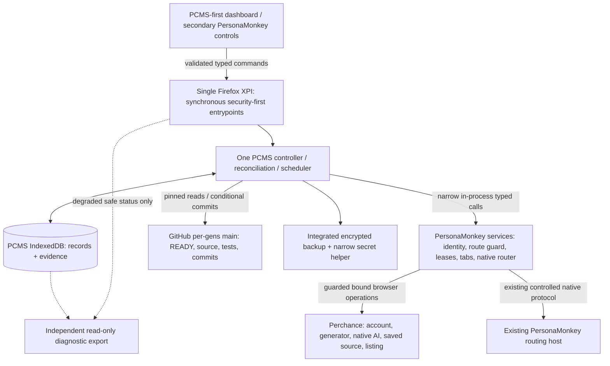
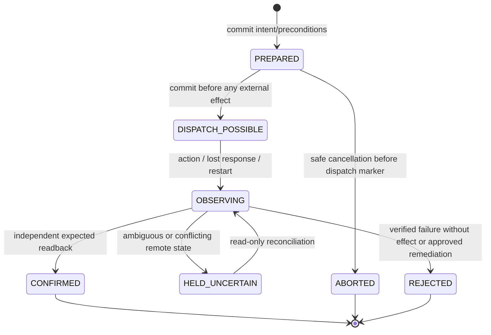

# PCMS-Alpha — Stage 3: Minimal Architecture and Acceptance Audit

> **Controlling finalization (2026-10-12):** F1 is **closed on operator-observed Perchance behavior**. Operator-driven v1.0.3 creation submitted `isPrivate:true` with zero-byte PJS/HTML and empty `srcManifest` in the *initial* save; Perchance returned `created`, and independent readback confirmed an empty private temporary generator `39cojqa706`. The separate read-only post-rename verifier confirmed the final slug `pcms-test-007-001-009` is private, empty, authentically owned, present exactly once in the account inventory, and absent from the checked recent-list sample (432 entries). **This is not proof of unobservable transient internal server listing or every public surface.** F2 is **closed by explicit operator scope amendment**: the native AI may edit the selected generator's PJS, HTML and `src/` assets, while PCMS retains GitHub writeback, approvals, publication and routing/identity authority. Q136 and the Stage 2 Q55 PJS/HTML-only portion are superseded. See Stage 3 Finalization/Handoff and the Decision Register.


**Date:** 2026-10-12  
**Status:** **STAGE 3 DESIGN FINALIZED AND ACCEPTED (2026-10-12).** Q107–Q154 accepted as originally decided, with Q136 and the corresponding Stage 2 PJS/HTML-only limitation explicitly superseded by the operator. F1 accepted on observed live evidence, F2 closed by product-scope amendment. Stage 5 combined-extension/remaining capability acceptance has NOT been performed.  
**Scope:** Design specification and reconciliation of the **operator-run disposable F1 live test** only. No PCMS implementation, GitHub repository mutation, coding-agent launch, unrelated live provider changes or final Stage 7 release ZIP.  
**Successor:** Stage 4 (UI/UX design); Stage 5 (targeted technical validation and subsequent implementation only when authorized).  
**Authoritative sources:** `PCMS-Alpha-Stage-1-Requirements-Audit.md`; `PCMS-Alpha-Stage-2-Behavior-and-Lifecycle-Specification.md`; `PCMS-Alpha-Stage-3-Design-Plan.md`. Donor evidence from `Neb963/persona-router`, historical `discovery-v3.zip`, and the Stage 3 Working Decision Register is evidence, not an amendment to accepted Stage 2 policy.

## 1. Executive architectural verdict

**One XPI, one PCMS logical controller, one PersonaMonkey-controlled browser execution boundary, one transactional PCMS database, one scheduler, two narrow remote source paths, one integrated encrypted backup.** These are responsibilities, not mandatory packages or microservices.

The explicit Stage 3 F2 scope amendment supersedes Stage 2 Q55's later PJS/HTML-only restriction and Stage 3 Q136. No other Stage 2 contradiction was found. **F1 is operationally verified** for initial private/empty creation followed by private-first rename, independent owner check, account inventory and a sampled recent-list absence. **F2 is resolved as a product decision**, not as proof of AI tool confinement. Remaining unknowns U-01–U-16 are implementation/provider acceptance obligations with conservative fallback paths, not unresolved Stage 3 design decisions. No client-side test can guarantee Perchance's unobservable internal transient listing state.

**Stage 3 design sign-off is complete.** This is permission to proceed with subsequent UI design and authorized targeted implementation/verification planning, **not** production readiness, donor regression acceptance, GitHub initialization, live provider automation, or permission to weaken runtime guards. F1 is provider-behavior evidence for an implementation design; the actual combined-XPI implementation still needs packaged-Firefox regression and failure-path tests.

## 2. First-principles invariants

1. Only PersonaMonkey owns `personaUid`, containers, protected routes, native routing, guarded browser execution and shared Persona control. PCMS never bypasses it.
2. Perchance owns actual session, remote generator ownership, saved code/assets and listing. GitHub owns `per-gens` committed bytes and `Status: READY`. PCMS owns bindings, release decisions, operation intent, approvals, time budgets and holds.
3. A local database transaction cannot atomically commit a Perchance or GitHub side effect. Mark the attempt durably *before* dispatch; confirm by independent authoritative readback; never blindly repeat an ambiguous side effect.
4. Human unsaved work and verified release approvals are non-negotiable constraints: a source-drift, dirty-editor or unknown-editor condition blocks competing mutation/publication.
5. **Operator-amended AI scope:** the native AI may modify any PJS, HTML and generator-owned `src/` file within the selected generator. The complete final deployable byte set, not merely editor text, defines the candidate. PCMS alone controls GitHub writeback, source association, protected browser admission and publication. Native-helper prompts/response text never confer those capabilities. All deployable files may be publicly accessible, even for unlisted generators.
6. The release candidate's canonical complete deployable byte set, final test evidence, GitHub source, human approval and Perchance saved state must converge before publication.
7. A Firefox event page may be suspended at any await boundary. Durable intent/receipts—not timers, tab handles, in-memory leases or event streams—control recovery.
8. Observed recent-list placement is independent of an attempted or successful refresh; operational time requires evidence and excludes confirmed downtime/holds.
9. A restored archive reconstructs state and history, **not live authority**. Unverified dependencies stay under scoped holds; protected routes remain fail-closed.
10. Protected backup secrets and emergency diagnostics must remain safe independently of the normal PCMS controller.

## 3. Minimal system/context diagram



**No second extension, external automation controller, generalized provider-plugin framework, background daemon for PCMS, custom routing RPC, generic workflow DSL or distributed coordinator.** The protected secret helper is a bounded, on-demand *backup-key access* mechanism, separate from and not a replacement for the routing host. Its feasibility is unverified.

### Authority and failure domains

| Component | Owns | May not do | Independent failure behavior |
|---|---|---|---|
| PersonaMonkey | Stable Persona UID, container, security, route, browser admission, tab ownership | Decide GitHub READY, approve public releases, rewrite PCMS journal | Route failure blocks dependent work; unrelated safe donor UI remains available where safe |
| PCMS controller | Business state, intents, scheduling, recovery disposition | Mutate protected routes or run unguarded browser automation | Invalid PCMS DB holds PCMS mutations; donor security remains intact |
| Perchance adapter | Observations/mutations in bound editor/page context | Export session tokens, infer ownership from edit permission | Ambiguous writes held; other generators can continue |
| GitHub adapter | Pinned path inventory, READY, non-forced conditional commits | Force-push or infer ownership from folder name | Reservations can continue if confirmed; publication blocked until revalidation |
| Native AI helper | Editing/testing all files of the *selected* generator, including `src/`, through its existing Perchance interface | PCMS/GitHub credentials, release authority, Persona routes, privileged extension commands | Observe final full-source bytes and test evidence; unknown target/identity/safety => scoped hold, not publication |
| Backup/restore | Portable archive, protection, staged import | Grant stale mutating authority | Locked vault suspends daily export; incomplete restore boots non-mutating |
| Emergency diagnostics | Allowlisted read-only safe status | Run normal PCMS Core, unlock keyring, leak source/secrets | Degraded export can work despite controller failure |

## 4. Runtime, trust and message contract

### 4.1 Event-page startup

1. **Synchronously** register security-first routing/webRequest guards and the alarm/message/installation/startup event entrypoints before any asynchronous recovery or dynamic import that could miss the wake event.
2. One single-flight asynchronous initialization restores donor security state and validates guarded services. Failure retains protection; no Direct fallback.
3. Initialize PCMS storage and validate schema, restore gate, controller activation, journal and migration status. PCMS failure disables PCMS remote mutation but does not discard safe donor management.
4. Rehydrate only relevant durable operations and due work, reconcile uncertain side effects, recreate necessary alarms and schedule bounded dispatch. UI tab presence is irrelevant.
5. Alarms/notifications and event streams are **hints**, not canonical transaction data. Requests carry stable IDs, exact target scope, expected revision and logical operation identity.

```mermaid
sequenceDiagram
    participant FF as Firefox event-page wake
    participant SG as Security bootstrap
    participant PM as PersonaMonkey
    participant C as PCMS controller
    participant DB as PCMS IndexedDB
    FF->>SG: Deliver alarm/message
    SG->>SG: Register guards/listeners synchronously
    SG->>PM: Recover/verify protected runtime
    alt donor security invalid
        SG-->>FF: Keep protected requests fail-closed
    else protected services healthy
        SG->>C: Initialize one controller
        C->>DB: Validate restore guard/schema, recover journal
        alt PCMS state invalid
            C-->>FF: PCMS writes held; donor safe controls remain
        else ready
            C->>C: Reconcile uncertain effects and due queue
            C->>PM: Request guarded admission for eligible work
        end
    end
```

### 4.2 Minimal typed boundaries (semantic contracts, not frozen function signatures)

- `PersonaGuard`: `resolveUid`, `getSafeRouteReadiness`, `acquireConflictGuard`, `runBoundedOwnedAction`, `inspectOwnedAction`, `cancelOwnedAction`, `releaseConflictGuard`, `offerHumanHandoff`, `observeGuardEvents`. All require exact target/UID, consent where applicable, and checked revocation. Do not expose arbitrary browser APIs or native RPC.
- `PCMSCommands`: allowlisted `list/get`, `preview`, `submitIntent`, `approve`, `pause/resume`, `reconcile`, `backup/restore-preview/apply`, `diagnostics`. Mutating calls require expected version and validated extension UI sender; content scripts have only narrow, authenticated per-tab signal paths. `requestId` alone is not durable deduplication; business commands bind an operation ID and payload fingerprint.
- `PerchanceProvider`: `observeAuthenticatedOwner`, `observeGenerator`, `reserveEmptyUnlisted`, `observeEditorSafety`, `stageVerifiedManifest`, `setListing`, `runNativeAiTestRepair`, `observeRecentList`, `observeMetrics`, `runValidatedRefresh`. Each mutation has explicit ownership/readiness preconditions; all remote observations have time/method/freshness; no raw credentials persisted.
- `GitHubSource`: `pinRevision`, `readRelevantManifest`, `validateReady`, `createNonReadyFolderIfAbsent`, `commitConditionalSource`, `readbackCommit`. Validate relevant paths and pinned bytes, never force-update `main`; protect against HEAD movement, READY revocation and unrelated folder conflict.
- `PCMSStore`: `transactWithExpectedVersions`, `reserveOperation`, `markDispatchPossible`, `recordObservationAndDisposition`, `applyScopedHold`, `claimDueWork`, `persistAudit`, `snapshotForBackup`, `commitRestoreCheckpoint`. One logical writer, transactionally enforced uniqueness and revisions.

**Sender security:** verify `sender.id`, actual extension page provenance/document origin, content-script tab/frame context, allowlisted message type/size and operation target. Never assume a supplied `accountId`, tab ID, `personaUid`, caller-declared owner or DOM location grants authority. Hash bytes where content identity matters. Boundary failures use typed stable codes and bounded redacted diagnostics.

**Arbitration ordering:** durable per-generator operation reservation -> temporary Persona guard -> verified page/account/target preflight -> committed dispatch-possible marker -> guarded remote action -> independent observation -> local disposition and lease release. Short-lived Persona leases never cover multi-day sleep or human approval periods. Human overrides cannot silently preserve stale PCMS execution authority.

## 5. Persistence and consistency contract

### 5.1 Storage choice and minimum logical indexes

One PCMS-owned IndexedDB database, separate from PersonaMonkey's existing `browser.storage.local`. Do not duplicate donor tables. One small PCMS read-only diagnostic heartbeat/safety marker may live in an independent storage.local key; it is **not** an alternative canonical business database. A restore-in-progress boot guard must also survive replacement of PCMS IndexedDB and must never be overwritten by donor state import.

| Logical family | Representative primary key | Required indexes/preconditions |
|---|---|---|
| `entities` | `(kind, stableId)` | Account/Persona active uniqueness; generator/account/remote identity uniqueness when evidenced; explicit slug and source-folder claims; monotonic revision |
| `operations` | `operationId` | `parentId`, `targetId`, `effectType`, status, due/retry key; unique active-conflict key per generator; immutable payload fingerprint |
| `snapshots` | SHA-256 of canonical byte manifest/content | Immutable bytes/metadata; references from releases, baselines, uncertain operations and backups; never prune referenced evidence |
| `observations` | `(targetId, observationId)` | `kind`, source/method, capturedAt, freshness; bounded retention and rollups; no ownership inference from timestamps alone |
| `events` | Monotonically allocated local event sequence | Correlation/causal ID, redacted structured transition, outcome; consequential records retained |
| `meta` | Stable singleton/keyed setting | Schema version, controller activation, global sequence, migration state, backup manifest revisions |

Approvals, Pauses, recovery holds and schedules may be typed `entities`; avoid independent manager/store abstractions unless profiling proves a benefit. Primary key/index details are implementation choices constrained by this contract. `cookieStoreId` is never used as stable Persona identity. A slug is not a proven immutable provider object ID; retain account + owner + observation provenance and tombstones.

### 5.2 Operation state machine and safety rule



**Safety:** Failure to commit `DISPATCH_POSSIBLE` prohibits dispatch. A crash after that commit means the effect *may* have happened; never blindly reissue. Observed equivalent remote state can confirm without second mutation. A contradictory observation yields a scoped hold. A per-generator mutating intent remains conflict-fenced during uncertainty; other generators are independent. Every mutation and hold transition produces an indexed causal audit event. No cross-provider transaction or fake automatic rollback.

Approval identity includes release, target binding revision, final **complete deployable** manifest digest, test evidence/default prompt revision, optional pinned `TESTING.md` and exception classification. Relevant change invalidates authority. A new irrelevant repository commit doesn't automatically invalidate an identical reviewed byte set, but READY revocation does.

### 5.3 Manifest canonicalization

Version the fingerprint algorithm; hash an unambiguous path-sorted manifest containing normalized generator-relative path, kind, exact byte length, SHA-256 of bytes for `main.pjs`, `index.html` and explicitly configured deployable asset/source files. Reject case/canonicalization collisions, unsafe traversal, and ambiguous duplicate paths. Distinguish an observed CDN URL or `srcManifest` key from verified file content. Test PASS and approval refer to **one exact final fingerprint**. All public Perchance source is treated as potentially visible even if its generator is unlisted. No tokens/secrets embedded into deployable code.

## 6. External generator and release workflows

### 6.1 Reservation, discovery and adoption

Verify authenticated account and Persona before reservation. The **operator-verified F1 path** begins on a pristine `/minimal#edit` fork, sets empty PJS/HTML, empty `srcManifest` and `isPrivate:true` **before the first native save**, independently confirms the created private/empty temporary slug, then renames to the explicitly requested slug and independently confirms final privacy, emptiness, authenticated ownership and inventory membership. A rename or creation with unknown outcome is `DISPATCH_POSSIBLE` and requires read-only reconciliation; never repeat blindly. The remote provider's internal no-transient-public-state guarantee cannot be proven from client logs: report this residual honestly and do not substitute a public-first create/hide sequence. Confirmed reservation remains valid while GitHub is down; independently queue a non-READY `DEPLOYMENT.md` folder commit. The empty `per-gens/main` first commit is a later operator-approved setup prerequisite, not created during design. Discovery never interprets a missing list entry as deletion. Public-generator adoption requires consent and original immutable local + non-overwriting GitHub archive before first modification. Reassociation preserves history, invalidates dependent authority and requires confirmation.

### 6.2 Release

- Pin READY GitHub source/asset paths/optional test instructions; preserve previous good P and original baseline where required.
- Existing generator: wait until sleep, verify session/route/owner/editor, unlist and confirm before staging. New empty unlisted generator does not need artificial prior sleep.
- Stage PJS/HTML/assets through PCMS-authorized path; verify save/readback and deployable manifest. Unknown/dirty human editors hold all conflicting writes and publication.
- Chat 1 tests with the version-pinned Settings default prompt; the native helper may modify **PJS, HTML and the selected generator's `src/` assets** as part of test→debug→fix→save→retest. Optional Chat 2 uses a genuinely fresh conversation with `TESTING.md` and the current repaired full-source state. Progress-governed iteration stops on resource/safety/no-progress conditions. Record actual final saved source and test evidence; known required failures block publication. Exceptional individual manual-testing fallback remains available as accepted in Stage 2; AI success prose alone is never PASS.
- **GitHub writeback is distinct from publication.** For an independently verified full-source candidate F, either (a) operator reviews exact diff and suggested commit message, then PCMS commits, or (b) if separately enabled, PCMS observes the attributed terminal helper response, extracts a strictly delimited *suggested* commit message, and conditionally commits F *only after* actual source, tests, owner, READY, editor-safety and relevant GitHub path/revision checks. The model message never authorizes a commit on its own. Missing/ambiguous marker or drift => manual review; both modes use non-forced multi-file commits and post-commit readback.
- **Publishing remains distinct and manually authorized.** AI-modified releases require individual publication approval; clean releases may use explicit safe bulk approval; exceptions require individual acknowledged review. Approval must pin the exact full-source fingerprint and actual test evidence, regardless of whether GitHub writeback happened before review. Before publishing, revalidate source/READY/ownership/editor/unlisted state; publish/list and independently verify listing/source before Refresher eligibility.
- Failure: retain P/F/commit evidence, quarantine F, safely restore P **only** when ownership/source/editor verified; restored previous good remains unlisted under review. Never rewrite GitHub history automatically.

### 6.3 Independent identities and source drifts

Account ↔ Persona is one active binding each. One generator↔one associated source folder, with explicit mapping. A GitHub path/slug string does not prove remote ownership. A route/account reassociation invalidates session-dependent evidence and requires renewed approval. A human's source change creates a new candidate/reconciliation choice, not permission to discard unsaved editor work.

## 7. Global Refresher and clocks

- One persistent global oldest-eligible-first queue; transactional stable eligibility ordinal and deterministic tie-breaker (stable generator ID). Per-generator READY release precedence applies only before that generator's next active admission.
- Default active operational budget ~24 hours, minimum sleep ~72 hours; pauses/holds/outages/browser closure freeze applicable budgets. Do not infer operational time from a wall-clock gap; event-page suspension **may** accrue only through supporting liveness/health evidence. Uncertain intervals are not credited.
- Account-unavailable active slot grace defaults to 60 minutes over qualifying evidenced intervals; after grace release slot without losing remaining active budget or waiting priority. Provider-wide outage does not mass-expire per-account grace.
- Target occupancy is a planning fraction `sum(A_i/(A_i+S_i))` limited by practical recent-list evidence and operator cap. Smooth cap revisions; credible drop immediately stops **new** admissions but does not evict valid current occupants. Preserve lower-bound cap when observations stale; warn.
- Single coalescing alarm, durable due records, staggered dispatch and per-Persona bounded execution. Do not schedule per-generator timers, reconstruct missed actions as a burst or alter minimum duration with jitter.
- ~10-min shared recent-list observations; bounded adaptive generator statistics; separate refresh attempt, remote save result, presence, rank, freshness. No no-op/comment spam or guaranteed ranking. Unknown refresh method => unavailable/held, not fake success.

## 8. One encrypted archive and restore

### 8.1 Backup construction

One versioned integrated authenticated encrypted file. Plaintext envelope contains only essential non-sensitive format/KDF data. Protected payload contains donor-approved portable section, PCMS consistent record cut, referenced immutable snapshots, unresolved intents, provenance, import mappings/compatibility manifest and checksum inventory. Reuse donor portable serialization/validation and compatible cryptography rather than flattening donor state. No WireGuard private config, no unintended local Integration API authority, no plaintext temporary sensitive archive.

A short admission barrier captures a **dependency-consistent logical cut**. Pin immutable snapshots until export completes. Donor storage/cookies and IndexedDB are not one physical transaction; detect revision drift when possible, bound retries, and explicitly classify unverifiable sections. An archive missing essential consistency is **incomplete**, must not report successful backup or become eligible as a retention replacement. Do not stall unrelated fleet execution throughout encryption. Profile, route, session and remote reality are *not* snapshotted as remotely authoritative facts.

One operator-retained portable recovery passphrase; OS Secret Service/KWallet through narrowly scoped on-demand native helper for unattended use, if proven. The existing native router host is **not** a keyring service. Locked/missing vault => suspend unattended backup and notify, never cache plaintext password in ordinary browser storage.

Distinguish (1) verified constructed encrypted archive, (2) Firefox completed download/existence/size, (3) independently re-read disk bytes if supported. Default retention 14 successful automatic backups; manual archives and last known-good not blindly removed. Retention uses exact tracked download identities. Protect against disk full, download interruption, lost history, filename collisions and deletion failures.

### 8.2 Staged restoration

1. Decrypt/authenticate/size-and-schema-validate; present inventory, unknown components, mapping and security changes.
2. Require operator-reviewed revision-bound restore plan, **verified recoverable pre-restore checkpoint** and persisted fail-closed restoration gate **outside the PCMS DB being overwritten** (e.g., dedicated independent extension storage key; not overwritten during donor import).
3. Apply coherent donor component groups through donor-validated inspect/import and security review; capture actual remapped Persona UIDs and created-container receipts. Apply mapped PCMS groups only when referential integrity holds. Record phase receipts before progressing. Do not claim global atomic rollback of Firefox identities/cookies across stores.
4. Restart mid-restore: boot sees gate, disables related remote mutation, observes existing containers/records and resumes reconciliation **without blind replay**. Partial cookie/route failures remain visible holds.
5. All archived in-flight effects become uncertain pending remote readback. Imported approvals are **historical**, not self-renewing authority. Fresh profile stays entirely non-mutating until operator confirms previous controller inactive and authorizes verified activation; same-profile restore releases only verified scopes. Protected failures stay Block; imported backup never grants Direct or external trusted-extension permission.

### 8.3 Emergency diagnostics

Independent read-only UI/exporter uses a small allowlist of safe metadata and durable diagnostic snapshots. It does **not** bootstrap normal PCMS providers/AI/scheduler, unlock backup secrets or request browser mutations. Exclude raw source/assets, session tokens, cookies, chat logs, arbitrary URLs/free-text, secrets and uncontrolled PII. If IndexedDB is corrupt or unavailable, report bounded missing-section facts from an independent safe status key. Do not promise diagnostics can recover every broken state. Export redaction must be negative-tested.

## 9. Operational failure traces

### Trace A — One generator: human edit, AI, GitHub drift

Existing G has previous good P, is sleeping with 22 hours remaining. Save P in snapshots, unlist after editor/owner check, freeze 22h sleep, stage READY candidate A. Chat 1 repairs to A1; optional fresh Chat 2 repairs to F and both suites pass on F. GitHub HEAD advances unrelatedly: compare affected files and READY; keep F if equal. Operator produces dirty unsaved tab: stop competing source writes and **publication**; preserve F/approval evidence. After explicit reconciliation revalidate tests/approval as needed. Conditional GitHub writeback, remote readback, then publication. Resume **22h** sleep. Crash after GitHub commit but before response: read GitHub bytes instead of blindly repeating. Crash after publication: inspect listing *and* source; hold if uncertain. Rollback of P leaves unlisted and does not rewrite GitHub history.

### Trace B — 50 accounts: one route fails

One protected Persona loses routing; freeze its generators and hold active slots for evidenced 60-min grace. Others progress under their own Personas. On grace expiry, release slots but retain remaining budgets and priority. A shared route failure holds only actual dependents; a confirmed Perchance-wide outage freezes all applicable operational clocks without masquerading as 50 independent failures. Explicit Persona rebinding invalidates stale approvals and requires ownership/session revalidation. No default Direct fallback.

### Trace C — 1,000 generators: capacity and restart

For 24h/72h nominal budgets, 1,000 homogeneous generators give planning target 250, **not promised occupancy/rank**. If defensible cap = 200 and occupancy 195, at most five safe admissions; cap drops to 180 => stop new admissions, don't evict current valid users. Forty new remote reservations can remain verified while GitHub is offline; queued folder initialization is independent. Firefox closes: suspend credits for unverified time; on return coalesce due work, do not produce 1,000 alarms/network bursts. Quota exhaustion blocks affected remote mutations, not donor protected routing or available redacted diagnostics.

### Trace D — Backup crash / fresh-profile restore

Archive includes release F with possibly executed GitHub write and retained old approval. New Firefox profile imports donor personas with UID remaps and possible partial cookie failure; staged restore journal marks failed group held. Controller starts non-mutating, operators verify previous controller inactive, restore route/session and verify saved source and GitHub READY. Reconcile possible GitHub commit from actual bytes. Old approval/test evidence alone never triggers publication. Healthy unaffected scopes resume after successful reviewed activation; no duplicate remote effect.

### Trace E — Operator-owned tab interrupted while Perchance save uncertain

A PCMS-owned automation tab is explicitly handed to an operator and its automation ownership is released. Operator changes unsaved source. Event page suspends while PCMS's last remote save is `DISPATCH_POSSIBLE`. After restart, donor job interruption and missing transient lease do **not** justify closing the now-human tab or retrying save. PCMS reads its ownership receipts, observes remote source if safely possible, holds G pending editor reconciliation, and continues unrelated work.

### Trace F — Quota, corrupted DB or locked vault

Critical IndexedDB commit fails: do not issue the remote effect; create best-effort safe failure status independent of business DB. If DB unreadable, emergency diagnostics show initialization failure without source/secret leakage. Vault locked: backup does not run; don't silently write unencrypted file or consume 14-good-backup retention slot. If restore journal is present, PCMS mutations remain blocked even if UI shows stale cached health.

## 10. Stage 2-to-architecture traceability

| Stage 2 contract | Stage 3 owner/mechanism | Exit condition / proof |
|---|---|---|
| §2 identity and exclusive account↔Persona | Stable UID, unique active binding records, guarded owner observations | U-01/U-02, identity collision and rebind tests |
| §3 reservation/discovery/adoption | F1-evidenced initial-private empty fork → guarded rename, journaling, GitHub folder queue and consent | F1 operator live PASS; U-03 crash/replay variants, U-04/U-08 still require packaged tests |
| §4 code/test/approval/release | Amended full-generator AI scope, manifest SHA-256, individual/bulk publication gates, manual/auto conditional GitHub writeback, editor safety | F2 product amendment closed; U-05/U-06/U-07/U-08 evidence/implementation tests remain |
| §5 Refresher and clocks | One due queue, evidenced clock, cap estimator, shared observer and scoped backoff | U-09/U-10/U-15 |
| §6 backup/restore/diagnostics | One encrypted file, vault fallback, staged import, independent diagnostic page | U-11–U-16 |
| §7 precedence and adversarial interactions | Per-generator release precedence, scope holds, immutable approval, no blind replay | Integrated scenario fixtures |
| §8 acceptance and operational proof | Narrow deterministic tests, packaged Firefox, operator-led provider checks | Stage 5 acceptance matrix |

## 11. Unknown/feasibility disposition: U-01–U-16

| ID | Stage 3 disposition | Stage 5 proof and safe fallback |
|---|---|---|
| U-01 | Donor guarded APIs evidenced, combined same-XPI facade not proven | Admission/routing/lease conflict tests; block PCMS browser work if guard unavailable |
| U-02 | Account/owner observation historically seen, not dependable contract | Wrong-owner/collaborator/editKey tests; hold wrong/unknown owner |
| U-03 | **F1 operational PASS**: initial private empty save, temp readback, final slug private/empty/owned/inventory verified; sample-list absence | Implement guarded private-first rename; test uncertain create/rename response, crash, slug collision, public listing response drift. Do not claim server-internal atomic visibility proof |
| U-04 | Slug reuse/remote immutable ID not proven | Canonicalization, collision, tombstone/reassignment tests; require evidence instead of slug assumption |
| U-05 | PJS/HTML and srcManifest historic readback evidenced, complete bytes/ordering not proven | Save-readback lost response/asset verification fixtures; block clean release if needed bytes unverifiable |
| U-06 | **F2 full-generator scope amendment CLOSED**; helper may change `src/`. Test/PASS evidence and final-response attribution still unverified | Verify exact final-source manifest, attributed final message/commit-marker parsing, observable tests, known failure, fresh Chat 2 and non-grant of PCMS/GitHub authority |
| U-07 | Local editor signals and donor tab tags evidenced, cross-session dirty detection limited | Owned/human tab, unsaved/collaborative conflict, handoff/crash tests; hold if uncertain |
| U-08 | GitHub nonforced commit semantics known, exact collision adapter unbuilt; private repo empty | Initialize main later explicitly; concurrent HEAD/path/READY/dropped response tests |
| U-09 | Event-page donor route gate exists, combined cold-wake listener registration unverified | Packaged Firefox wake/suspension/restart/no-dashboard, evidenced clocks; hold on failed bootstrap |
| U-10 | Recent capacity ~283/284 anecdotal, effective refresh method unverified | Operator time-stamped validation; no promise rank, no trivial-save spam |
| U-11 | Donor crypto proven in source, OS vault/native access unverified | Actual Fedora KDE unlocked/locked vault/host permissions; manual unlock fallback |
| U-12 | Donor imports/remaps evidenced, cross-store staged restore unproven | Crash after every restore phase, UID collision, partial cookie errors, independent guard tests |
| U-13 | Downloads completion metadata known, disk readback unknown | Packaged Firefox filename/size/tracked removal/file hash experiment; tiered reporting |
| U-14 | Independent emergency exporter not built | Break Core deliberately and test read-only safe ZIP with redaction-negative fixtures |
| U-15 | Target 50+ accounts/1,000+ generators unproven | Representative bounded queue, memory, quota, encryption and telemetry test |
| U-16 | One-controller rule accepted as operational condition, no distributed lock | Fresh-profile preview/activation/non-mutating restore and old-controller confirmation |

All rows retain their Stage 2 ID and uncertainty; no Stage 5 tests are claimed complete.

## 12. Targeted Stage 5 test order and go/no-go decisions

**Gate 0 — completed Stage 3 design proof disposition:** F1 received an operator-run live create/rename/ownership/private-empty PASS on one disposable generator; F2 was explicitly changed to full-generator editing by the operator. **No repeat happy-path test is needed.** This does not waive the remaining U-03/U-06 implementation and failure-path tests. Coding agents must not assume authority to perform live Perchance/Mullvad/Cloudflare mutations; use fixtures and explicitly operator-authorized narrow verification.

**Gate 1 — security and runtime:** donor regression, internal PersonaGuard non-bypass, cold-wake listener, tab/handoff, fail-closed routing, exact Gecko/native ID compatibility, in-place upgrade from donor fixture.

**Gate 2 — local state and concurrency:** IndexedDB schema migration and blocked-upgrade handling, quota and strict durability fallback, kill-at-every-remote-boundary operation harness, mutation collision and stale UI response tests, robust telemetry causality.

**Gate 3 — provider simulation:** account/owner/slug, READY and assets, conditional GitHub commits with unrelated/relevant HEAD drift, PJS/HTML and srcManifest source checks, two-chat evidence and known-failure gate, uncertain publication; no live mutation by coding agents.

**Gate 4 — fleet behavior:** 50-account route failure, 1,000 generators, scheduler clock outages/Firefox closure/event-page suspension, cap hysteresis, fairness, partial provider outage, backpressure.

**Gate 5 — backup and recovery:** OS vault permission/locked behavior, archive integrity and large-memory limits, download tiers, staged rollback/resume/UID remap, fresh-profile inactive controller, Core-broken redacted diagnostics. Explicit operator-led end-to-end manual checklist and Markdown fallback from Stage 2 Q31.

**Go/no-go reporting:** distinguish *source-proven*, *deterministic simulated PASS*, *packaged-Firefox PASS*, *operator live PASS* and *not tested*. No substitute acceptance claims. Stage 5 may be sequenced with limited independent work only after Gate 0 and owner contracts are confirmed.

## 13. Stage 4 UI/UX handoff

- PCMS-first surfaces: fleet/accounts/Personas, generators and explicit source mapping, reservation/discovery, releases/test evidence/diffs/approvals, Refresher/capacity, backup/restore, diagnostics/settings; donor advanced controls secondary and discoverable.
- Status must distinguish **confirmed**, **pending**, **unlisted**, **source drift**, **needs approval**, **AI testing unavailable**, **manual test exception**, **known test failure**, **uncertain remote outcome**, **operator Pause**, **recovery hold**, **offline/locked vault**, **restored but inactive**. Never flatten these into green/red “success/failure”.
- Exact-target confirmation for adoption, binding/rebinding, Direct exceptions, publish, delete, restore mappings and fresh-profile activation. Clear UI distinctions between remotely saved code, browser editor unsaved data, GitHub committed source and canonical PCMS intent.
- Review source manifests and unverified public asset bytes; never imply “unlisted” is confidential. Show visible owner/route/editor evidence freshness and changes invalidating approval.
- Keyboard-first compact lists, deterministic ordering and pagination/virtualization at 1,000 generators; no one-tab-per-generator requirement. One-click guided manual checklist and Markdown export from Stage 2 Q31.
- Optimistic UI cannot claim committed state before server/IDB acknowledgment. Every pending action has operation ID, cancellability rules and recovery link. Stale replies never override newer entity revision; source of truth is durable background state.
- Warning-specific action design: F1 is source-evidenced but an implementation can still be unverified/unavailable; F2 allows full-generator AI edits but requires test and source-readback evidence. Disable actions for **actual unverified runtime prerequisites**, not obsolete F1/F2 policy blockers. Never offer “force unsafe operation”.

## 14. Explicitly rejected complexity and future changes

| Rejected design | Reason | Revisit trigger |
|---|---|---|
| Separate PCMS extension beside PersonaMonkey | Duplicates trust/control and changes Stage 2 single-XPI requirement | Only explicit product requirement change |
| One PCMS native daemon/SQLite server | Lifecycle/install/privilege burden for no current necessity | IndexedDB verified insufficient under measured load |
| Distributed leases/leader election | One-machine operational contract; remote distributed exclusivity not guaranteed anyway | Supported multi-machine product requested |
| Universal event-sourcing/event-bus framework | Operation journal + consequential events already cover recovery/diagnostics | Proven independent consumers needing replay semantics |
| Generic pluggable source adapters/workflow DSL | Two known providers and one Refresher scheduler | Demonstrable new provider with materially different behavior |
| Full local Git clone as canonical source | GitHub is authoritative, snapshots only needed for recovery | Offline authoring explicitly required |
| AI prompt as source/test/commit authority | Model text cannot establish saved bytes, PASS or release permission | Never: PCMS must independently verify candidate and authorizations |
| Lock Persona throughout multi-day active/sleep/review | Starves donor functionality and unnecessary | Only operation-bound guarded control |
| Automatic guessed remote replay/rollback | Can duplicate destructive effects and erase human work | Never without authoritative safe proof |
| Pretend backup is globally atomic | Firefox storage/cookies/providers lack common transaction | Not a valid promise |

## 15. Architecture acceptance checklist

| Exit requirement from Stage 3 plan | Disposition |
|---|---|
| One architecture document, diagrams, failure sequences | **Covered** in this document |
| PersonaMonkey/PCMS authority and safety interface | **Covered**, combined code not yet validated |
| Storage choice, schema concepts, journal, concurrency | **Covered**, physical schema/Firefox capability testing deferred |
| Perchance/AI/GitHub interfaces with unknowns | **Covered**; F1 live behavior PASS, F2 scope amended/closed; remaining adapter implementation acceptance OPEN |
| Refresher clock/capacity/evidence policy | **Covered**, provider refresh semantics OPEN |
| Integrated encryption/backup/restore/diagnostics | **Covered**, vault/download/restore tests OPEN |
| Stage 2 crosswalk + U-01–U-16 + Stage 4/5 handoff | **Covered** |
| One/50/1,000-scale adversarial design traces | **Covered**, not measured performance |

**Stage 3 conclusion (FINALIZED):** The minimal architecture and design decisions Q107–Q154 are accepted, with explicit supersession of Q136 and the PJS/HTML-only part of Stage 2 Q55. F1 is **operator-live-verified on the accepted observable contract**; F2 is **closed by scope amendment**. No architectural feasibility gate remains open. U-01–U-16 residual implementation/lifecycle/provider verification requirements are tracked for Stage 5. The user performed only the targeted F1 live tests; **no PCMS implementation, GitHub mutation or final release ZIP was produced**. A Stage 3 design PASS is **not** packaged-browser, integrated-workflow or production acceptance.
